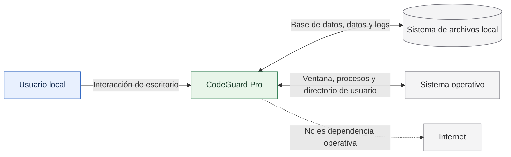
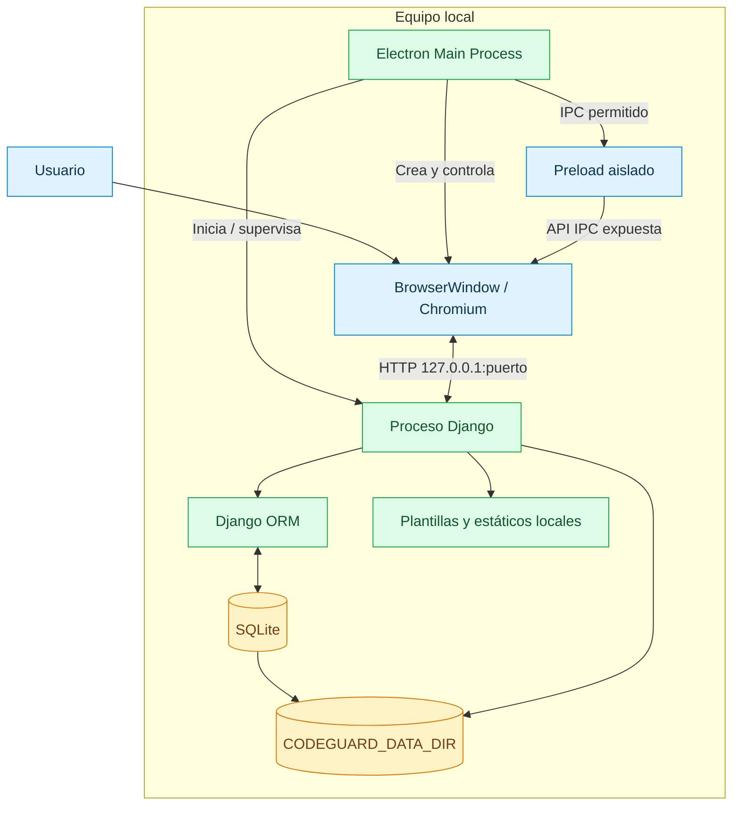
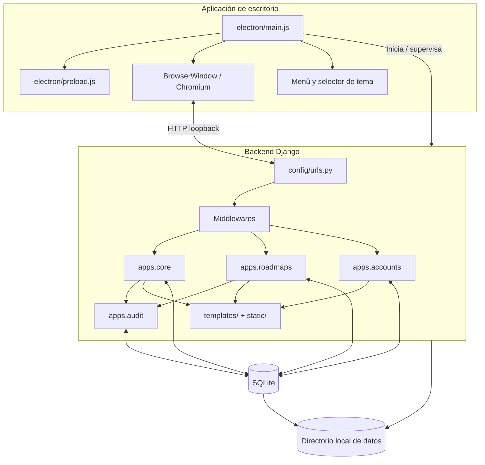
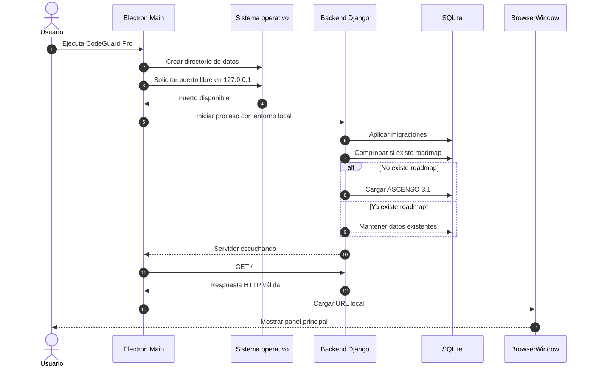
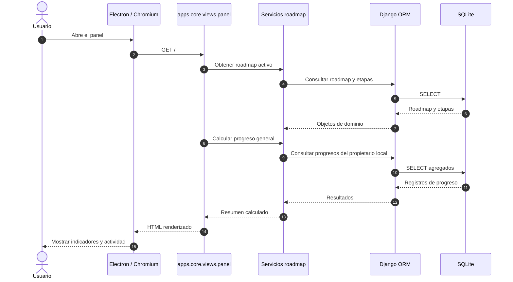
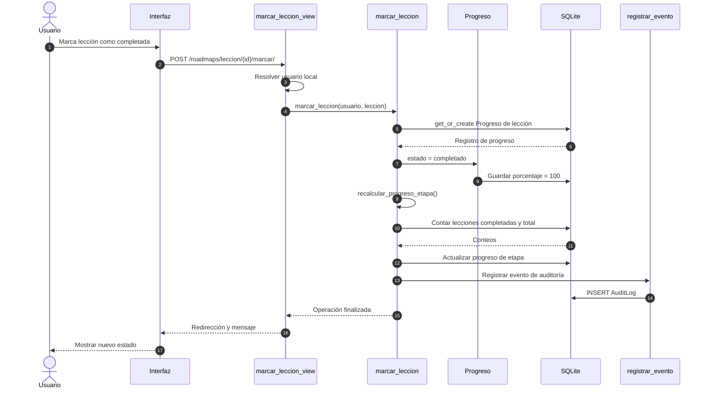
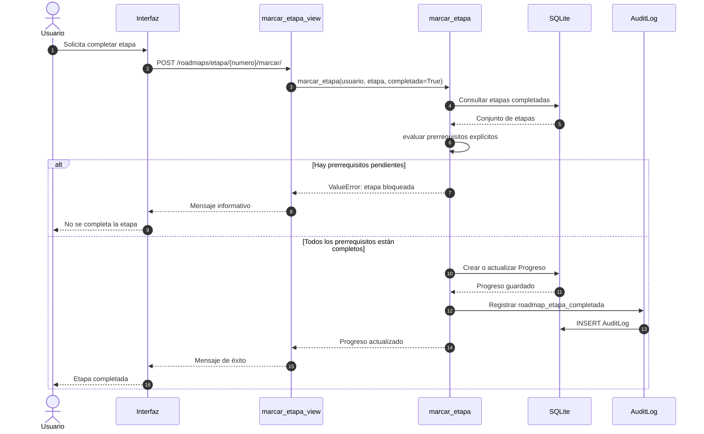
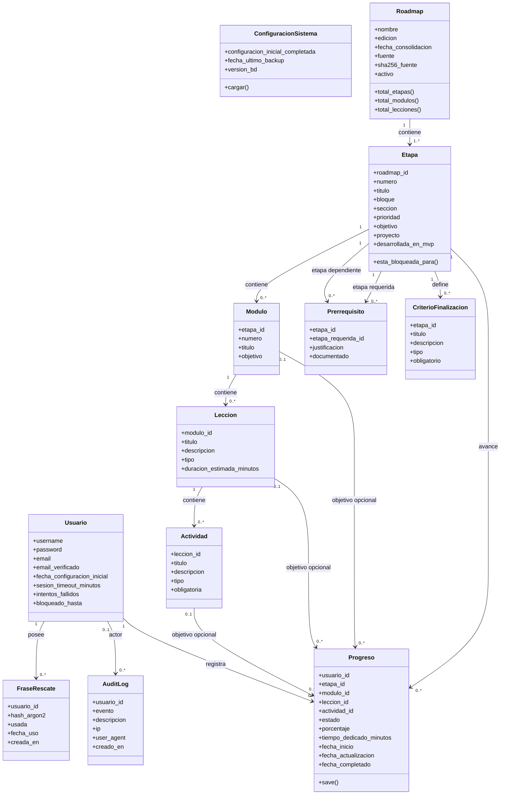
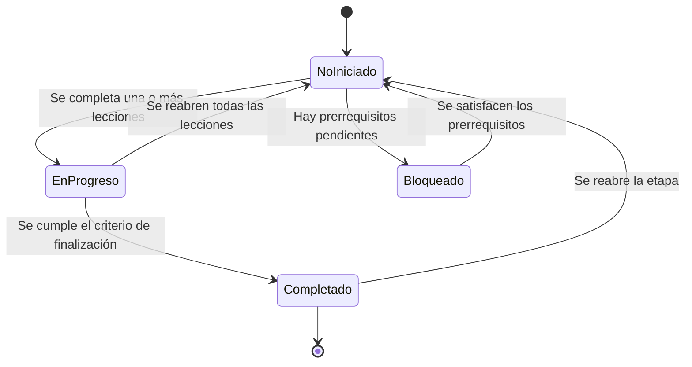
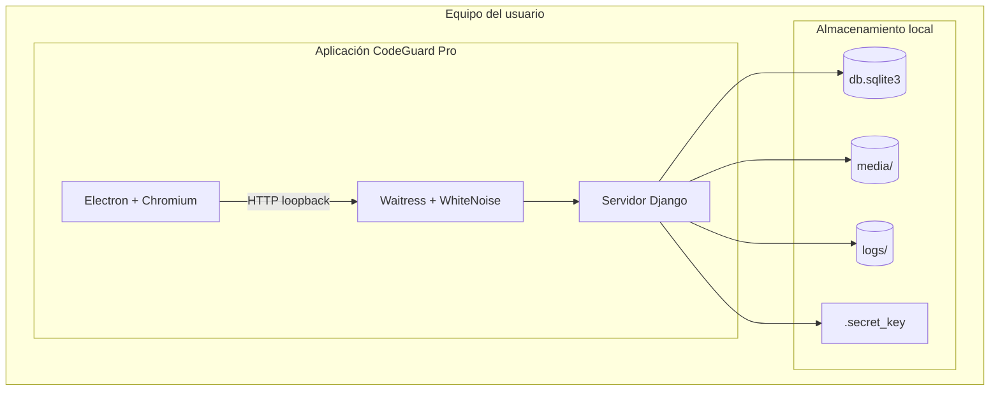

# CodeGuard Pro — Especificación de Requisitos de Software (SRS)

| Metadato | Valor |
|---|---|
| Producto | CodeGuard Pro |
| Documento | Especificación de Requisitos de Software |
| Identificador | CGP-SRS-001 |
| Versión | 3.0 |
| Fecha de revisión | 10 de noviembre de 2026 |
| Referencia normativa | IEEE Std 830-1998 (estructura adaptada) |
| Estado | Borrador técnico consolidado para validación del propietario |
| Repositorio | [MaverickBms/CodeGuard-Pro](https://github.com/MaverickBms/CodeGuard-Pro) |
| Línea base inspeccionada | Rama `main`, commit `d1528df8aad431cfe6b04192194ab6b543c07286` |

> **Nota de control:** este documento diferencia lo que existe en el código, lo que está aprobado como objetivo del producto y lo que continúa pendiente. La palabra *requisito* no implica por sí sola que una función esté implementada. Ningún requisito futuro debe presentarse como funcionalidad disponible.

---

## Control del documento

### Historial de versiones

| Versión | Fecha | Descripción |
|---|---|---|
| 2.2 | 05-11-2026 | Línea base previa: Electron + Django, requisitos amplios de producto y roadmap ASCENSO. |
| 3.0 | 10-11-2026 | Revisión del repositorio: actualización del estado real del roadmap, autenticación, arquitectura Electron, modelo de dominio, diagramas UML y trazabilidad. |

### Convenciones de estado

| Estado | Significado |
|---|---|
| **IMPLEMENTADO** | Existe código funcional en la línea base inspeccionada. |
| **IMPLEMENTADO — PRUEBA PENDIENTE** | Se identificó implementación, pero no se verificó una prueba automatizada o evidencia suficiente en esta revisión. |
| **PARCIAL** | Existe una parte del comportamiento; faltan escenarios o componentes para cumplirlo completamente. |
| **APROBADO — NO IMPLEMENTADO** | Forma parte del alcance funcional documentado, pero no se encontró implementado en la línea base. |
| **PROPUESTO** | Idea de evolución que requiere aprobación expresa. |
| **PENDIENTE DE DECISIÓN** | Hace falta una decisión del propietario antes de especificar o implementar. |
| **FUERA DE ALCANCE** | No forma parte de la versión objetivo definida en este documento. |

### Convenciones de prioridad

- **P0 — Crítica:** necesaria para iniciar, operar o proteger los datos del producto.
- **P1 — Alta:** necesaria para completar el flujo principal de aprendizaje.
- **P2 — Media:** aporta capacidades complementarias.
- **P3 — Evolutiva:** mejora o extensión posterior.

### Reglas para redactar requisitos verificables

Cada requisito debe:
1. Tener un identificador único y estable.
2. Expresar un comportamiento observable, evitando describir únicamente una tecnología.
3. Contener una condición o criterio de aceptación comprobable.
4. Tener prioridad y estado.
5. Mantener trazabilidad con módulos, datos, casos de uso y pruebas.
6. No mezclar varias obligaciones independientes en una sola frase.

---

# 1. Introducción

## 1.1 Propósito

Este documento especifica los requisitos funcionales, no funcionales, de datos, interfaces, seguridad y operación de **CodeGuard Pro**. Su finalidad es servir como línea base para el análisis, diseño, implementación, pruebas, mantenimiento y evolución del producto.

La especificación se estructura siguiendo la organización clásica de IEEE 830-1998, complementada con modelos UML y diagramas de arquitectura en Mermaid para que pueda mantenerse directamente desde GitHub.

La versión 3.0 corrige una limitación de la versión anterior: algunos requisitos aprobados para el producto aparecían mezclados con funciones ya implementadas. En esta revisión se documenta explícitamente la diferencia entre:

- Estado actual verificable en el repositorio.
- Alcance funcional aprobado o previsto.
- Funcionalidades pendientes de desarrollo.
- Decisiones todavía no aprobadas.

## 1.2 Alcance del producto

CodeGuard Pro es una aplicación de escritorio personal, local y **offline-first**, orientada a organizar y registrar el aprendizaje técnico de un usuario. Su núcleo actual permite consultar un roadmap formativo, navegar por etapas y lecciones, registrar avances y visualizar el progreso.

La aplicación combina:

- **Electron:** contenedor de escritorio y ciclo de vida de la aplicación.
- **Django 5.2:** servidor local, lógica de negocio, vistas y persistencia.
- **SQLite:** base de datos local.
- **HTML, CSS y JavaScript:** interfaz renderizada dentro de Chromium.
- **Bootstrap, HTMX y SweetAlert2:** recursos de interfaz distribuidos localmente cuando corresponda.
- **Waitress y WhiteNoise:** servidor WSGI y entrega de estáticos en el paquete de escritorio.
- **PyInstaller y electron-builder:** empaquetado de la aplicación.

El servidor local debe escuchar exclusivamente en `127.0.0.1`. La aplicación no requiere una cuenta remota, backend cloud ni conexión permanente a Internet.

### 1.2.1 Alcance implementado en la línea base inspeccionada

| Área | Capacidad observada | Estado |
|---|---|---|
| Escritorio | Ventana Electron, splash de inicio, arranque y supervisión del proceso Django | IMPLEMENTADO |
| Servidor local | Selección de puerto libre, comprobación de disponibilidad y bind a localhost | IMPLEMENTADO |
| Panel principal | Resumen de progreso, siguiente actividad sugerida y actividad reciente | IMPLEMENTADO |
| Roadmap | Carga y consulta de ASCENSO 3.1, 33 etapas, módulos y lecciones | IMPLEMENTADO |
| Navegación académica | Listado, filtros y detalle de etapa | IMPLEMENTADO |
| Progreso | Marcar lecciones y etapas; recalcular porcentaje de etapa | IMPLEMENTADO |
| Prerrequisitos | Bloqueo de etapas cuando faltan etapas requeridas | IMPLEMENTADO |
| Auditoría | Registro de eventos de acceso y cambios de progreso | IMPLEMENTADO |
| Temas | 12 temas visuales seleccionables | IMPLEMENTADO |
| Persistencia | SQLite y directorio local de datos configurable | IMPLEMENTADO |
| Autenticación | Código y modelos conservados, pero el flujo está temporalmente desactivado | DESACTIVADO POR CONFIGURACIÓN |
| Biblioteca documental, competencias, evaluaciones, evidencias y laboratorios | Definidos como evolución del producto; no se encontraron como módulos activos en `INSTALLED_APPS` de la línea base | APROBADO — NO IMPLEMENTADO / POR VALIDAR |

**Importante:** la presencia de modelos, rutas o eventos aislados no basta para considerar terminado un módulo. Para cambiar el estado a IMPLEMENTADO se requiere comprobar el flujo completo y sus pruebas.

### 1.2.2 Objetivos del producto

1. Centralizar el proceso de formación técnica en un entorno local.
2. Representar fielmente el roadmap ASCENSO y sus dependencias.
3. Registrar el avance con datos persistentes y verificables.
4. Facilitar la consulta del progreso y de la siguiente actividad disponible.
5. Mantener privacidad y autonomía operativa mediante funcionamiento local.
6. Proporcionar una interfaz consistente, adaptable y personalizable.
7. Permitir incorporar nuevos módulos sin convertir el núcleo en un monolito difícil de mantener.

### 1.2.3 Fuera del alcance de la línea base

No se debe asumir que las siguientes capacidades están disponibles en la versión actual:

- Sincronización con servicios cloud.
- Colaboración multiusuario o perfiles remotos.
- Tutor de inteligencia artificial integrado.
- Ejecución de máquinas virtuales o contenedores desde la aplicación.
- OCR de documentos escaneados.
- Foros o funciones sociales.
- Reproducción multimedia integrada.
- Ejecución automática de código potencialmente peligroso.
- Distribución de datos a terceros o telemetría.

Su incorporación requiere requisitos, análisis de riesgos y aprobación propios.

## 1.3 Definiciones, acrónimos y abreviaturas

| Término | Definición |
|---|---|
| SRS | Software Requirements Specification; especificación de requisitos de software. |
| IEEE 830 | Estándar histórico que define una estructura recomendada para SRS. |
| ASCENSO | Roadmap maestro de formación técnica, edición 3.1, compuesto por 33 etapas numeradas de 0 a 32. |
| Offline-first | Enfoque que prioriza la disponibilidad local sin depender de Internet. |
| Monousuario | Producto diseñado para un propietario local en un equipo. |
| Electron | Plataforma que permite construir aplicaciones de escritorio con tecnologías web. |
| Chromium | Motor de renderizado utilizado por Electron. |
| Django | Framework web de Python utilizado como backend local. |
| MVT | Model-View-Template, patrón arquitectónico de Django. |
| ORM | Object-Relational Mapping; capa de mapeo objeto-relacional. |
| SQLite | Motor de base de datos relacional embebido. |
| FTS5 | Extensión de búsqueda de texto completo de SQLite. |
| WSGI | Web Server Gateway Interface. |
| Waitress | Servidor WSGI utilizado por el servidor empaquetado. |
| WhiteNoise | Middleware/biblioteca para servir archivos estáticos desde la aplicación. |
| IPC | Inter-Process Communication; comunicación entre procesos de Electron. |
| CSP | Content Security Policy. |
| CSRF | Cross-Site Request Forgery. |
| XSS | Cross-Site Scripting. |
| Argon2 | Algoritmo de hash de contraseñas. |
| SHA-256 | Función hash criptográfica de 256 bits. |
| MVP | Minimum Viable Product. |
| SUT | System Under Test; sistema sometido a pruebas. |

## 1.4 Referencias

1. IEEE Std 830-1998, *IEEE Recommended Practice for Software Requirements Specifications*.
2. Repositorio CodeGuard Pro: [https://github.com/MaverickBms/CodeGuard-Pro](https://github.com/MaverickBms/CodeGuard-Pro).
3. `README.md` — descripción del producto, instalación y uso.
4. `docs/ARQUITECTURA.md` — arquitectura y sistema de diseño.
5. `docs/MODELO_DATOS.md` — entidades y relaciones documentadas.
6. `docs/SEGURIDAD.md` — controles de seguridad.
7. `docs/PLAN_PRUEBAS.md` — estrategia y evidencia de pruebas.
8. `docs/MATRIZ_TRAZABILIDAD.md` — trazabilidad histórica de requisitos.
9. `docs/MODO_SIN_AUTENTICACION.md` — estado de la autenticación.
10. `requirements.txt` y `package.json` — dependencias fijadas.
11. Documento maestro **PROYECTO ASCENSO — Roadmap Maestro Consolidado 3.1**, fuente de verdad para el contenido académico.
12. Documentación oficial de Django, Electron, SQLite, Waitress, PyInstaller y electron-builder.
13. OWASP ASVS y OWASP Top 10, como referencias para los controles de seguridad.

## 1.5 Visión general del documento

- **Sección 1:** contexto, propósito, alcance y referencias.
- **Sección 2:** perspectiva del producto, usuarios, restricciones y supuestos.
- **Sección 3:** requisitos específicos y criterios de aceptación.
- **Sección 4:** modelos de casos de uso, secuencia, componentes y clases.
- **Sección 5:** requisitos de datos y reglas de negocio.
- **Sección 6:** requisitos de calidad, seguridad y operación.
- **Sección 7:** trazabilidad y estrategia de verificación.
- **Sección 8:** decisiones, riesgos y evolución.

---

# 2. Descripción general

## 2.1 Perspectiva del producto

CodeGuard Pro es un sistema de escritorio con arquitectura local de dos procesos principales:

1. Electron administra la ventana, el menú, la selección de temas y el ciclo de vida del proceso backend.
2. Django atiende las solicitudes HTTP locales, ejecuta la lógica de negocio y accede a SQLite.

La interfaz web interna no es un servicio público: se carga dentro de una ventana Electron y se comunica con el servidor Django a través de una dirección loopback.

### 2.1.1 Diagrama de contexto del sistema



### 2.1.2 Diagrama de contenedores



## 2.2 Funciones del producto

### 2.2.1 Funciones disponibles en la línea base

- Arranque de la aplicación de escritorio.
- Inicialización del backend local y espera de disponibilidad.
- Presentación del panel principal.
- Consulta del resumen del roadmap activo.
- Consulta de las etapas, módulos y lecciones.
- Filtrado de etapas por bloque, prioridad y texto.
- Visualización del detalle de una etapa.
- Consulta de prerrequisitos y estado de bloqueo.
- Marcado y reapertura de lecciones.
- Marcado y reapertura de etapas.
- Recalculo del progreso de etapa a partir de las lecciones.
- Registro de eventos de progreso en auditoría.
- Selección de uno de los 12 temas visuales.
- Almacenamiento local de datos.

### 2.2.2 Funciones previstas para incrementos posteriores

- Gestión avanzada de competencias y niveles de dominio.
- Evaluaciones teóricas y prácticas.
- Biblioteca documental con importación, extracción e indexación PDF.
- Base de conocimiento con relaciones y referencias a fragmentos.
- Evidencias con hash e integridad.
- Laboratorios y registro de resultados.
- Backups y restauración.
- Revisión de vigencia documental.
- Exportación de informes y portafolios.

Estas funciones se conservan como alcance evolutivo; no se consideran disponibles hasta que exista implementación comprobable.

## 2.3 Características de los usuarios

| Actor | Descripción | Responsabilidades |
|---|---|---|
| Usuario propietario | Persona que utiliza la aplicación en su equipo local. | Consultar roadmap, registrar progreso, personalizar la interfaz y administrar los datos locales. |
| Sistema operativo | Entorno anfitrión de Electron y Django. | Proporcionar sistema de archivos, procesos, ventanas y permisos. |
| Administrador técnico del proyecto | Rol de mantenimiento del repositorio, no necesariamente un rol dentro de la aplicación. | Mantener dependencias, migraciones, pruebas, empaquetado y documentación. |

El producto actual es monousuario. No se especifican permisos diferenciados ni colaboración multiusuario.

## 2.4 Restricciones

1. El backend debe escuchar exclusivamente en `127.0.0.1`.
2. La aplicación debe poder operar sin Internet.
3. Los datos escribibles deben almacenarse en un directorio de datos del usuario, separado del directorio de instalación cuando se ejecuta empaquetada.
4. Django debe conservar separación entre modelos, vistas, servicios y plantillas.
5. La base de datos debe ser SQLite para el escenario monousuario actual.
6. Los recursos estáticos y las dependencias frontend deben servirse localmente.
7. Electron debe mantener `contextIsolation: true`, `nodeIntegration: false`, `sandbox: true` y `webSecurity: true` en la ventana principal.
8. La ventana debe bloquear navegación externa no autorizada y nuevas ventanas no controladas.
9. Los identificadores y las relaciones del roadmap deben proceder del documento ASCENSO oficial.
10. Los 12 temas visuales existentes deben conservar sus identificadores y su posibilidad de selección.
11. La autenticación se encuentra temporalmente desactivada en la configuración actual; no debe describirse como una barrera activa hasta que se reactive.
12. El sistema debe ser compatible con las dependencias fijadas en los archivos del repositorio.

## 2.5 Suposiciones y dependencias

- El usuario dispone de permisos de lectura y escritura sobre el directorio local de datos.
- El sistema operativo permite iniciar procesos locales.
- Electron puede crear una ventana Chromium.
- Python y las dependencias requeridas están disponibles durante el desarrollo; el paquete distribuido incorpora el servidor autónomo.
- El contenido maestro ASCENSO 3.1 es la fuente autorizada de las etapas y sus relaciones.
- La base de datos local no se comparte concurrentemente entre múltiples instalaciones.
- La disponibilidad de espacio en disco es responsabilidad del entorno anfitrión.

## 2.6 Entorno operativo y stack identificado

| Capa | Tecnología identificada | Evidencia |
|---|---|---|
| Escritorio | Electron | `package.json`, `electron/main.js` |
| Motor UI | Chromium integrado en Electron | `BrowserWindow` |
| Backend | Django 5.2.19 | `requirements.txt` |
| Base de datos | SQLite | `config/settings/base.py` |
| Servidor empaquetado | Waitress 3.0.0 | `server_entry.py`, `requirements.txt` |
| Estáticos | WhiteNoise 6.9.0 | `requirements.txt`, arquitectura |
| Hash de contraseñas | Argon2 | configuración y módulo accounts |
| Frontend | HTML, CSS y JavaScript | `templates/`, `static/` |
| Componentes UI | Bootstrap, HTMX y SweetAlert2 locales | README y recursos del proyecto |
| Empaquetado backend | PyInstaller | `requirements.txt`, script de construcción |
| Empaquetado escritorio | electron-builder | `package.json` |

Las versiones deben actualizarse en este documento cuando cambien los archivos de dependencias. No se debe asumir compatibilidad con cualquier versión de Python o Node sin ejecutar las pruebas de instalación.

---

# 3. Requisitos específicos

## 3.1 Interfaces externas

### 3.1.1 Interfaz de usuario

- La interfaz se presenta dentro de una ventana nativa Electron.
- El contenido debe estar redactado en español, salvo términos técnicos que requieran conservar su forma original.
- La navegación principal debe permitir acceder al panel y al roadmap.
- La interfaz debe mostrar los estados de carga, vacío, error, bloqueo y confirmación de acciones.
- El sistema de temas debe conservar los 12 temas actuales.
- Los controles deben disponer de etiquetas comprensibles, foco visible y estados interactivos.
- La distribución debe adaptarse al espacio disponible sin superposición ni pérdida de contenido.

### 3.1.2 Interfaz de hardware

No existe una interfaz especial con hardware externo. El sistema utiliza teclado, ratón, pantalla y almacenamiento local del equipo.

### 3.1.3 Interfaces de software

| Interfaz | Contrato |
|---|---|
| Electron → Django | HTTP local hacia `127.0.0.1:<puerto>`. |
| Chromium → Django | Solicitudes HTTP de navegación y formularios. |
| Electron Main → Renderer | IPC limitado a canales definidos por el proceso principal y el preload. |
| Django → SQLite | ORM de Django y transacciones. |
| Django → sistema de archivos | Lectura de recursos del proyecto y escritura de datos bajo el directorio configurado. |
| Servidor WSGI → estáticos | WhiteNoise en el modo empaquetado. |

### 3.1.4 Interfaces de comunicación

- El backend no debe escuchar en `0.0.0.0`.
- Electron debe seleccionar un puerto local disponible durante el arranque.
- La ventana debe cargar la URL local únicamente después de comprobar que el servidor responde.
- Las llamadas IPC deben limitarse a operaciones explícitas; no se debe exponer `require`, Node.js ni acceso arbitrario al sistema de archivos al renderer.

## 3.2 Requisitos funcionales

### 3.2.1 Escritorio y ciclo de vida

| ID | Requisito | Prioridad | Estado |
|---|---|---:|---|
| RF-ACT-001 | El sistema deberá iniciar el proceso backend local antes de cargar la interfaz principal. | P0 | IMPLEMENTADO |
| RF-ACT-002 | El sistema deberá seleccionar un puerto libre y enlazar el backend a `127.0.0.1`. | P0 | IMPLEMENTADO |
| RF-ACT-003 | El sistema deberá comprobar la disponibilidad HTTP del backend antes de mostrar la interfaz funcional. | P0 | IMPLEMENTADO |
| RF-ACT-004 | El sistema deberá mostrar una pantalla de inicio mientras el backend se inicializa. | P2 | IMPLEMENTADO |
| RF-ACT-005 | El sistema deberá detener el proceso backend cuando la aplicación de escritorio se cierre. | P0 | IMPLEMENTADO |
| RF-ACT-006 | El sistema deberá bloquear la apertura de ventanas y navegación hacia destinos no autorizados. | P0 | IMPLEMENTADO |
| RF-ACT-007 | El sistema deberá conservar el aislamiento entre renderer y proceso principal. | P0 | IMPLEMENTADO |
| RF-ACT-008 | El sistema deberá informar un error comprensible si el backend no inicia dentro del tiempo máximo configurado. | P1 | IMPLEMENTADO — PRUEBA PENDIENTE |

### 3.2.2 Panel principal

| ID | Requisito | Prioridad | Estado |
|---|---|---:|---|
| RF-ACT-010 | El sistema deberá mostrar un panel principal al abrir la aplicación. | P0 | IMPLEMENTADO |
| RF-ACT-011 | El panel deberá presentar el resumen del progreso del roadmap activo. | P1 | IMPLEMENTADO |
| RF-ACT-012 | El panel deberá mostrar etapas completadas y porcentaje general calculado desde los registros persistidos. | P1 | IMPLEMENTADO |
| RF-ACT-013 | El panel deberá identificar la siguiente etapa disponible que no esté completada ni bloqueada. | P1 | IMPLEMENTADO |
| RF-ACT-014 | El panel deberá presentar actividad reciente del usuario local. | P2 | IMPLEMENTADO |
| RF-ACT-015 | El panel deberá manejar el escenario en el que no exista un roadmap cargado. | P1 | IMPLEMENTADO |

### 3.2.3 Roadmap académico ASCENSO

| ID | Requisito | Prioridad | Estado |
|---|---|---:|---|
| RF-ACT-020 | El sistema deberá cargar y representar el roadmap ASCENSO 3.1 a partir de su fuente de datos oficial. | P0 | IMPLEMENTADO |
| RF-ACT-021 | El sistema deberá conservar las 33 etapas numeradas de 0 a 32. | P0 | IMPLEMENTADO |
| RF-ACT-022 | El sistema deberá representar la jerarquía roadmap → etapa → módulo → lección → actividad. | P1 | IMPLEMENTADO |
| RF-ACT-023 | El sistema deberá mostrar título, objetivo, prioridad, bloque, sección y proyecto cuando esos datos estén disponibles. | P1 | IMPLEMENTADO |
| RF-ACT-024 | El sistema deberá permitir filtrar etapas por bloque. | P2 | IMPLEMENTADO |
| RF-ACT-025 | El sistema deberá permitir filtrar etapas por prioridad. | P2 | IMPLEMENTADO |
| RF-ACT-026 | El sistema deberá permitir buscar etapas por texto. | P2 | IMPLEMENTADO |
| RF-ACT-027 | El sistema deberá presentar el detalle de una etapa y su contenido relacionado. | P1 | IMPLEMENTADO |
| RF-ACT-028 | El sistema deberá mostrar los prerrequisitos explícitos de cada etapa. | P1 | IMPLEMENTADO |
| RF-ACT-029 | El sistema no deberá inventar dependencias que no estén documentadas en la fuente oficial. | P0 | IMPLEMENTADO EN LA LÓGICA DE CARGA |
| RF-ACT-030 | El proceso de carga inicial deberá ser idempotente y evitar duplicar el roadmap cuando ya exista. | P0 | IMPLEMENTADO |

### 3.2.4 Registro y cálculo del progreso

| ID | Requisito | Prioridad | Estado |
|---|---|---:|---|
| RF-ACT-040 | El sistema deberá permitir marcar una lección como completada mediante una solicitud POST. | P0 | IMPLEMENTADO |
| RF-ACT-041 | El sistema deberá permitir reabrir una lección previamente completada. | P1 | IMPLEMENTADO |
| RF-ACT-042 | El sistema deberá permitir marcar una etapa como completada. | P0 | IMPLEMENTADO |
| RF-ACT-043 | El sistema deberá impedir completar una etapa si alguno de sus prerrequisitos no está completado. | P0 | IMPLEMENTADO |
| RF-ACT-044 | El sistema deberá permitir reabrir una etapa completada. | P1 | IMPLEMENTADO |
| RF-ACT-045 | El sistema deberá recalcular el porcentaje de una etapa a partir de las lecciones completadas. | P0 | IMPLEMENTADO |
| RF-ACT-046 | El sistema deberá calcular el progreso general usando los registros asociados al usuario local y roadmap activo. | P1 | IMPLEMENTADO |
| RF-ACT-047 | El sistema deberá mantener la consistencia entre estado y porcentaje: una entidad completada tendrá 100% y una no iniciada 0%. | P0 | IMPLEMENTADO EN EL MODELO PROGRESO |
| RF-ACT-048 | El sistema deberá impedir operaciones de escritura de progreso cuando no exista un propietario local válido. | P0 | IMPLEMENTADO |
| RF-ACT-049 | El sistema deberá registrar en auditoría la finalización y reapertura de etapas y lecciones. | P1 | IMPLEMENTADO |

### 3.2.5 Personalización visual

| ID | Requisito | Prioridad | Estado |
|---|---|---:|---|
| RF-ACT-050 | El sistema deberá ofrecer los 12 temas visuales definidos por el producto. | P1 | IMPLEMENTADO |
| RF-ACT-051 | El usuario deberá poder seleccionar un tema desde los controles de escritorio disponibles. | P1 | IMPLEMENTADO |
| RF-ACT-052 | El sistema deberá conservar los identificadores de tema utilizados por CSS y Electron. | P0 | IMPLEMENTADO |
| RF-ACT-053 | Los componentes deberán utilizar tokens semánticos para adaptarse al tema activo. | P1 | IMPLEMENTADO |
| RF-ACT-054 | El tema de alto contraste deberá mantener un tratamiento visual específico. | P1 | IMPLEMENTADO |
| RF-ACT-055 | La interfaz deberá respetar la preferencia de movimiento reducido del sistema operativo. | P1 | IMPLEMENTADO EN LOS ESTILOS DOCUMENTADOS |

Los temas identificados son: `light`, `dark`, `high-contrast`, `retro-pixel`, `cyberpunk`, `fantasy`, `sci-fi`, `warrior`, `mage`, `rogue`, `paladin` y `dark-mage`.

### 3.2.6 Identidad y acceso

El repositorio conserva modelos, formularios, servicios, vistas y pruebas del flujo de autenticación. Sin embargo, el interruptor `AUTH_DISABLED = True` se encuentra activo en la línea base revisada.

| ID | Requisito | Prioridad | Estado |
|---|---|---:|---|
| RF-ACT-060 | Cuando la autenticación esté habilitada, el sistema deberá permitir configurar el usuario local y la contraseña maestra. | P1 | IMPLEMENTADO EN CÓDIGO, DESACTIVADO |
| RF-ACT-061 | Cuando la autenticación esté habilitada, el sistema deberá validar credenciales locales usando Argon2. | P1 | IMPLEMENTADO EN CÓDIGO, DESACTIVADO |
| RF-ACT-062 | El sistema deberá generar una frase de rescate de alta entropía, mostrarla una sola vez y almacenar únicamente su hash. | P1 | IMPLEMENTADO EN CÓDIGO, DESACTIVADO |
| RF-ACT-063 | El sistema deberá permitir recuperar el acceso con la frase de rescate y consumirla únicamente al completar el cambio de contraseña. | P1 | IMPLEMENTADO EN CÓDIGO, DESACTIVADO |
| RF-ACT-064 | Cuando la autenticación esté habilitada, el sistema deberá cerrar la sesión mediante POST protegido contra CSRF. | P1 | IMPLEMENTADO EN CÓDIGO, DESACTIVADO |
| RF-ACT-065 | Cuando la autenticación esté habilitada, el sistema deberá aplicar expiración por inactividad. | P1 | IMPLEMENTADO EN CÓDIGO, DESACTIVADO |
| RF-ACT-066 | El sistema deberá mantener el modo sin autenticación claramente identificado mientras `AUTH_DISABLED = True`. | P0 | IMPLEMENTADO |
| RF-ACT-067 | La reactivación de autenticación deberá requerir autorización expresa del propietario y pruebas de regresión. | P0 | REGLA DE CAMBIO |

**Condición de seguridad:** mientras el modo sin autenticación esté activo, no debe afirmarse que el acceso a la aplicación está protegido por contraseña o sesión. La protección del equipo, del usuario del sistema operativo y del directorio de datos depende de los controles del sistema anfitrión.

### 3.2.7 Auditoría

| ID | Requisito | Prioridad | Estado |
|---|---|---:|---|
| RF-ACT-070 | El sistema deberá almacenar eventos de auditoría con tipo, descripción y fecha de creación. | P1 | IMPLEMENTADO |
| RF-ACT-071 | El sistema deberá permitir asociar un evento a un usuario cuando exista un actor autenticado. | P1 | IMPLEMENTADO |
| RF-ACT-072 | El sistema deberá permitir registrar eventos sin usuario asociado en modo sin autenticación. | P1 | IMPLEMENTADO |
| RF-ACT-073 | El sistema deberá registrar eventos de finalización y reapertura de etapas y lecciones. | P1 | IMPLEMENTADO |
| RF-ACT-074 | El sistema deberá conservar índices que permitan consultar eventos por tipo, usuario y fecha. | P2 | IMPLEMENTADO |

### 3.2.8 Requisitos de evolución del producto

Los siguientes requisitos proceden de la línea base funcional anterior y se conservan como objetivos de evolución. No forman parte del conjunto de capacidades implementadas verificadas en esta revisión.

| Rango de IDs | Módulo previsto | Alcance resumido | Estado |
|---|---|---|---|
| RF-FUT-080 a RF-FUT-089 | Competencias | Competencias, niveles, criterios, reglas de logro y registro de dominio | APROBADO — NO IMPLEMENTADO |
| RF-FUT-090 a RF-FUT-099 | Biblioteca documental | Importación PDF, metadatos, extracción de texto, visor y búsqueda FTS5 | APROBADO — NO IMPLEMENTADO |
| RF-FUT-100 a RF-FUT-109 | Conocimiento | Conceptos, relaciones y vínculos con documentos y actividades | APROBADO — NO IMPLEMENTADO |
| RF-FUT-110 a RF-FUT-119 | Evaluaciones | Preguntas, intentos, rúbricas, resultados y retroalimentación | APROBADO — NO IMPLEMENTADO |
| RF-FUT-120 a RF-FUT-129 | Evidencias | Archivos, asociaciones, SHA-256 e integridad | APROBADO — NO IMPLEMENTADO |
| RF-FUT-130 a RF-FUT-139 | Laboratorios | Guías, pasos, comandos, resultados y capturas | APROBADO — NO IMPLEMENTADO |
| RF-FUT-140 a RF-FUT-149 | Administración | Backups, restauración, exportación y auditoría administrativa ampliada | APROBADO — NO IMPLEMENTADO |
| RF-FUT-150 a RF-FUT-159 | Vigencia | Revisión y estado de vigencia de contenidos | APROBADO — NO IMPLEMENTADO |
| RF-FUT-160 a RF-FUT-169 | Ética | Advertencias, aceptación y guías de uso responsable | APROBADO — NO IMPLEMENTADO |

Los identificadores de esta sección son una reorganización temática para la versión 3.0. Los identificadores históricos RF-ACT-020…RF-FUT-123 de la versión 2.2 deberán conservarse en la matriz de migración si se requiere compatibilidad documental estricta.

## 3.3 Requisitos no funcionales

| ID | Requisito | Criterio de aceptación | Prioridad | Estado |
|---|---|---|---:|---|
| RNF-ACT-001 | El producto deberá operar sin conexión a Internet para sus funciones locales. | Con la red desconectada se inicia Electron, Django y se consulta/modifica el progreso local. | P0 | IMPLEMENTADO POR ARQUITECTURA; PRUEBA DE REGRESIÓN |
| RNF-ACT-002 | El backend deberá escuchar únicamente en loopback. | Inspección del socket muestra `127.0.0.1`, nunca `0.0.0.0`. | P0 | IMPLEMENTADO |
| RNF-ACT-003 | La aplicación deberá separar datos escribibles del directorio de instalación. | La ejecución empaquetada utiliza `CODEGUARD_DATA_DIR` o `app.getPath('userData')`. | P0 | IMPLEMENTADO |
| RNF-ACT-004 | La persistencia deberá mantener integridad referencial y transaccional. | Migraciones y pruebas de integridad pasan sobre una base nueva. | P0 | IMPLEMENTADO EN SQLITE/DJANGO; PRUEBAS CONTINUAS |
| RNF-ACT-005 | La interfaz deberá ser adaptable al tamaño de la ventana. | No se producen solapamientos ni pérdida de controles en resoluciones objetivo. | P1 | REQUIERE VALIDACIÓN VISUAL |
| RNF-ACT-006 | La aplicación deberá ofrecer estados accesibles y navegación por teclado. | Controles con foco visible, etiquetas y orden de tabulación coherente. | P1 | REQUIERE AUDITORÍA DE ACCESIBILIDAD |
| RNF-ACT-007 | La arquitectura deberá separar presentación, lógica de negocio y persistencia. | Vistas delegan reglas de negocio en servicios y modelos; el acceso a datos usa ORM. | P1 | IMPLEMENTADO |
| RNF-ACT-008 | El renderer de Electron no deberá tener acceso directo a Node.js. | `nodeIntegration=false`, `contextIsolation=true`, `sandbox=true`. | P0 | IMPLEMENTADO |
| RNF-ACT-009 | La aplicación deberá bloquear navegación externa no autorizada. | Pruebas de navegación externa y apertura de ventanas son rechazadas. | P0 | IMPLEMENTADO |
| RNF-ACT-010 | La interfaz deberá utilizar recursos locales, sin CDN como dependencia funcional. | La aplicación funciona sin descargar scripts, estilos o fuentes de terceros. | P0 | IMPLEMENTADO SEGÚN DOCUMENTACIÓN; VERIFICAR RED |
| RNF-ACT-011 | La aplicación deberá respetar preferencias de movimiento reducido. | Animaciones no esenciales se reducen o desactivan con `prefers-reduced-motion`. | P1 | IMPLEMENTADO EN ESTILOS DOCUMENTADOS |
| RNF-ACT-012 | Las consultas de progreso deberán derivar sus porcentajes de registros persistidos. | Los porcentajes mostrados coinciden con los registros de progreso. | P0 | IMPLEMENTADO |
| RNF-ACT-013 | El sistema deberá manejar errores de arranque y ausencia de datos sin cerrarse abruptamente. | Se muestra un estado o mensaje de error recuperable. | P1 | PARCIAL / PRUEBA PENDIENTE |
| RNF-ACT-014 | El producto deberá mantener dependencias con versiones fijadas. | Los paquetes Python tienen versiones explícitas y el manifiesto npm identifica sus dependencias. | P1 | IMPLEMENTADO |
| RNF-ACT-015 | El sistema deberá evitar telemetría y llamadas externas no justificadas. | Inspección de red en ejecución offline no revela conexiones externas de la aplicación. | P0 | DOCUMENTADO; PRUEBA PENDIENTE |
| RNF-ACT-016 | El sistema deberá mantener tiempos de respuesta adecuados para el escenario monousuario. | Definir conjunto de datos, equipo y percentiles antes de declarar un umbral. | P2 | PENDIENTE DE MEDICIÓN |
| RNF-ACT-017 | El sistema deberá poder instalarse y ejecutarse en los sistemas operativos oficialmente soportados. | Instalación limpia y pruebas de humo por plataforma objetivo. | P1 | PENDIENTE DE MATRIZ DE PLATAFORMAS |
| RNF-ACT-018 | El código deberá ser mantenible y verificable. | `manage.py check`, pruebas, comprobación de migraciones y validaciones de empaquetado documentadas. | P1 | PARCIAL |
| RNF-ACT-019 | La aplicación deberá conservar los 12 temas sin introducir dependencias de paleta entre ellos. | Cambio de tema no rompe componentes y cada tema conserva su identificador. | P1 | IMPLEMENTADO; PRUEBA VISUAL PENDIENTE |
| RNF-ACT-020 | El sistema deberá evitar que el cierre de Electron deje procesos backend huérfanos. | Al cerrar la ventana y la aplicación, el proceso Django termina. | P0 | IMPLEMENTADO; PRUEBA DE PLATAFORMA PENDIENTE |

## 3.4 Requisitos de datos

### 3.4.1 Entidades implementadas

| ID | Entidad | Responsabilidad | Persistencia |
|---|---|---|---|
| RD-ACT-001 | Usuario | Propietario local y datos de autenticación conservados. | SQLite |
| RD-ACT-002 | FraseRescate | Hash de frase de recuperación y estado de uso. | SQLite |
| RD-ACT-003 | ConfiguracionSistema | Configuración global singleton. | SQLite |
| RD-ACT-004 | AuditLog | Registro cronológico de eventos. | SQLite |
| RD-ACT-005 | Roadmap | Contenedor de una ruta formativa y su edición. | SQLite |
| RD-ACT-006 | Etapa | Unidad numerada, prioridad, objetivo y proyecto. | SQLite |
| RD-ACT-007 | Modulo | Agrupación de lecciones dentro de una etapa. | SQLite |
| RD-ACT-008 | Leccion | Unidad de aprendizaje. | SQLite |
| RD-ACT-009 | Actividad | Acción concreta asociada a una lección. | SQLite |
| RD-ACT-010 | Prerrequisito | Dependencia explícita entre etapas. | SQLite |
| RD-ACT-011 | CriterioFinalizacion | Criterio asociado a una etapa. | SQLite |
| RD-ACT-012 | Progreso | Estado y porcentaje de avance por objetivo académico. | SQLite |

### 3.4.2 Reglas de integridad

1. Un roadmap se identifica de forma única por nombre y edición.
2. Una etapa no puede repetirse dentro del mismo roadmap.
3. Un módulo no puede repetirse dentro de la misma etapa.
4. Una lección no puede repetirse por título dentro del mismo módulo.
5. Una actividad no puede repetirse por título dentro de la misma lección.
6. Un prerrequisito no puede apuntar a la misma etapa como origen y destino.
7. La combinación de etapa y objetivo de progreso debe identificar un registro de progreso único según las restricciones del modelo.
8. El porcentaje de progreso debe permanecer entre 0 y 100.
9. Al marcar un progreso como completado, el porcentaje se establece en 100.
10. Al marcarlo como no iniciado, el porcentaje se establece en 0 y se limpia la fecha de finalización.
11. Los eventos de auditoría pueden conservarse sin usuario asociado.
12. La configuración global se maneja como singleton lógico con clave primaria fija.

### 3.4.3 Entidades futuras

Las siguientes entidades son conceptuales y no deben confundirse con tablas ya desplegadas:

- Competencia, NivelDominio, CriterioEvaluacion, ReglaFinalizacion.
- Documento, FragmentoDocumental, MetadatoDocumento.
- Concepto, RelacionConcepto, VinculoConceptoFragmento.
- Evaluacion, Pregunta, Opcion, Intento, Resultado, Rubrica.
- Evidencia, ArchivoEvidencia, HashEvidencia.
- Laboratorio, PasoLaboratorio, Comando, ResultadoPaso.
- BackupOperacion, RevisionContenido, DecisionRevision.

## 3.5 Requisitos de seguridad

| ID | Requisito | Criterio de aceptación | Estado |
|---|---|---|---|
| RS-ACT-001 | El servidor deberá enlazarse a localhost exclusivamente. | El socket no es accesible desde otras interfaces de red. | IMPLEMENTADO |
| RS-ACT-002 | El renderer deberá ejecutarse con aislamiento de contexto y sandbox. | Configuración Electron segura inspeccionable. | IMPLEMENTADO |
| RS-ACT-003 | El sistema deberá aplicar protección CSRF a las operaciones que cambian estado. | POST sin token válido es rechazado cuando el middleware está activo. | IMPLEMENTADO EN DJANGO |
| RS-ACT-004 | Las plantillas deberán escapar contenido dinámico para reducir XSS. | Pruebas con payloads no ejecutan scripts. | IMPLEMENTADO POR FRAMEWORK; PRUEBA PENDIENTE |
| RS-ACT-005 | Las consultas de base de datos deberán utilizar ORM o parámetros seguros. | No se construyen consultas SQL mediante concatenación de entradas. | IMPLEMENTADO POR ORM |
| RS-ACT-006 | La aplicación deberá añadir cabeceras de seguridad y CSP. | Respuestas incluyen las cabeceras definidas por la política del proyecto. | IMPLEMENTADO |
| RS-ACT-007 | Los secretos deberán mantenerse fuera del repositorio. | `.secret_key` y variables sensibles no se versionan; permisos locales restrictivos. | IMPLEMENTADO POR CONFIGURACIÓN |
| RS-ACT-008 | Las contraseñas deberán almacenarse mediante hash seguro Argon2 cuando la autenticación esté habilitada. | No existe contraseña en texto plano en la base de datos. | IMPLEMENTADO EN CÓDIGO; AUTENTICACIÓN DESACTIVADA |
| RS-ACT-009 | La frase de rescate deberá almacenarse como hash y ser de un solo uso. | Se invalida únicamente tras completar correctamente el restablecimiento. | IMPLEMENTADO EN CÓDIGO; AUTENTICACIÓN DESACTIVADA |
| RS-ACT-010 | El sistema deberá evitar revelar si un usuario existe ante errores de autenticación. | Mensaje de error genérico. | IMPLEMENTADO EN CÓDIGO; AUTENTICACIÓN DESACTIVADA |
| RS-ACT-011 | La aplicación deberá registrar eventos relevantes de acceso y progreso. | Los eventos esperados aparecen en AuditLog. | IMPLEMENTADO |
| RS-ACT-012 | El sistema no deberá exponer errores internos ni secretos al usuario final. | `DEBUG=False` por defecto y mensajes de error controlados. | IMPLEMENTADO POR CONFIGURACIÓN |
| RS-ACT-013 | Los datos de usuario deberán almacenarse en un directorio local separado del binario instalado. | Directorio de datos independiente en modo empaquetado. | IMPLEMENTADO |
| RS-ACT-014 | Los archivos de evidencias futuros deberán validarse por tipo, tamaño y contenido, y almacenarse fuera del web root. | Pruebas de MIME, extensión, tamaño, traversal y descarga segura. | APROBADO — NO IMPLEMENTADO |
| RS-ACT-015 | Los backups futuros deberán validarse antes de restaurarse. | Rechazo de rutas, entradas y contenido no permitido. | APROBADO — NO IMPLEMENTADO |
| RS-ACT-016 | El sistema deberá evitar telemetría y transmisión no autorizada de información personal. | Verificación de tráfico de red. | DOCUMENTADO; PRUEBA PENDIENTE |
| RS-ACT-017 | El modo sin autenticación deberá comunicarse como una condición explícita de seguridad. | UI y documentación no afirman que exista protección por login mientras el interruptor esté activo. | IMPLEMENTADO COMO DECISIÓN ACTUAL |
| RS-ACT-018 | La reactivación de autenticación deberá realizarse mediante cambio controlado y pruebas de regresión. | Revisión de configuración, flujos y pruebas con `AUTH_DISABLED=False`. | REGLA DE CAMBIO |

---

# 4. Modelos y diagramas del sistema

Los diagramas de esta sección describen la arquitectura y el dominio observados en el repositorio en la fecha de revisión. Los módulos futuros se identifican por separado y no aparecen como clases implementadas.

## 4.1 Diagrama de componentes



## 4.2 Diagrama de secuencia — Inicio de la aplicación



## 4.3 Diagrama de secuencia — Consultar el panel



## 4.4 Diagrama de secuencia — Completar una lección



## 4.5 Diagrama de secuencia — Completar una etapa con prerrequisitos



## 4.6 Diagrama de clases — Modelo implementado

Este diagrama representa las clases persistentes identificadas en `apps.accounts`, `apps.core`, `apps.audit` y `apps.roadmaps`. No incluye entidades futuras.



**Nota de interpretación:** `Progreso` puede referenciar una etapa y, de forma opcional, un módulo, una lección o una actividad. La restricción de unicidad y los campos opcionales deben validarse junto con las migraciones reales de SQLite; el diagrama no sustituye el esquema físico.

## 4.7 Diagrama de estados del progreso



El estado `bloqueado` se utiliza como estado de dominio previsto para el progreso, mientras que el bloqueo por prerrequisitos también se calcula a partir de las relaciones entre etapas. La representación visual debe distinguir ambos conceptos.

## 4.8 Diagrama de despliegue



---

# 5. Casos de uso

## 5.1 Actores

- **ACT-01 Usuario local:** actor primario que utiliza la aplicación.
- **ACT-02 Sistema operativo:** actor de soporte para procesos, ventanas y archivos.

## 5.2 Catálogo de casos de uso

| ID | Caso de uso | Actor primario | Prioridad | Estado |
|---|---|---|---:|---|
| CU-001 | Iniciar aplicación de escritorio | Usuario local | P0 | IMPLEMENTADO |
| CU-002 | Consultar panel principal | Usuario local | P0 | IMPLEMENTADO |
| CU-003 | Consultar roadmap | Usuario local | P0 | IMPLEMENTADO |
| CU-004 | Filtrar etapas | Usuario local | P2 | IMPLEMENTADO |
| CU-005 | Consultar detalle de etapa | Usuario local | P1 | IMPLEMENTADO |
| CU-006 | Completar una lección | Usuario local | P0 | IMPLEMENTADO |
| CU-007 | Reabrir una lección | Usuario local | P1 | IMPLEMENTADO |
| CU-008 | Completar una etapa | Usuario local | P0 | IMPLEMENTADO |
| CU-009 | Cambiar tema visual | Usuario local | P1 | IMPLEMENTADO |
| CU-010 | Consultar auditoría de progreso | Usuario local | P2 | PARCIAL — registro disponible; visor por confirmar |
| CU-011 | Configurar usuario y credenciales | Usuario local | P1 | IMPLEMENTADO EN CÓDIGO; DESACTIVADO |
| CU-012 | Recuperar acceso con frase de rescate | Usuario local | P1 | IMPLEMENTADO EN CÓDIGO; DESACTIVADO |
| CU-013 | Importar y consultar documentos PDF | Usuario local | P2 | APROBADO — NO IMPLEMENTADO |
| CU-014 | Registrar competencias y evaluaciones | Usuario local | P2 | APROBADO — NO IMPLEMENTADO |
| CU-015 | Registrar evidencias y laboratorios | Usuario local | P2 | APROBADO — NO IMPLEMENTADO |
| CU-016 | Crear y restaurar backups | Usuario local | P1 | APROBADO — NO IMPLEMENTADO |

## 5.3 Especificación de casos de uso principales

### CU-001 — Iniciar aplicación de escritorio

**Objetivo:** abrir CodeGuard Pro y presentar la interfaz cuando el servidor local esté disponible.

**Precondiciones:**
- El usuario puede ejecutar la aplicación.
- Los archivos de la aplicación están disponibles.
- Existe permiso de escritura en el directorio de datos.

**Flujo principal:**
1. El usuario ejecuta la aplicación.
2. Electron determina el directorio de datos.
3. Electron obtiene un puerto local libre.
4. Electron inicia Django o el binario empaquetado.
5. Django aplica migraciones.
6. Django carga ASCENSO si no existe un roadmap.
7. Electron comprueba la disponibilidad HTTP.
8. Electron carga la URL local en la ventana principal.

**Flujos alternativos:**
- A1: si no se encuentra el binario empaquetado, se informa que debe reconstruirse el paquete.
- A2: si el servidor no responde dentro del timeout, se presenta un error controlado.
- A3: si ya existe el roadmap, no se duplica la carga inicial.

**Postcondiciones:**
- La interfaz queda disponible o se informa un error recuperable.
- El proceso backend queda bajo supervisión de Electron.

### CU-002 — Consultar panel principal

**Objetivo:** mostrar una síntesis real del avance formativo.

**Precondiciones:**
- El backend está operativo.
- Existe un roadmap activo.
- Existe un propietario local para asociar el progreso.

**Flujo principal:**
1. El usuario accede al panel.
2. Django obtiene el roadmap activo.
3. El sistema consulta etapas y progresos.
4. El sistema calcula el porcentaje general y los conteos.
5. El sistema identifica la siguiente etapa no completada y no bloqueada.
6. El sistema recupera actividad reciente.
7. Django renderiza el panel.

**Alternativas:**
- A1: si no existe roadmap, se muestra el estado sin datos.
- A2: si no existe propietario local, la lectura puede mostrarse, pero las escrituras deben bloquearse.

### CU-006 — Completar una lección

**Objetivo:** registrar la finalización de una unidad de aprendizaje y actualizar el progreso.

**Precondiciones:**
- Existe una lección válida.
- Existe un propietario local.
- La solicitud se realiza mediante POST.

**Flujo principal:**
1. El usuario marca la lección.
2. La vista resuelve el propietario local.
3. El servicio obtiene o crea el registro de progreso.
4. El estado de la lección cambia a completado.
5. El modelo establece el porcentaje en 100%.
6. El servicio recalcula el porcentaje de la etapa.
7. Se registra el evento de auditoría.
8. El usuario recibe confirmación.

**Postcondiciones:**
- El progreso de la lección queda persistido.
- El porcentaje de la etapa refleja el conteo actualizado.
- El evento queda registrado.

### CU-008 — Completar una etapa

**Objetivo:** completar una etapa solo cuando se satisfacen sus prerrequisitos.

**Precondiciones:**
- Existe la etapa.
- Existe un propietario local.
- La solicitud es POST.

**Flujo principal:**
1. El usuario solicita completar la etapa.
2. El servicio consulta las etapas ya completadas.
3. El servicio evalúa los prerrequisitos documentados.
4. Si todos están completos, guarda el progreso como completado.
5. Se registra el evento de auditoría.
6. Se confirma la operación.

**Excepción:**
- Si falta algún prerrequisito, la operación no se ejecuta y se informa que la etapa continúa bloqueada.

### CU-009 — Cambiar tema visual

**Objetivo:** adaptar la interfaz al tema elegido por el usuario.

**Flujo principal:**
1. El usuario selecciona un tema.
2. Electron recibe la selección por el canal IPC correspondiente.
3. La interfaz aplica el identificador de tema.
4. Los componentes consumen los tokens semánticos del tema.

**Postcondición:** la interfaz refleja el tema seleccionado sin alterar datos académicos.

---

# 6. Reglas de negocio y restricciones de dominio

| ID | Regla |
|---|---|
| RN-001 | ASCENSO 3.1 es la fuente de verdad del contenido y las dependencias académicas. |
| RN-002 | No se deben crear etapas, lecciones ni prerrequisitos inventados. |
| RN-003 | Una etapa no puede completarse mientras tenga prerrequisitos pendientes. |
| RN-004 | Marcar una lección como completada actualiza el progreso de la etapa correspondiente. |
| RN-005 | Una etapa completada tiene porcentaje 100. |
| RN-006 | Una etapa no iniciada tiene porcentaje 0. |
| RN-007 | El progreso pertenece al propietario local o al usuario autenticado, según el modo configurado. |
| RN-008 | En modo sin autenticación no se crea un usuario ficticio si no existe propietario local. |
| RN-009 | Los eventos de progreso deben registrar la acción ejecutada. |
| RN-010 | La configuración del sistema debe comportarse como singleton lógico. |
| RN-011 | Los identificadores de los 12 temas son parte del contrato de interfaz y no deben cambiarse sin migración compatible. |
| RN-012 | El directorio de datos debe sobrevivir a la actualización o reinstalación de los binarios de aplicación. |

---

# 7. Verificación y trazabilidad

## 7.1 Estrategia de verificación

Cada requisito se verificará mediante uno o más de los siguientes métodos:

- **INS — Inspección:** revisión de código, configuración, estructura o documentación.
- **DEM — Demostración:** ejecución del flujo por parte de un usuario.
- **TST — Prueba:** prueba automatizada o manual con entradas y resultados definidos.
- **ANA — Análisis:** cálculo, revisión de arquitectura o evaluación de riesgo.

Un requisito no se considera verificado solo porque exista una ruta o un modelo. Debe demostrarse su comportamiento de extremo a extremo.

## 7.2 Matriz de trazabilidad de requisitos implementados

| Requisito | Componente principal | Método de verificación |
|---|---|---|
| RF-ACT-001 a RF-ACT-008 | `electron/main.js`, `electron/preload.js` | INS, DEM, TST |
| RF-ACT-010 a RF-ACT-015 | `apps/core/views.py`, plantillas core | DEM, TST |
| RF-ACT-020 a RF-ACT-030 | `apps/roadmaps/models.py`, `services.py`, `views.py`, comando de carga | INS, TST |
| RF-ACT-040 a RF-ACT-049 | `apps/roadmaps/services.py`, modelos Progreso y AuditLog | TST, INS |
| RF-ACT-050 a RF-ACT-055 | `electron/main.js`, `static/css/themes.css`, JavaScript de temas | DEM, INS |
| RF-ACT-060 a RF-ACT-067 | `apps/accounts`, `config/settings/base.py` | INS, TST con configuración habilitada |
| RF-ACT-070 a RF-ACT-074 | `apps/audit/models.py`, `apps/audit/services.py` | INS, TST |
| RNF-ACT-001 a RNF-ACT-020 | Configuración Electron/Django, despliegue y frontend | INS, ANA, TST |
| RS-ACT-001 a RS-ACT-018 | Electron, middleware Django, accounts, audit | INS, TST de seguridad |

## 7.3 Pruebas de aceptación mínimas

| ID prueba | Requisito asociado | Escenario | Resultado esperado |
|---|---|---|---|
| AT-001 | RF-ACT-001…RF-ACT-003 | Iniciar aplicación con entorno correcto | Electron inicia Django, espera respuesta y abre la ventana. |
| AT-002 | RF-ACT-002, RS-ACT-001 | Inspeccionar puerto del backend | El servidor escucha solo en 127.0.0.1. |
| AT-003 | RF-ACT-010…RF-ACT-015 | Abrir panel con datos cargados | Se muestran valores calculados desde SQLite. |
| AT-004 | RF-ACT-020…RF-ACT-030 | Cargar ASCENSO en base vacía | Se crea un único roadmap con sus etapas y jerarquía. |
| AT-005 | RF-ACT-024…RF-ACT-026 | Filtrar por bloque, prioridad y texto | El listado muestra únicamente las coincidencias. |
| AT-006 | RF-ACT-040, RF-ACT-045 | Completar una lección | Se guarda el progreso y se recalcula el porcentaje de etapa. |
| AT-007 | RF-ACT-043 | Completar etapa con prerrequisito pendiente | El sistema rechaza la operación y no persiste el estado completado. |
| AT-008 | RF-ACT-049, RF-ACT-073 | Completar y reabrir una lección | Se registra el evento correspondiente en AuditLog. |
| AT-009 | RF-ACT-050…RF-ACT-055 | Seleccionar cada tema visual | Los 12 temas se aplican sin romper la interfaz. |
| AT-010 | RF-ACT-066, RS-ACT-017 | Inspeccionar modo actual | La interfaz no solicita login y la documentación lo declara desactivado. |
| AT-011 | RNF-ACT-008, RS-ACT-002 | Inspeccionar BrowserWindow | Aislamiento, sandbox y nodeIntegration se encuentran configurados correctamente. |
| AT-012 | RNF-ACT-003 | Ejecutar paquete y modificar datos | Los datos se escriben en el directorio de usuario, no en el directorio de instalación. |
| AT-013 | RNF-ACT-001, RNF-ACT-010 | Ejecutar con red desconectada | Los flujos locales esenciales siguen disponibles. |
| AT-014 | RNF-ACT-020 | Cerrar aplicación | No queda proceso backend huérfano. |

## 7.4 Comandos de verificación del proyecto

Los siguientes comandos están documentados en el repositorio y deben ejecutarse desde la raíz del proyecto con el entorno virtual activo:

```bash
python manage.py check
python manage.py makemigrations --check --dry-run
python manage.py test apps.core apps.accounts apps.audit apps.roadmaps
```

Para verificar el frontend de escritorio:

```bash
npm install
npm start
```

Para el empaquetado de Windows:

```bat
build_windows.bat
```

La ejecución de estos comandos debe registrarse con fecha, entorno, versión y resultado. Este documento no afirma que las pruebas se hayan ejecutado durante la revisión documental.

## 7.5 Trazabilidad con documentos complementarios

| Tema | Documento de referencia |
|---|---|
| Arquitectura | `docs/ARQUITECTURA.md` |
| Modelo de datos | `docs/MODELO_DATOS.md` |
| Seguridad | `docs/SEGURIDAD.md` |
| Pruebas | `docs/PLAN_PRUEBAS.md` |
| Matriz histórica | `docs/MATRIZ_TRAZABILIDAD.md` |
| Modo sin autenticación | `docs/MODO_SIN_AUTENTICACION.md` |
| Instalación y uso | `README.md` y `README_WINDOWS.md` |

**Acción documental pendiente:** sincronizar los estados de `docs/MATRIZ_TRAZABILIDAD.md` con esta versión. El documento anterior contiene referencias históricas en las que el roadmap figura como pendiente, aunque el código actual ya contiene `apps.roadmaps`.

---

# 8. Decisiones, riesgos y evolución

## 8.1 Decisiones técnicas vigentes

| ID | Decisión | Justificación |
|---|---|---|
| DEC-001 | Aplicación de escritorio Electron | Ventana nativa y empaquetado multiplataforma. |
| DEC-002 | Backend Django local | Reutilización del ecosistema Python y separación MVT. |
| DEC-003 | SQLite | Persistencia embebida adecuada al escenario monousuario. |
| DEC-004 | Bind exclusivo a 127.0.0.1 | Reduce exposición de red. |
| DEC-005 | Recursos locales | Operación offline y reducción de dependencias externas. |
| DEC-006 | Directorio de datos independiente | Evita escribir en el directorio de instalación. |
| DEC-007 | 12 temas CSS | Personalización sin duplicar la estructura de interfaz. |
| DEC-008 | ASCENSO 3.1 como fuente académica | Evita inventar contenido o dependencias. |
| DEC-009 | Autenticación temporalmente desactivada | Decisión actual de configuración; no equivale a eliminación del sistema de autenticación. |

## 8.2 Riesgos identificados

| ID | Riesgo | Impacto | Mitigación |
|---|---|---|---|
| RSK-001 | La autenticación permanece desactivada. | Cualquier persona con acceso a la sesión local del equipo puede abrir la aplicación. | Mantener explícita la condición; proteger el usuario del sistema operativo y el directorio de datos; reactivar autenticación cuando se apruebe. |
| RSK-002 | Los documentos de requisitos y trazabilidad pueden quedar desactualizados. | Decisiones erróneas y pruebas incompletas. | Actualizar SRS, matriz, arquitectura y pruebas en cada incremento. |
| RSK-003 | El proceso Django puede quedar activo si falla el cierre del proceso Electron. | Consumo de recursos y puerto ocupado. | Pruebas de cierre y manejo de señales por plataforma. |
| RSK-004 | Pérdida o corrupción del archivo SQLite. | Pérdida del progreso del usuario. | Diseñar y validar backups antes de declarar el módulo disponible. |
| RSK-005 | Datos académicos inconsistentes con ASCENSO. | Desviación de la ruta formativa. | Mantener el documento maestro y su hash como fuente de verdad. |
| RSK-006 | El comportamiento visual no ha sido validado en todas las resoluciones y temas. | Errores de usabilidad y accesibilidad. | Pruebas visuales en desktop, tablet y tamaños mínimos de ventana. |
| RSK-007 | Dependencias desactualizadas o incompatibles. | Fallos de ejecución o vulnerabilidades. | Auditoría periódica de dependencias y pruebas de actualización. |
| RSK-008 | Backups futuros sin cifrado. | Exposición de datos al transportar archivos. | Decidir política de cifrado y documentar límites de cifrado de disco. |

## 8.3 Decisiones pendientes del propietario

| ID | Decisión requerida | Motivo |
|---|---|---|
| P-001 | Definir si la autenticación seguirá desactivada durante el siguiente incremento o se reactivará. | La configuración actual no exige credenciales. |
| P-002 | Confirmar la selección de etapas que se consideran desarrolladas en el MVP. | La propuesta documentada menciona etapas 0, 1, 2, 3, 8, 17 y 21; debe validarse contra el estado real del producto. |
| P-003 | Definir sistemas operativos oficialmente soportados. | El empaquetado incluye objetivos Windows y Linux, pero la matriz de pruebas debe confirmarse. |
| P-004 | Definir estrategia de backup, retención y cifrado. | No se debe asumir que un backup está protegido por LUKS al trasladarse a otro dispositivo. |
| P-005 | Aprobar el orden de desarrollo de competencias, biblioteca documental, evaluaciones, evidencias y laboratorios. | Los módulos no están todos implementados en la línea base. |

## 8.4 Hoja de ruta propuesta

| Incremento | Objetivo | Entregables verificables |
|---|---|---|
| I-01 | Núcleo de escritorio y persistencia | Electron, Django, SQLite, configuración, auditoría. |
| I-02 | Roadmap y progreso | ASCENSO, etapas, módulos, lecciones, prerrequisitos, panel y avance. |
| I-03 | Competencias y evaluaciones | Modelo de competencias, rúbricas, intentos y resultados. |
| I-04 | Biblioteca y conocimiento | Importación PDF, extracción, FTS5, conceptos y relaciones. |
| I-05 | Evidencias y laboratorios | Archivos, integridad, guías y resultados. |
| I-06 | Administración y vigencia | Backups, restauración, revisión de contenido y exportación. |

La hoja de ruta es una organización de trabajo sugerida. No autoriza por sí misma la implementación de funciones propuestas.

## 8.5 Criterios para aprobar una nueva versión del SRS

Una revisión futura deberá:

1. Actualizar el commit de referencia y la fecha.
2. Inspeccionar código, migraciones, rutas y pruebas.
3. Cambiar el estado de un requisito solo con evidencia.
4. Añadir requisitos nuevos sin reutilizar identificadores existentes.
5. Actualizar los diagramas si cambia la arquitectura o el modelo de datos.
6. Mantener la trazabilidad con los casos de uso y las pruebas.
7. Registrar las decisiones que afecten seguridad, privacidad o persistencia.
8. Revisar que los documentos complementarios no se contradigan.

---

## Anexo A. Inventario de archivos inspeccionados

La revisión documental de la versión 3.0 utilizó como mínimo los siguientes archivos de la rama `main`:

- `README.md`
- `requirements.txt`
- `package.json`
- `IEEE830.md` (versión 2.2, documento de referencia)
- `config/settings/base.py`
- `config/urls.py`
- `server_entry.py`
- `electron/main.js`
- `apps/core/views.py`
- `apps/core/models.py`
- `apps/roadmaps/models.py`
- `apps/roadmaps/views.py`
- `apps/roadmaps/services.py`
- `apps/roadmaps/urls.py`
- `apps/accounts/views.py`
- `apps/audit/models.py`
- `docs/ARQUITECTURA.md`
- `docs/MODELO_DATOS.md`
- `docs/SEGURIDAD.md`
- `docs/PLAN_PRUEBAS.md`
- `docs/MATRIZ_TRAZABILIDAD.md`
- `docs/MODO_SIN_AUTENTICACION.md`

La revisión fue estática a partir del contenido del repositorio. No equivale a una ejecución de la aplicación, pruebas automatizadas, análisis dinámico de seguridad ni validación visual en navegador.

## Anexo B. Limitaciones y asuntos por validar

- Confirmar que el conjunto de pruebas actual cubre todos los requisitos marcados como implementados.
- Ejecutar los comandos de verificación sobre una instalación limpia.
- Validar el arranque y cierre de Electron en cada sistema operativo soportado.
- Validar visualmente los 12 temas y los breakpoints de la interfaz.
- Revisar el contrato IPC completo de `electron/preload.js` y su correspondencia con los canales utilizados por el renderer.
- Confirmar las decisiones P-001 a P-005 con el propietario.
- Sincronizar la matriz de trazabilidad y los documentos de arquitectura con los estados de este SRS.

---

**Fin del documento — CGP-SRS-001, versión 3.0.**
