# CodeGuard Pro — Especificación de Requisitos de Software (SRS)

> **Documento de referencia del producto.** Esta especificación describe el estado verificable del repositorio y separa explícitamente la funcionalidad existente de la que está planificada. Los diagramas UML representan el código implementado salvo que su título indique «propuesto».

| Campo | Valor |
|---|---|
| Producto | CodeGuard Pro |
| Tipo de documento | Software Requirements Specification (SRS) |
| Referencia metodológica | IEEE Std 830-1998 |
| Versión | 3.0 |
| Fecha de revisión | 10 de noviembre de 2026 |
| Estado | Línea base documental en revisión |
| Repositorio | https://github.com/MaverickBms/CodeGuard-Pro |
| Rama de referencia | `main` |
| Idioma | Español |
| Audiencia | Propietario del producto, analistas, desarrolladores, QA y evaluadores académicos |

**Convención de evidencia:** «Implementado» significa que se identificó código para la capacidad en el repositorio. No equivale por sí solo a una certificación de calidad ni a una prueba ejecutada durante esta revisión. «Verificado por pruebas» solo se utilizará cuando exista evidencia de ejecución satisfactoria.

---

## Control del documento

### Historial de versiones

| Versión | Fecha | Descripción |
|---|---|---|
| 2.2 | 05-11-2026 | Versión anterior: requisitos funcionales, no funcionales, datos, seguridad y trazabilidad. |
| 3.0 | 10-11-2026 | Revisión basada en el código actual. Se separan capacidades implementadas, parcialmente implementadas, desactivadas por configuración y planificadas. Se incorporan diagramas Mermaid de contexto, despliegue, casos de uso, secuencia y clases. |

### Criterios de estado

| Estado | Significado |
|---|---|
| **IMPLEMENTADO** | Existe implementación identificable en el código actual. |
| **IMPLEMENTADO / DESACTIVADO** | Existe código, pero una configuración impide su uso normal. |
| **PARCIAL** | Existe una parte de la capacidad; faltan componentes o cobertura. |
| **PENDIENTE** | Está definido como necesidad, pero no se encontró implementación funcional en el alcance revisado. |
| **PROPUESTO** | Es una posibilidad futura que requiere aprobación del propietario. |
| **POR VALIDAR** | Requiere prueba de ejecución, revisión manual o decisión funcional para confirmar su cumplimiento. |

### Fuente de verdad y precedencia

En caso de contradicción, se aplicará el siguiente orden:

1. Código fuente y configuración de la rama identificada.
2. Pruebas automatizadas existentes y resultados de ejecución registrados.
3. Documentación técnica vigente de `docs/`.
4. Esta especificación.
5. Documentos históricos y notas de planificación.

La documentación no debe convertir una intención en una funcionalidad implementada. Los requisitos futuros se mantienen visibles para orientar la evolución, pero no se describen como capacidades disponibles.

---

# 1. Introducción

## 1.1 Propósito

Este documento establece los requisitos funcionales, no funcionales, de datos, interfaces y seguridad de **CodeGuard Pro**. Su objetivo es servir como referencia común para:

- Comprender el propósito y los límites del producto.
- Definir el comportamiento esperado del sistema.
- Distinguir la implementación actual del roadmap futuro.
- Guiar el diseño técnico, la programación y las pruebas.
- Documentar la arquitectura y las relaciones entre componentes.
- Mantener trazabilidad entre requisitos, módulos, código y casos de prueba.
- Facilitar la evaluación, mantenimiento y evolución del proyecto.

La estructura toma como referencia IEEE Std 830-1998 y se complementa con diagramas UML expresados en Mermaid para que puedan visualizarse directamente en GitHub.

## 1.2 Alcance del producto

CodeGuard Pro es una aplicación educativa personal, local, monousuario y orientada al funcionamiento offline-first. Su propósito es organizar el aprendizaje técnico, representar una ruta formativa, registrar el avance del usuario y ofrecer una interfaz de escritorio integrada.

La solución actual combina:

- **Electron:** proceso principal de escritorio, ventana nativa, menú y ciclo de vida de la aplicación.
- **Django 5.2:** servidor web local, lógica de aplicación, vistas, plantillas y acceso a datos.
- **SQLite:** persistencia local.
- **HTML, CSS y JavaScript:** interfaz renderizada en Chromium.
- **Bootstrap, HTMX, SweetAlert2 y Font Awesome:** bibliotecas frontend distribuidas localmente.

El servidor se enlaza a `127.0.0.1`; Electron inicia el proceso Django y carga la interfaz en una ventana propia. En modo de desarrollo, el proceso principal inicia Django mediante Python. En el paquete de escritorio, inicia el ejecutable del servidor generado con PyInstaller y configurado para Waitress.

### 1.2.1 Capacidades identificadas en el código actual

1. Panel principal con resumen del avance académico.
2. Representación del roadmap ASCENSO 3.1.
3. Listado de etapas con filtros por bloque, prioridad y texto.
4. Vista de detalle de etapa con módulos, lecciones, proyecto y prerrequisitos.
5. Registro de progreso por etapa y lección.
6. Recalculo del porcentaje de avance de una etapa a partir de las lecciones completadas.
7. Bloqueo de etapas cuando no se han completado los prerrequisitos.
8. Interfaz con doce temas visuales.
9. Aplicación de escritorio Electron que inicia y supervisa el servidor local.
10. Código de autenticación local conservado, aunque desactivado en la configuración actual.
11. Registro de eventos de auditoría para operaciones de acceso y progreso.

### 1.2.2 Capacidades previstas, no confirmadas como implementadas

La especificación anterior contempla biblioteca PDF avanzada, base de conocimiento, evaluaciones, competencias, evidencias, laboratorios, backups gestionados desde la interfaz, revisión de vigencia y advertencias éticas. Estas áreas se consideran **pendientes o planificadas** cuando no existe una aplicación Django funcional correspondiente en el árbol de código actual.

La presencia de enlaces, tarjetas, identificadores de requisitos, modelos conceptuales o eventos preparados no demuestra que un módulo esté terminado.

### 1.2.3 Fuera del alcance confirmado

No se considera implementado, salvo que una versión posterior aporte evidencia:

- Plataforma multiusuario o sincronización en la nube.
- Servicios de autenticación externos (OAuth, SSO).
- Ejecución integrada de máquinas virtuales o contenedores.
- Funcionalidades de inteligencia artificial.
- OCR y extracción semántica avanzada de documentos.
- Foros o colaboración entre usuarios.
- Ejecución automática de comandos de laboratorio desde la aplicación.

## 1.3 Definiciones, acrónimos y abreviaturas

| Término | Definición |
|---|---|
| ASCENSO | Roadmap formativo maestro utilizado por CodeGuard Pro. |
| SRS | Software Requirements Specification; especificación de requisitos de software. |
| RF | Requisito funcional. |
| RNF | Requisito no funcional. |
| RD | Requisito de datos. |
| RS | Requisito de seguridad. |
| MVP | Minimum Viable Product; producto mínimo viable. |
| Offline-first | Diseño que prioriza la operación local sin depender de Internet. |
| Monousuario | Instancia destinada a un propietario local. |
| MVT | Model-View-Template, patrón arquitectónico de Django. |
| ORM | Object-Relational Mapper. |
| IPC | Inter-Process Communication; comunicación entre procesos de Electron. |
| FTS5 | Extensión de búsqueda de texto completo de SQLite. |
| CSP | Content Security Policy. |
| CSRF | Cross-Site Request Forgery. |
| XSS | Cross-Site Scripting. |
| SHA-256 | Función hash criptográfica de 256 bits. |
| Argon2 | Algoritmo de hashing de contraseñas. |
| PyInstaller | Herramienta para empaquetar aplicaciones Python. |
| Waitress | Servidor WSGI usado en el paquete de escritorio. |
| WhiteNoise | Middleware para servir archivos estáticos desde el proceso Django. |

## 1.4 Referencias

- IEEE Std 830-1998, *IEEE Recommended Practice for Software Requirements Specifications*.
- Repositorio CodeGuard Pro: https://github.com/MaverickBms/CodeGuard-Pro
- `README.md`.
- `docs/ARQUITECTURA.md`.
- `docs/MODELO_DATOS.md`.
- `docs/MATRIZ_TRAZABILIDAD.md`.
- `docs/SEGURIDAD.md`.
- `docs/MODO_SIN_AUTENTICACION.md`.
- `docs/PLAN_PRUEBAS.md`.
- `docs/DECISIONES_PENDIENTES.md`.
- Django 5.2 documentation: https://docs.djangoproject.com/en/5.2/
- Electron documentation: https://www.electronjs.org/docs/latest/
- SQLite documentation: https://www.sqlite.org/docs.html
- OWASP ASVS: https://owasp.org/www-project-application-security-verification-standard/

## 1.5 Organización del documento

La sección 1 presenta el propósito y alcance; la sección 2 describe el producto y su contexto; la sección 3 especifica requisitos; la sección 4 define interfaces; la sección 5 documenta arquitectura y diagramas; la sección 6 presenta el modelo de datos; la sección 7 establece requisitos de calidad y seguridad; la sección 8 define criterios de verificación; la sección 9 mantiene la trazabilidad; y la sección 10 registra restricciones, riesgos y decisiones pendientes.

---

# 2. Descripción general

## 2.1 Perspectiva del producto

CodeGuard Pro es una aplicación de escritorio local construida como un sistema modular. Electron actúa como contenedor de escritorio y Django concentra la lógica de negocio y persistencia.

No se trata de microservicios: las aplicaciones Django comparten configuración, proceso servidor y base de datos SQLite. La separación por aplicaciones responde a dominios funcionales dentro de un **monolito modular**.

### 2.1.1 Contexto del sistema

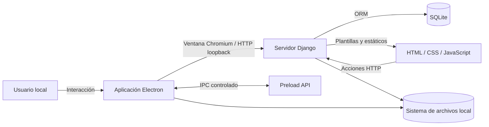

**Interpretación:** el usuario opera la ventana Electron. El renderer muestra la interfaz web servida por Django. Las operaciones del dominio se procesan en Django; SQLite conserva los datos estructurados y el sistema de archivos contiene los datos locales asociados. La API preload expone un conjunto limitado de operaciones de escritorio al renderer.

## 2.2 Funciones del producto

| ID | Función | Descripción | Estado |
|---|---|---|---|
| FP-01 | Panel principal | Resume progreso, etapas completadas y actividad reciente. | IMPLEMENTADO |
| FP-02 | Roadmap | Lista las etapas cargadas desde ASCENSO 3.1. | IMPLEMENTADO |
| FP-03 | Detalle académico | Presenta módulos, lecciones, objetivos, proyecto y prerrequisitos. | IMPLEMENTADO |
| FP-04 | Seguimiento | Permite marcar o reabrir etapas y lecciones. | IMPLEMENTADO |
| FP-05 | Cálculo de avance | Recalcula porcentajes y estados de progreso. | IMPLEMENTADO |
| FP-06 | Restricción por prerrequisitos | Impide completar una etapa bloqueada. | IMPLEMENTADO |
| FP-07 | Personalización visual | Permite elegir entre doce temas. | IMPLEMENTADO |
| FP-08 | Escritorio | Inicia Django y muestra la interfaz en Electron. | IMPLEMENTADO |
| FP-09 | Identidad y acceso | Alta inicial, login, rescate y cambio de contraseña. | IMPLEMENTADO / DESACTIVADO |
| FP-10 | Auditoría | Registra eventos de autenticación y progreso. | PARCIAL / IMPLEMENTADO |
| FP-11 | Biblioteca documental | Gestión avanzada, visor, indexación y anotaciones PDF. | PENDIENTE |
| FP-12 | Competencias y evaluaciones | Rúbricas, intentos, resultados y niveles. | PENDIENTE |
| FP-13 | Evidencias y laboratorios | Portafolio y registro de prácticas. | PENDIENTE |
| FP-14 | Administración | Backups, restauración y exportación desde la interfaz. | PENDIENTE |
| FP-15 | Vigencia y ética | Revisión de contenidos y advertencias contextuales. | PENDIENTE |

## 2.3 Características de los usuarios

### Usuario principal

- Persona que estudia programación, desarrollo de software y ciberseguridad.
- Utiliza un equipo personal y administra su entorno local.
- Necesita organizar contenidos, rutas de aprendizaje y progreso.
- Puede ejecutar comandos de instalación y diagnóstico.
- No requiere conocimientos avanzados de administración para las operaciones habituales de la interfaz.

### Perfil de administración

En la versión actual, el propietario local administra la instalación, configuración, datos y actualizaciones. No existe un panel multiusuario ni un sistema de roles confirmado.

## 2.4 Entorno operativo

| Componente | Tecnología / configuración |
|---|---|
| Sistema de escritorio | Electron |
| Renderer | Chromium integrado |
| Backend | Python + Django 5.2 |
| Servidor local empaquetado | Waitress + WhiteNoise |
| Persistencia | SQLite |
| Frontend | HTML, CSS y JavaScript |
| UI | Bootstrap, HTMX, SweetAlert2, Font Awesome |
| Empaquetado Python | PyInstaller |
| Empaquetado escritorio | electron-builder |
| Dirección local | `127.0.0.1` |
| Datos | Directorio local configurable mediante `CODEGUARD_DATA_DIR` |

El repositorio incluye configuraciones para desarrollo y escritorio. El directorio de datos se separa del directorio de instalación en el paquete de escritorio para permitir escritura en la carpeta de datos del usuario.

## 2.5 Restricciones de diseño e implementación

1. La aplicación está orientada a un único usuario local.
2. El servidor no debe exponerse a interfaces de red públicas ni a la LAN.
3. La interfaz debe poder operar sin CDN ni servicios externos obligatorios.
4. La persistencia principal debe seguir siendo local.
5. La arquitectura backend se mantiene como monolito modular Django.
6. La interfaz debe conservar los doce temas existentes.
7. La lógica de negocio debe permanecer en servicios/modelos y no duplicarse en las plantillas.
8. Las operaciones que modifican progreso deben utilizar métodos HTTP apropiados y protección CSRF.
9. No se deben documentar como terminados módulos que solo aparecen como accesos futuros en el dashboard.
10. La autenticación no debe reactivarse sin decisión explícita del propietario, porque actualmente está desactivada por configuración.

## 2.6 Suposiciones y dependencias

- El usuario dispone de permisos de lectura y escritura sobre el directorio de datos.
- SQLite está disponible mediante la biblioteca incluida en Python.
- Electron puede iniciar el proceso local Django.
- El sistema operativo permite ejecutar la aplicación y sus binarios empaquetados.
- Los contenidos de ASCENSO se cargan desde el JSON versionado en `apps/roadmaps/data/ascenso_3_1.json`.
- El comportamiento de producción empaquetada y el comportamiento de desarrollo pueden diferir en el arranque y en el servidor WSGI.

## 2.7 Evolución funcional

Los módulos pendientes deberán incorporarse como aplicaciones Django independientes por dominio. Cada incremento debe incluir: requisitos aprobados, modelos y migraciones, servicios, vistas y rutas, interfaz, pruebas, documentación técnica y actualización de trazabilidad.

---

# 3. Requisitos específicos

## 3.1 Convenciones de especificación

Cada requisito debe ser:

- Identificable mediante un ID único.
- Atómico y no ambiguo.
- Verificable mediante inspección, prueba o demostración.
- Trazable a un módulo y, cuando sea posible, a una prueba.
- Etiquetado con prioridad y estado.

**Prioridades:**  
**MUST:** imprescindible para la línea base funcional actual o para la aceptación del requisito.  
**SHOULD:** importante, pero no bloquea por sí solo el funcionamiento básico.  
**COULD:** mejora opcional.  
**FUTURE:** fuera de la línea base actual.

### 3.1.1 Requisitos funcionales implementados

#### A. Panel principal — módulo `apps.core`

| ID | Requisito | Prioridad | Estado | Evidencia principal |
|---|---|---|---|---|
| RF-001 | El sistema deberá mostrar un panel principal al acceder a la ruta raíz. | MUST | IMPLEMENTADO | `apps/core/views.py`, `templates/core/panel.html` |
| RF-002 | El panel deberá presentar un resumen del progreso del roadmap activo. | MUST | IMPLEMENTADO | `apps/core/views.py`, `apps/roadmaps/services.py` |
| RF-003 | El panel deberá mostrar el número de etapas completadas y el avance general. | MUST | IMPLEMENTADO | `apps/core/views.py` |
| RF-004 | El panel deberá identificar una próxima etapa o actividad cuando los datos permitan calcularla. | SHOULD | IMPLEMENTADO | `apps/core/views.py` |
| RF-005 | El panel deberá indicar qué módulos están disponibles y cuáles son accesos futuros. | SHOULD | IMPLEMENTADO | `apps/core/views.py`, plantilla del panel |

#### B. Roadmap académico — módulo `apps.roadmaps`

| ID | Requisito | Prioridad | Estado | Evidencia principal |
|---|---|---|---|---|
| RF-010 | El sistema deberá cargar el roadmap ASCENSO desde un archivo JSON versionado. | MUST | IMPLEMENTADO | `apps/roadmaps/data/ascenso_3_1.json`, `services.py` |
| RF-011 | El sistema deberá permitir consultar el listado de etapas del roadmap activo. | MUST | IMPLEMENTADO | `apps/roadmaps/views.py`, `templates/roadmaps/lista.html` |
| RF-012 | El listado deberá permitir filtrar etapas por bloque, prioridad y texto. | SHOULD | IMPLEMENTADO | `apps/roadmaps/views.py` |
| RF-013 | El usuario deberá poder consultar el detalle de una etapa. | MUST | IMPLEMENTADO | `apps/roadmaps/views.py`, `templates/roadmaps/detalle.html` |
| RF-014 | El detalle deberá presentar módulos, lecciones, proyecto, criterios y prerrequisitos asociados. | MUST | IMPLEMENTADO | `apps/roadmaps/models.py`, vistas y plantillas |
| RF-015 | El sistema deberá registrar el progreso por etapa y lección para el propietario local. | MUST | IMPLEMENTADO | Modelo `Progreso`, `services.py` |
| RF-016 | El sistema deberá permitir marcar y reabrir una etapa mediante una petición POST. | MUST | IMPLEMENTADO | `marcar_etapa_view`, `marcar_etapa` |
| RF-017 | El sistema deberá permitir marcar y reabrir una lección mediante una petición POST. | MUST | IMPLEMENTADO | `marcar_leccion_view`, `marcar_leccion` |
| RF-018 | El sistema deberá recalcular el porcentaje de una etapa después de modificar el estado de una lección. | MUST | IMPLEMENTADO | `recalcular_progreso_etapa` |
| RF-019 | El sistema deberá impedir completar una etapa si alguno de sus prerrequisitos no está completado. | MUST | IMPLEMENTADO | `Etapa.esta_bloqueada_para`, `marcar_etapa` |
| RF-020 | El sistema deberá impedir que una etapa sea prerrequisito de sí misma. | MUST | IMPLEMENTADO | Restricción y validación de `Prerrequisito` |
| RF-021 | El cargador de ASCENSO deberá poder ejecutarse de forma idempotente sin borrar el progreso por defecto. | SHOULD | IMPLEMENTADO | `cargar_ascenso` |
| RF-022 | El sistema deberá conservar la fuente y el hash SHA-256 de la fuente del roadmap cuando estén disponibles. | SHOULD | IMPLEMENTADO | Modelo `Roadmap` |

#### C. Identidad y acceso — módulo `apps.accounts`

> El código de autenticación existe, pero el ajuste `AUTH_DISABLED = True` desactiva el flujo en la configuración base actual. Los requisitos de este grupo no deben presentarse como una barrera de acceso activa en la experiencia actual.

| ID | Requisito | Prioridad | Estado | Evidencia principal |
|---|---|---|---|---|
| RF-030 | El sistema deberá conservar un modelo de usuario local personalizado. | MUST | IMPLEMENTADO | `apps/accounts/models.py` |
| RF-031 | El sistema deberá permitir crear el usuario inicial cuando la autenticación esté habilitada. | SHOULD | IMPLEMENTADO / DESACTIVADO | `apps/accounts/views.py`, `services.py` |
| RF-032 | El sistema deberá almacenar contraseñas mediante los hashers configurados, con Argon2 como opción principal. | MUST | IMPLEMENTADO | `config/settings/base.py` |
| RF-033 | El sistema deberá generar una frase de rescate y almacenarla como hash, mostrándola una sola vez. | SHOULD | IMPLEMENTADO / DESACTIVADO | `apps/accounts/services.py` |
| RF-034 | La frase de rescate deberá invalidarse solo después de completar satisfactoriamente el cambio de contraseña. | SHOULD | IMPLEMENTADO / DESACTIVADO | `cambiar_contrasena_por_frase` |
| RF-035 | El sistema deberá permitir iniciar y cerrar sesión cuando la autenticación esté habilitada. | SHOULD | IMPLEMENTADO / DESACTIVADO | `apps/accounts/views.py` |
| RF-036 | El sistema deberá bloquear una cuenta después de cinco intentos fallidos consecutivos durante quince minutos. | SHOULD | IMPLEMENTADO / DESACTIVADO | `LoginView`, modelo `Usuario` |
| RF-037 | El sistema deberá expirar sesiones autenticadas por inactividad según el tiempo configurado. | SHOULD | IMPLEMENTADO / DESACTIVADO | `SesionInactividadMiddleware` |

#### D. Auditoría — módulo `apps.audit`

| ID | Requisito | Prioridad | Estado | Evidencia principal |
|---|---|---|---|---|
| RF-040 | El sistema deberá almacenar eventos de auditoría con tipo, descripción y fecha. | MUST | IMPLEMENTADO | `apps/audit/models.py` |
| RF-041 | El registro de auditoría deberá permitir asociar un usuario cuando exista un actor autenticado. | SHOULD | IMPLEMENTADO | Modelo `AuditLog` |
| RF-042 | El sistema deberá registrar eventos relevantes del progreso del roadmap. | SHOULD | IMPLEMENTADO | `apps/roadmaps/services.py` |
| RF-043 | El sistema deberá registrar eventos de autenticación y recuperación cuando esos flujos estén habilitados. | SHOULD | IMPLEMENTADO / DESACTIVADO | `apps/accounts/services.py`, vistas |

### 3.1.2 Requisitos funcionales pendientes o planificados

Los siguientes requisitos mantienen el propósito funcional descrito en la versión anterior, pero no se consideran parte de las capacidades implementadas en la rama revisada.

| ID | Requisito futuro | Prioridad sugerida | Estado |
|---|---|---|---|
| RF-050 | Importar archivos PDF y extraer metadatos y texto. | SHOULD | PENDIENTE |
| RF-051 | Detectar PDFs corruptos, protegidos, escaneados y duplicados. | SHOULD | PENDIENTE |
| RF-052 | Indexar el contenido documental y permitir búsqueda de texto completo. | SHOULD | PENDIENTE |
| RF-053 | Asociar documentos y fragmentos a etapas, módulos y lecciones. | SHOULD | PENDIENTE |
| RF-054 | Crear y relacionar conceptos en una base de conocimiento. | COULD | PENDIENTE |
| RF-055 | Gestionar competencias, niveles y criterios de dominio. | SHOULD | PENDIENTE |
| RF-056 | Crear evaluaciones, preguntas, rúbricas e intentos. | SHOULD | PENDIENTE |
| RF-057 | Registrar resultados y retroalimentación de evaluaciones. | SHOULD | PENDIENTE |
| RF-058 | Gestionar evidencias y calcular SHA-256 de los archivos. | SHOULD | PENDIENTE |
| RF-059 | Asociar evidencias a actividades, competencias y laboratorios. | SHOULD | PENDIENTE |
| RF-060 | Gestionar guías de laboratorio, pasos, comandos y observaciones. | COULD | PENDIENTE |
| RF-061 | Crear y validar copias de seguridad desde la interfaz. | SHOULD | PENDIENTE |
| RF-062 | Restaurar copias de seguridad después de validar su contenido. | SHOULD | PENDIENTE |
| RF-063 | Gestionar vigencia, revisión y obsolescencia de contenidos. | COULD | PENDIENTE |
| RF-064 | Mostrar advertencias éticas y requerir aceptación contextual. | SHOULD | PENDIENTE |

### 3.2 Requisitos de interfaces externas

#### 3.2.1 Interfaz de usuario

- La aplicación deberá mostrar la interfaz en una ventana Electron.
- La interfaz web deberá renderizarse con Chromium integrado.
- Los estilos y scripts de la aplicación deberán servirse localmente.
- La interfaz deberá conservar los doce temas definidos en el frontend.
- Los controles de progreso deberán comunicar claramente su estado.
- Las acciones que modifican datos deberán mostrar confirmación o resultado comprensible.
- La navegación deberá conservar consistencia entre panel, roadmap y detalle de etapa.

#### 3.2.2 Interfaz de software

| Interfaz | Dirección / mecanismo | Propósito |
|---|---|---|
| Electron → Django | HTTP sobre loopback | Cargar la interfaz y enviar acciones del usuario. |
| Renderer → Preload | API expuesta mediante `contextBridge` | Acceder a funciones de escritorio permitidas. |
| Preload → Electron main | IPC | Solicitar acciones del proceso principal. |
| Django → SQLite | Django ORM | Consultar y persistir datos. |
| Django → sistema de archivos | API local de Python | Leer/escribir base de datos, medios y logs. |
| Electron → proceso servidor | `child_process.spawn` | Iniciar y detener Django. |

#### 3.2.3 Interfaz de hardware

No se identifica comunicación con hardware especializado. La aplicación depende de recursos convencionales del equipo: CPU, memoria, almacenamiento y pantalla.

#### 3.2.4 Interfaz de comunicación

- El servidor Django deberá escuchar únicamente en `127.0.0.1`.
- El puerto se selecciona dinámicamente en el arranque de Electron.
- Electron deberá esperar a que el servidor responda antes de cargar la interfaz principal.
- Las peticiones que cambian estado deberán respetar CSRF y los métodos HTTP adecuados.

### 3.3 Requisitos no funcionales

Los requisitos cuantitativos que aún no tengan medición se marcan como «por validar» y no como garantías.

| ID | Atributo | Requisito verificable | Estado |
|---|---|---|---|
| RNF-001 | Operación local | Las funciones implementadas del MVP deberán operar sin depender de un servicio remoto. | POR VALIDAR en prueba offline integral |
| RNF-002 | Red | El servidor local deberá enlazarse a `127.0.0.1`, no a `0.0.0.0`. | IMPLEMENTADO en configuración de arranque |
| RNF-003 | Persistencia | Los datos principales deberán permanecer en SQLite y en el directorio local de datos. | IMPLEMENTADO |
| RNF-004 | Modularidad | El backend deberá separar dominios en aplicaciones Django. | IMPLEMENTADO |
| RNF-005 | Consistencia | Las operaciones de escritura deberán utilizar el ORM y respetar integridad referencial. | IMPLEMENTADO; cobertura por validar |
| RNF-006 | Interfaz | La interfaz deberá ser utilizable en la ventana mínima configurada de Electron (1024 × 720). | POR VALIDAR visualmente |
| RNF-007 | Temas | El frontend deberá ofrecer doce temas visuales seleccionables. | IMPLEMENTADO |
| RNF-008 | Accesibilidad | Los estados y controles deberán ser navegables y comprensibles con teclado y tecnologías de asistencia. | POR VALIDAR |
| RNF-009 | Rendimiento | El panel y el listado del roadmap deberán responder sin bloqueos perceptibles con el conjunto de datos previsto. | POR MEDIR |
| RNF-010 | Búsqueda | Los filtros de etapa deberán devolver resultados correctos para bloque, prioridad y texto. | IMPLEMENTADO; pruebas de aceptación por validar |
| RNF-011 | Mantenibilidad | Las reglas de negocio del roadmap deberán centralizarse en `apps/roadmaps/services.py`. | IMPLEMENTADO |
| RNF-012 | Portabilidad | El paquete de escritorio deberá separar los datos del usuario de los archivos de instalación. | IMPLEMENTADO en configuración Electron |
| RNF-013 | Dependencias | Las dependencias Python deberán estar fijadas en `requirements.txt`. | IMPLEMENTADO |
| RNF-014 | Recursos | Las bibliotecas frontend deberán servirse localmente, sin CDN obligatorio. | IMPLEMENTADO |
| RNF-015 | Recuperación | La base de datos y los datos del usuario deberán poder respaldarse y restaurarse. | PENDIENTE de módulo integrado y validación |
| RNF-016 | Privacidad | La aplicación no deberá enviar datos del usuario a servicios externos sin consentimiento y especificación explícita. | POR VALIDAR mediante prueba de tráfico |
| RNF-017 | Movimiento | Las animaciones deberán respetar `prefers-reduced-motion`. | POR VALIDAR en todos los componentes |
| RNF-018 | Compatibilidad | El proceso de desarrollo deberá ejecutarse en entornos compatibles con las versiones fijadas de Python y Node. | POR VALIDAR por plataforma |
| RNF-019 | Diagnóstico | Los fallos del proceso Django deberán poder diagnosticarse mediante la salida del proceso y los logs locales. | IMPLEMENTADO parcialmente |
| RNF-020 | Empaquetado | La aplicación deberá generar instaladores/paquetes según los targets configurados en electron-builder. | CONFIGURADO; build por validar |

### 3.4 Requisitos de datos

#### 3.4.1 Datos persistidos actualmente

| ID | Entidad | Datos principales | Implementación |
|---|---|---|---|
| RD-001 | Usuario | Identidad, contraseña hash, email opcional, configuración inicial y bloqueo. | `apps.accounts.Usuario` |
| RD-002 | FraseRescate | Usuario propietario, hash Argon2, usada, fecha de uso y creación. | `apps.accounts.FraseRescate` |
| RD-003 | ConfiguracionSistema | Estado de configuración, último backup y versión de BD. | `apps.core.ConfiguracionSistema` |
| RD-004 | AuditLog | Actor opcional, evento, descripción, IP, user-agent y fecha. | `apps.audit.AuditLog` |
| RD-005 | Roadmap | Nombre, edición, fuente, hash, estado activo y fechas. | `apps.roadmaps.Roadmap` |
| RD-006 | Etapa | Número, título, bloque, prioridad, objetivo, proyecto y orden. | `apps.roadmaps.Etapa` |
| RD-007 | Modulo | Etapa, número, título, objetivo y orden. | `apps.roadmaps.Modulo` |
| RD-008 | Leccion | Módulo, título, descripción, tipo y orden. | `apps.roadmaps.Leccion` |
| RD-009 | Actividad | Lección, título, descripción, tipo y obligatoriedad. | `apps.roadmaps.Actividad` |
| RD-010 | Prerrequisito | Etapa dependiente, etapa requerida y justificación. | `apps.roadmaps.Prerrequisito` |
| RD-011 | CriterioFinalizacion | Etapa, título, descripción, tipo y obligatoriedad. | `apps.roadmaps.CriterioFinalizacion` |
| RD-012 | Progreso | Usuario, objetivo académico, estado, porcentaje y fechas. | `apps.roadmaps.Progreso` |

#### 3.4.2 Reglas de integridad identificadas

- Un roadmap no puede repetir la combinación nombre + edición.
- Una etapa no puede repetir su número dentro del mismo roadmap.
- Un módulo no puede repetir su número dentro de la misma etapa.
- Una lección no puede repetir su título dentro del mismo módulo.
- Una actividad no puede repetir su título dentro de la misma lección.
- Un prerrequisito no puede duplicar la misma relación etapa-etapa.
- Una etapa no puede ser prerrequisito de sí misma.
- El porcentaje de progreso debe permanecer entre 0 y 100.
- Un progreso completado se normaliza a 100%; uno no iniciado, a 0%.
- La configuración global utiliza un singleton lógico con clave primaria 1.

#### 3.4.3 Datos previstos

Los modelos de documentos, fragmentos, conceptos, evaluaciones, competencias, evidencias, laboratorios y backups se consideran entidades futuras hasta que exista implementación y migración verificables.

### 3.5 Requisitos de seguridad

| ID | Requisito | Estado actual |
|---|---|---|
| RS-001 | Restringir el servidor a loopback. | IMPLEMENTADO |
| RS-002 | Utilizar Argon2 como hasher principal de contraseñas. | IMPLEMENTADO |
| RS-003 | Mantener CSRF en formularios y operaciones de escritura. | IMPLEMENTADO en configuración |
| RS-004 | Aplicar cabeceras de seguridad y CSP. | IMPLEMENTADO |
| RS-005 | Deshabilitar la integración Node en el renderer y habilitar context isolation. | IMPLEMENTADO en BrowserWindow |
| RS-006 | Exponer al renderer solo una API explícita mediante preload. | IMPLEMENTADO |
| RS-007 | Bloquear navegación externa no autorizada dentro de la ventana. | IMPLEMENTADO |
| RS-008 | Mantener `DEBUG=False` por defecto y en el modo desktop. | IMPLEMENTADO |
| RS-009 | No almacenar secretos reales en el repositorio. | CONFIGURADO; auditoría de repositorio por validar |
| RS-010 | Mantener los datos escribibles fuera del directorio de instalación empaquetado. | IMPLEMENTADO |
| RS-011 | Expirar sesiones por inactividad cuando la autenticación esté activa. | IMPLEMENTADO / DESACTIVADO |
| RS-012 | Registrar eventos relevantes de autenticación y progreso. | IMPLEMENTADO |
| RS-013 | Validar tipo, tamaño, ubicación y contenido de archivos cargados. | PENDIENTE para módulo de evidencias/documentos |
| RS-014 | Validar archivos de backup antes de restaurarlos. | PENDIENTE |
| RS-015 | Cifrar copias de seguridad exportables. | PROPUESTO; requiere decisión |

**Advertencia operativa:** en la configuración base actual `AUTH_DISABLED = True`. Por tanto, la aplicación no solicita credenciales al abrirse. La existencia del código de autenticación no equivale a que la protección por login esté activa. Este comportamiento debe figurar en cualquier evaluación de seguridad del producto.

---

# 4. Casos de uso

## 4.1 Actores

| Actor | Descripción |
|---|---|
| Usuario local | Persona que utiliza CodeGuard Pro y registra su progreso. |
| Sistema operativo | Proporciona procesos, almacenamiento, ventanas y rutas de datos. |
| Proceso Electron | Coordina ventana, proceso servidor, menú y API de escritorio. |
| Servidor Django | Ejecuta la lógica de aplicación y atiende solicitudes HTTP locales. |

## 4.2 Diagrama general de casos de uso

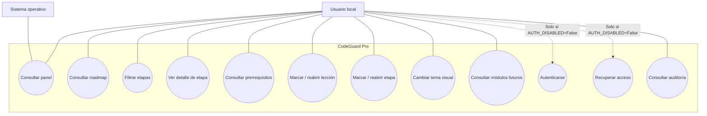

Los casos UC10 y UC11 están implementados en el código, pero no forman parte del flujo activo mientras `AUTH_DISABLED=True`.

## 4.3 Especificación resumida de casos de uso

### UC-01 — Consultar panel principal

| Campo | Descripción |
|---|---|
| Actor principal | Usuario local |
| Precondición | Aplicación iniciada y servidor local disponible. |
| Disparador | El usuario abre la aplicación o navega a la ruta raíz. |
| Flujo principal | 1. Electron muestra la ventana. 2. Django atiende GET /. 3. La vista obtiene roadmap, progreso y actividad reciente. 4. Django renderiza la plantilla del panel. 5. El usuario visualiza el resumen. |
| Alternativas | Si no hay roadmap cargado, el panel debe comunicar el estado sin provocar un error no controlado. |
| Postcondición | No se modifica el progreso. |
| Requisitos | RF-001 a RF-005. |

### UC-02 — Consultar y filtrar roadmap

| Campo | Descripción |
|---|---|
| Actor principal | Usuario local |
| Precondición | Existe un roadmap activo. |
| Disparador | El usuario abre la sección Roadmap. |
| Flujo principal | 1. Django obtiene el roadmap activo. 2. Recupera etapas y relaciones necesarias. 3. Aplica filtros de bloque, prioridad y búsqueda. 4. Calcula estados de progreso y bloqueo. 5. Renderiza el listado. |
| Alternativas | Si no existe roadmap activo, se presenta la vista sin datos. |
| Postcondición | Se presenta el listado filtrado; no se altera la base de datos. |
| Requisitos | RF-010 a RF-012, RF-019. |

### UC-03 — Registrar finalización de lección

| Campo | Descripción |
|---|---|
| Actor principal | Usuario local |
| Precondición | Existe una lección y un propietario local disponible. |
| Disparador | El usuario marca o reabre una lección. |
| Flujo principal | 1. La interfaz envía POST. 2. Django valida la petición. 3. La vista resuelve al usuario local. 4. El servicio crea o actualiza el progreso. 5. Recalcula el porcentaje de la etapa. 6. Registra el evento de auditoría. 7. Redirige al detalle de la etapa. |
| Alternativas | Si no existe propietario local, la escritura se bloquea y se muestra un mensaje. |
| Postcondición | El progreso de la lección y el agregado de la etapa quedan actualizados. |
| Requisitos | RF-015, RF-017, RF-018, RF-040 a RF-042. |

### UC-04 — Completar etapa

| Campo | Descripción |
|---|---|
| Actor principal | Usuario local |
| Precondición | Existe etapa, usuario local y sus prerrequisitos están completos. |
| Disparador | El usuario solicita marcar la etapa como completada. |
| Flujo principal | 1. La interfaz envía POST. 2. La vista resuelve el usuario y la etapa. 3. El servicio obtiene etapas completadas. 4. Evalúa prerrequisitos. 5. Si se cumplen, actualiza el progreso a completado. 6. Registra auditoría. |
| Alternativa | Si existe un prerrequisito pendiente, la operación se rechaza y se informa el motivo. |
| Postcondición | La etapa queda completada o conserva su estado anterior. |
| Requisitos | RF-016, RF-019, RF-040 a RF-042. |

### UC-05 — Cambiar tema visual

| Campo | Descripción |
|---|---|
| Actor principal | Usuario local |
| Precondición | Interfaz cargada. |
| Disparador | El usuario elige uno de los temas disponibles. |
| Flujo principal | 1. El usuario selecciona el tema. 2. La interfaz aplica el identificador del tema. 3. Las variables y estilos correspondientes actualizan la presentación. |
| Postcondición | La interfaz utiliza el tema seleccionado. |
| Requisitos | RNF-007. |

### UC-06 — Autenticación local (flujo conservado, desactivado)

| Campo | Descripción |
|---|---|
| Actor principal | Usuario local |
| Precondición | `AUTH_DISABLED=False`. |
| Disparador | El usuario envía credenciales válidas. |
| Flujo principal | 1. Django valida el formulario. 2. El backend autentica la contraseña. 3. Reinicia contadores de fallos. 4. Crea la sesión. 5. Registra auditoría. 6. Redirige al panel. |
| Alternativas | Credenciales incorrectas; cuenta bloqueada; sesión expirada. |
| Postcondición | Sesión autenticada o rechazo de acceso. |
| Requisitos | RF-030 a RF-037, RS-002, RS-011, RS-012. |
| Estado | Implementado en código, desactivado en configuración. |

---

# 5. Arquitectura y diseño del sistema

## 5.1 Estilo arquitectónico

El sistema sigue un **monolito modular con cliente de escritorio**:

- Electron gestiona el ciclo de vida de la aplicación y la ventana.
- Django organiza el backend por aplicaciones de dominio.
- Las vistas reciben solicitudes HTTP y coordinan servicios.
- Los servicios encapsulan operaciones de negocio reutilizables.
- Los modelos Django representan datos y restricciones.
- SQLite actúa como almacenamiento persistente local.
- Las plantillas Django generan HTML; CSS y JavaScript implementan presentación e interacción.

No existe evidencia de una API REST pública ni de microservicios como arquitectura principal.

## 5.2 Componentes backend identificados

| Componente | Responsabilidad | Estado |
|---|---|---|
| `apps.core` | Panel principal y configuración global. | IMPLEMENTADO |
| `apps.accounts` | Usuario, autenticación y recuperación local. | IMPLEMENTADO / DESACTIVADO |
| `apps.audit` | Registro de eventos. | IMPLEMENTADO |
| `apps.roadmaps` | Roadmap, etapas, módulos, lecciones, prerrequisitos y progreso. | IMPLEMENTADO |
| `config.settings` | Configuración base, desarrollo y desktop. | IMPLEMENTADO |
| `config.middleware` | Acceso local, cabeceras y expiración de sesión. | IMPLEMENTADO |
| Biblioteca documental | Importación y consulta avanzada de PDFs. | PENDIENTE |
| Evaluaciones / competencias | Instrumentos y dominio de competencias. | PENDIENTE |
| Evidencias / laboratorios | Portafolio y prácticas. | PENDIENTE |
| Backups | Gestión de copias desde el producto. | PENDIENTE |

## 5.3 Diagrama de componentes

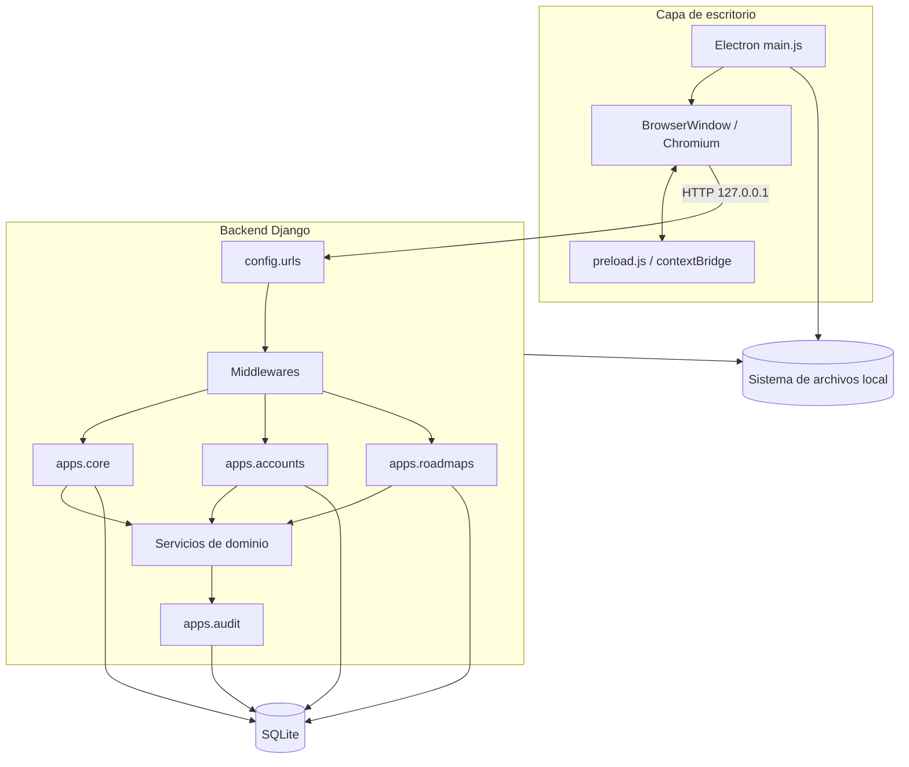

## 5.4 Diagrama de despliegue

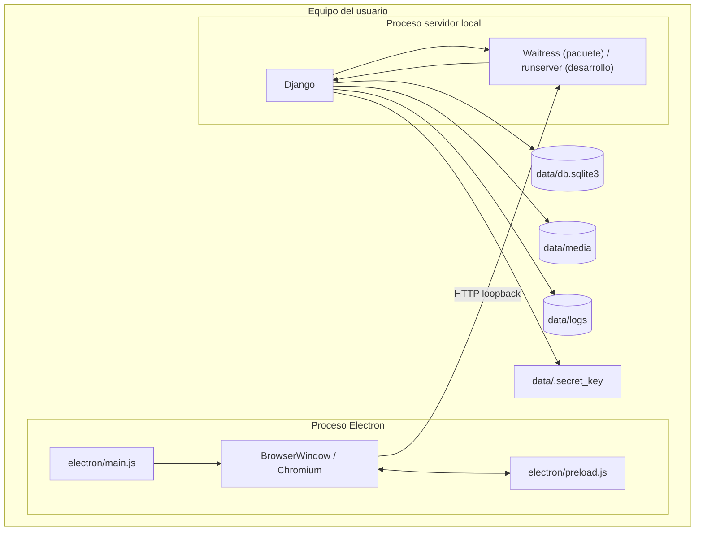

### 5.4.1 Modo de desarrollo

1. Electron busca el intérprete Python configurado o disponible.
2. Inicia `manage.py runserver` sobre `127.0.0.1` y un puerto libre.
3. Espera a que el servidor responda.
4. Carga la URL local en BrowserWindow.

### 5.4.2 Modo empaquetado

1. Electron localiza el ejecutable del servidor empaquetado.
2. Define `DJANGO_SETTINGS_MODULE=config.settings.desktop`.
3. Proporciona `CODEGUARD_PORT` y `CODEGUARD_DATA_DIR`.
4. Inicia el servidor local.
5. Espera la respuesta HTTP.
6. Carga la interfaz en la ventana nativa.

El código de `desktop/` contiene una implementación histórica basada en PySide6; el flujo principal actual se encuentra en `electron/`. No debe confundirse el código histórico con el punto de entrada vigente.

## 5.5 Diagrama de secuencia — arranque de aplicación

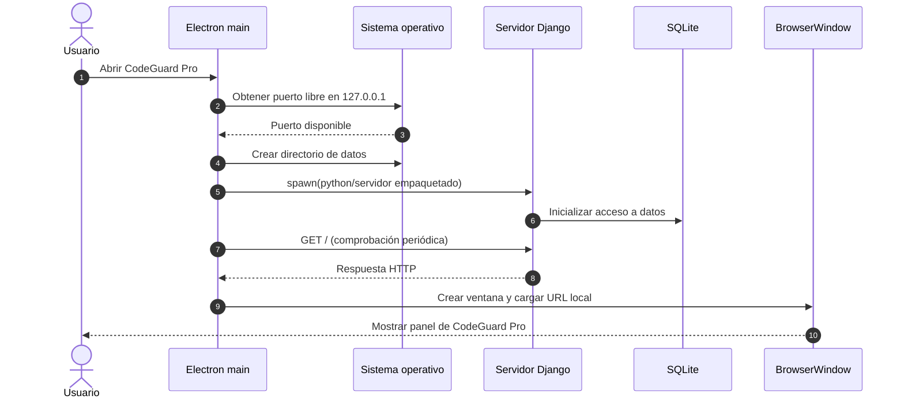

## 5.6 Diagrama de secuencia — consultar roadmap

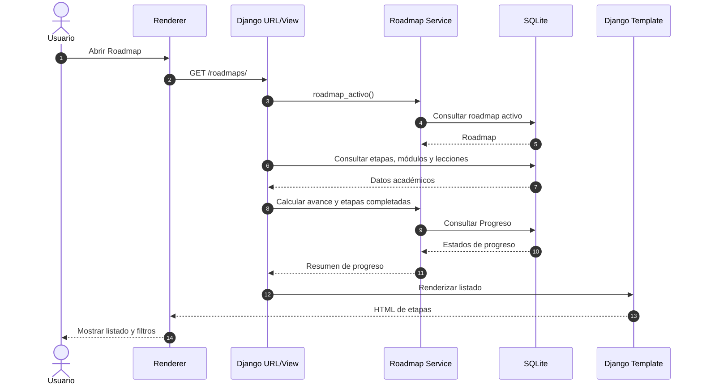

## 5.7 Diagrama de secuencia — marcar una lección

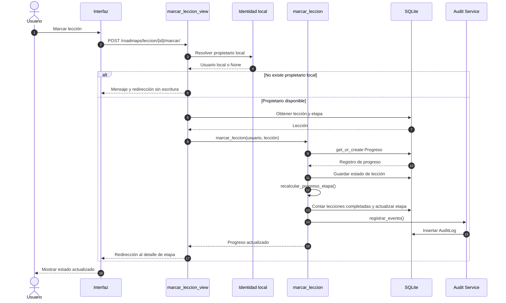

## 5.8 Diagrama de secuencia — completar una etapa y validar prerrequisitos

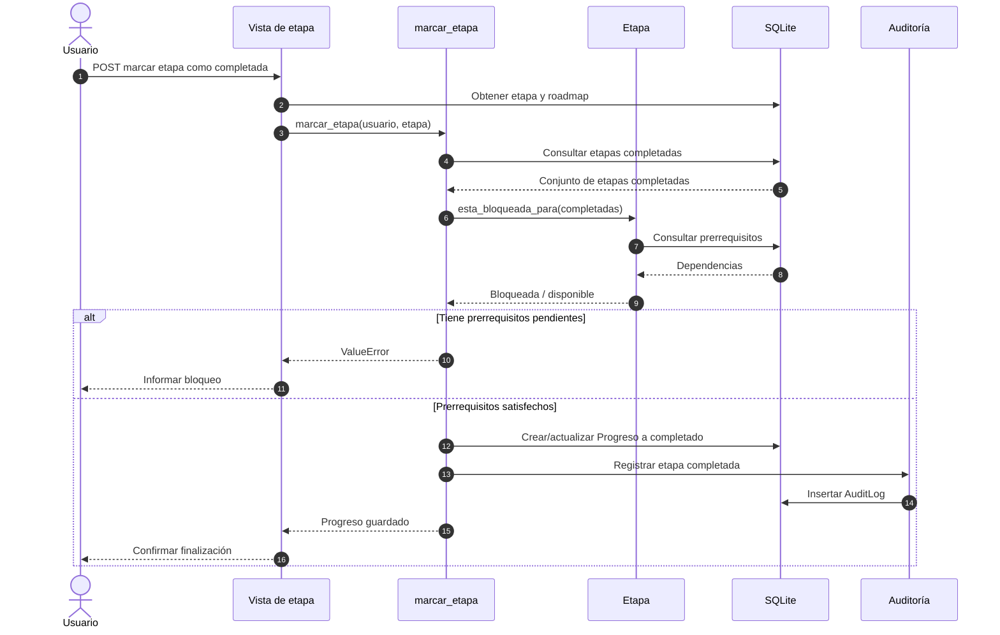

## 5.9 Diagrama de secuencia — autenticación local (condicional)

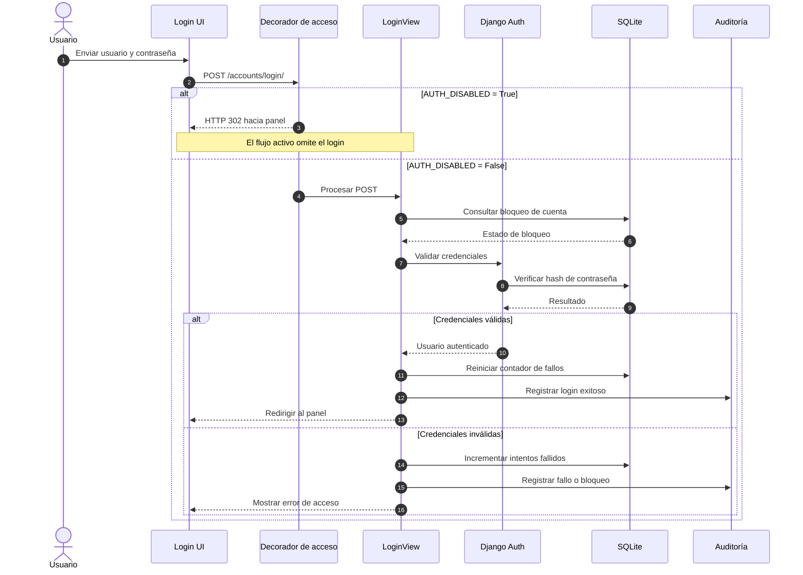

## 5.10 Diagrama de clases — modelo implementado

El siguiente diagrama representa las entidades Django encontradas en los módulos actuales. Se omiten campos secundarios para mantener legibilidad; el detalle completo se encuentra en los modelos fuente.

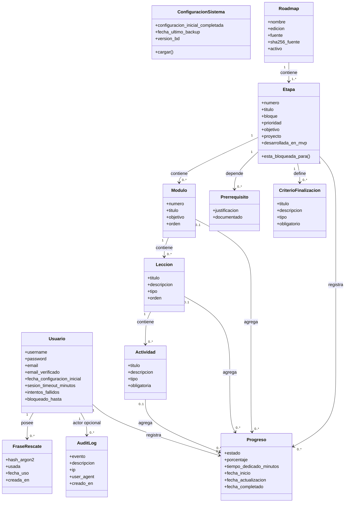

**Nota:** `Prerrequisito` contiene dos referencias a `Etapa`: etapa dependiente y etapa requerida. `Progreso` se vincula a un objetivo académico y admite referencias opcionales a módulo, lección y actividad. La base de datos aplica una restricción única compuesta sobre usuario, etapa y objetivo.

## 5.11 Organización del repositorio

| Ruta | Responsabilidad |
|---|---|
| `apps/accounts/` | Identidad local, formularios, vistas y servicios de autenticación. |
| `apps/audit/` | Modelo y servicio de auditoría. |
| `apps/core/` | Panel principal y configuración del sistema. |
| `apps/roadmaps/` | Modelos, vistas, servicios, datos ASCENSO y comando de carga. |
| `config/settings/` | Configuración base, desarrollo y escritorio. |
| `config/middleware.py` | Acceso local, cabeceras de seguridad y timeout de sesión. |
| `electron/` | Proceso principal y preload. |
| `templates/` | Plantillas HTML de Django. |
| `static/` | CSS, JavaScript, fuentes e iconos locales. |
| `desktop/` | Código histórico de integración desktop anterior. |
| `docs/` | Documentación técnica, pruebas y operación. |

---

# 6. Modelo de datos

## 6.1 Entidades principales

### Identidad

- **Usuario:** identidad local que extiende `AbstractUser`.
- **FraseRescate:** hash de una frase de recuperación asociada a un usuario.

### Configuración y auditoría

- **ConfiguracionSistema:** registro singleton de configuración global.
- **AuditLog:** eventos relevantes con actor opcional.

### Dominio académico

- **Roadmap:** ruta formativa versionada.
- **Etapa:** unidad de nivel superior del roadmap.
- **Modulo:** agrupación temática dentro de una etapa.
- **Leccion:** unidad de aprendizaje de un módulo.
- **Actividad:** tarea asociada a una lección.
- **Prerrequisito:** dependencia entre dos etapas.
- **CriterioFinalizacion:** condición documentada para una etapa.
- **Progreso:** estado de avance del usuario sobre una unidad académica.

## 6.2 Reglas de negocio del progreso

1. Cada registro de progreso pertenece a un usuario y una etapa.
2. El registro puede referirse a módulo, lección o actividad.
3. El estado puede ser no iniciado, en progreso, completado o bloqueado.
4. El porcentaje está limitado entre 0 y 100.
5. Al marcar como completado, el porcentaje se establece en 100.
6. Al reabrir o volver a no iniciado, el porcentaje se establece en 0.
7. Al modificar una lección, el servicio recalcula el progreso agregado de su etapa.
8. La finalización explícita de una etapa debe comprobar sus prerrequisitos.
9. Las acciones de progreso registran un evento de auditoría.

## 6.3 Diagrama entidad-relación simplificado

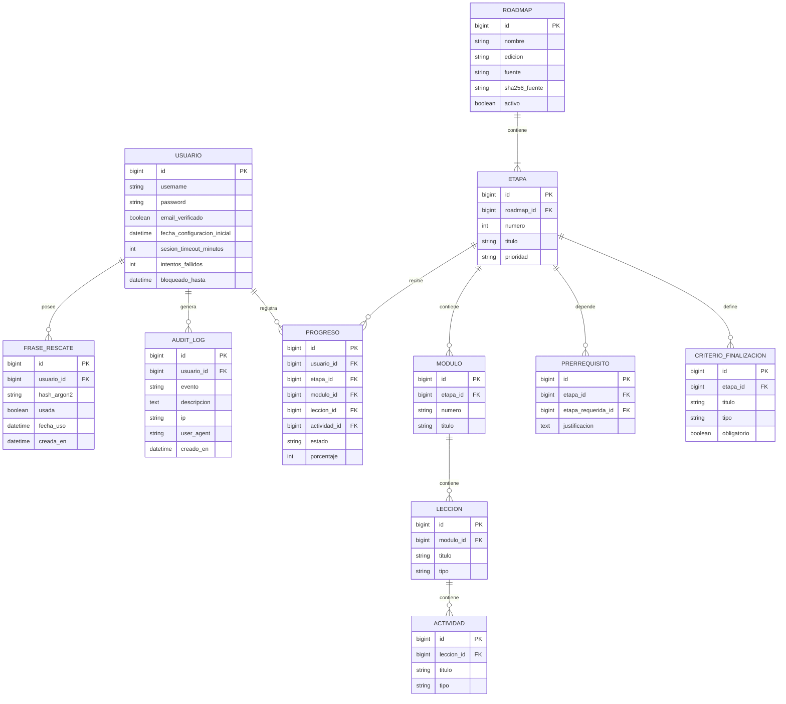

---

# 7. Requisitos de calidad y criterios de aceptación

## 7.1 Criterios generales

Un requisito no se considera aceptado únicamente porque exista una función o una vista. Su aceptación debe comprobar el comportamiento observable, los casos alternativos y la persistencia esperada.

### 7.1.1 Criterios del roadmap

- El listado muestra las etapas presentes en el roadmap activo.
- Los filtros combinados no deben producir resultados incorrectos.
- El detalle de una etapa presenta los módulos y lecciones asociados.
- Una etapa con prerrequisitos incompletos no puede marcarse como completada.
- Una lección marcada como completada debe persistir después de recargar la página.
- El porcentaje de etapa debe recalcularse al completar o reabrir una lección.
- Las acciones de escritura deben rechazar métodos HTTP no permitidos.
- Los eventos de progreso deben registrarse en auditoría.

### 7.1.2 Criterios del escritorio

- Electron debe seleccionar un puerto libre en loopback.
- Electron debe iniciar el proceso Django y capturar su salida.
- La ventana principal no debe cargar la aplicación antes de que el servidor responda.
- La navegación fuera del origen local permitido debe bloquearse.
- Al cerrar la aplicación, el proceso servidor debe detenerse.
- Los datos persistentes deben guardarse en el directorio de datos configurado.

### 7.1.3 Criterios visuales

- Los doce temas deben ser seleccionables y presentar una interfaz legible.
- Los componentes comunes deben utilizar tokens semánticos del tema activo.
- Los estados de foco, hover, deshabilitado y error deben distinguirse.
- La interfaz debe probarse en la resolución mínima de ventana y en tamaños superiores.
- Debe verificarse contraste, navegación por teclado y reducción de movimiento.

## 7.2 Estrategia de pruebas

| Nivel | Alcance | Evidencia esperada |
|---|---|---|
| Unitarias | Servicios de progreso, bloqueo, carga idempotente, identidad y auditoría. | Pruebas Django. |
| Integración | Vistas + ORM + SQLite + servicios. | Django Test Client. |
| Seguridad | CSRF, cabeceras, acceso local, navegación Electron y configuración auth. | Pruebas automatizadas y revisión. |
| Interfaz | Panel, filtros, detalle, progreso y temas. | Pruebas manuales o automatizadas de navegador. |
| Escritorio | Arranque, espera del servidor, cierre y persistencia. | Prueba de empaquetado y ejecución. |
| Regresión | Flujos existentes después de cambios. | Suite completa ejecutada. |

### 7.2.1 Comandos de comprobación documentados

```bash
python manage.py check
python manage.py makemigrations --check --dry-run
python manage.py test apps.core apps.accounts apps.audit apps.roadmaps
```

Estos comandos son el procedimiento documentado en el repositorio. Esta revisión documental no ejecutó los comandos ni certifica su resultado en el equipo del usuario.

## 7.3 Métricas pendientes de establecer

| Métrica | Método | Estado |
|---|---|---|
| Tiempo de arranque en frío | Medir desde apertura de Electron hasta panel visible. | POR MEDIR |
| Consumo RAM en reposo | RSS de Electron y Django tras estabilización. | POR MEDIR |
| Tiempo de carga del roadmap | Medir GET /roadmaps/ con el dataset de referencia. | POR MEDIR |
| Tiempo de respuesta al marcar progreso | Medir petición POST completa. | POR MEDIR |
| Compatibilidad de empaquetado | Build y ejecución en cada SO objetivo. | POR VALIDAR |
| Contraste de los doce temas | Medición WCAG para pares texto/fondo y controles. | POR VALIDAR |

---

# 8. Matriz de trazabilidad

La matriz enlaza requisitos, componente y verificación. Los identificadores de prueba son propuestos para mantener trazabilidad; no implican que todas las pruebas estén implementadas o ejecutadas.

| Requisito | Componente | Caso de uso | Prueba propuesta | Estado |
|---|---|---|---|---|
| RF-001 a RF-005 | `apps.core` | UC-01 | T-CORE-01 a T-CORE-05 | IMPLEMENTADO |
| RF-010 a RF-014 | `apps.roadmaps` | UC-02 | T-ROAD-01 a T-ROAD-05 | IMPLEMENTADO |
| RF-015, RF-017, RF-018 | `apps.roadmaps.services` | UC-03 | T-PROG-01 a T-PROG-04 | IMPLEMENTADO |
| RF-016, RF-019 | `apps.roadmaps.services` | UC-04 | T-PROG-05 a T-PROG-07 | IMPLEMENTADO |
| RF-020 | `Prerrequisito.clean / constraint` | UC-04 | T-ROAD-06 | IMPLEMENTADO |
| RF-021, RF-022 | `cargar_ascenso`, `Roadmap` | UC-02 | T-ROAD-07 a T-ROAD-09 | IMPLEMENTADO |
| RF-030 a RF-037 | `apps.accounts` | UC-06 | T-AUTH-01 a T-AUTH-12 | IMPLEMENTADO / DESACTIVADO |
| RF-040 a RF-043 | `apps.audit` | UC-03, UC-04, UC-06 | T-AUD-01 a T-AUD-05 | IMPLEMENTADO |
| RNF-002 | Electron / Django | UC-01 | T-SEC-01 | IMPLEMENTADO; prueba de red por ejecutar |
| RNF-007 | Frontend | UC-05 | T-UI-01 | IMPLEMENTADO |
| RS-001 a RS-010 | Configuración y Electron | UC-01 | T-SEC-01 a T-SEC-10 | IMPLEMENTADO / POR VALIDAR |
| RF-050 a RF-064 | Módulos futuros | — | T-FUT-01 en adelante | PENDIENTE |

## 8.1 Evidencia de implementación por archivo

| Área | Archivos de referencia |
|---|---|
| Configuración Django | `config/settings/base.py`, `development.py`, `desktop.py` |
| Rutas | `config/urls.py`, `apps/core/urls.py`, `apps/roadmaps/urls.py`, `apps/accounts/urls.py` |
| Identidad | `apps/accounts/models.py`, `views.py`, `services.py`, `identity.py` |
| Auditoría | `apps/audit/models.py`, `apps/audit/services.py` |
| Dashboard | `apps/core/models.py`, `apps/core/views.py` |
| Roadmap | `apps/roadmaps/models.py`, `views.py`, `services.py` |
| Escritorio | `electron/main.js`, `electron/preload.js` |
| Empaquetado | `package.json`, `build_windows.bat`, `server_entry.py` |
| UI | `templates/`, `static/css/`, `static/js/` |

---

# 9. Restricciones, riesgos y decisiones pendientes

## 9.1 Riesgos identificados

| ID | Riesgo | Impacto | Tratamiento recomendado |
|---|---|---|---|
| R-01 | La autenticación está desactivada en la configuración actual. | Alto si el equipo o los datos son accesibles a terceros. | Mantenerlo explícito en la documentación; decidir cuándo reactivarla y probar el flujo. |
| R-02 | La documentación histórica declara como implementadas capacidades que ahora están pendientes. | Alto para planificación y evaluación. | Usar esta SRS como línea base y mantener estados con evidencia. |
| R-03 | La aplicación depende de un proceso servidor local iniciado por Electron. | Medio/alto ante fallos de arranque o cierre. | Probar timeouts, cierre y recuperación del proceso. |
| R-04 | El paquete de escritorio puede diferir del entorno de desarrollo. | Alto para distribución. | Ejecutar builds y pruebas en cada sistema operativo objetivo. |
| R-05 | La matriz de pruebas documentada no demuestra por sí sola que la suite se haya ejecutado recientemente. | Medio. | Registrar fecha, entorno, comando y resultado de cada ejecución. |
| R-06 | Los módulos documentales y de evidencias no están implementados. | Medio para el alcance futuro. | Planificar incrementos con modelos, seguridad y pruebas. |
| R-07 | La persistencia local no equivale a una estrategia de backup probada. | Alto ante pérdida del equipo. | Definir backup, restauración y validación antes de depender de datos críticos. |

## 9.2 Decisiones pendientes

| ID | Decisión | Situación | Responsable |
|---|---|---|---|
| DP-01 | ¿Cuándo se reactivará la autenticación? | `AUTH_DISABLED=True`; cambio requiere autorización explícita. | Propietario |
| DP-02 | ¿Qué sistemas operativos se consideran oficialmente soportados? | Package configura targets Windows y Linux; validar ejecución real. | Propietario / desarrollo |
| DP-03 | ¿Se implementará backup cifrado? | Propuesto, no aprobado. | Propietario |
| DP-04 | ¿Qué módulos académicos se priorizan después del roadmap? | Requiere roadmap de producto. | Propietario |
| DP-05 | ¿Se mantendrá la biblioteca PDF dentro del alcance del siguiente incremento? | Planificada; implementación pendiente. | Propietario |
| DP-06 | ¿Cuál será el procedimiento oficial de actualización y migración de datos? | Requiere formalización y pruebas. | Desarrollo |

## 9.3 Cambios controlados

Todo cambio que afecte requisitos deberá:

1. Identificar el requisito y la motivación.
2. Evaluar impacto sobre arquitectura, modelos, seguridad y datos existentes.
3. Actualizar el código y las pruebas.
4. Actualizar esta SRS y la matriz de trazabilidad.
5. Registrar decisiones relevantes en `docs/DECISIONES_PENDIENTES.md` o un ADR.
6. Documentar el resultado de validación.

---

# 10. Glosario de módulos y responsabilidades futuras

| Módulo propuesto | Responsabilidad prevista | Dependencias principales |
|---|---|---|
| Competencias | Definir competencias, niveles y criterios de dominio. | Roadmaps, evaluaciones y evidencias. |
| Biblioteca | Importar, catalogar, consultar y asociar documentos. | Sistema de archivos, Roadmaps. |
| Conocimiento | Relacionar conceptos con documentos y actividades. | Biblioteca, Roadmaps. |
| Evaluaciones | Preguntas, rúbricas, intentos y resultados. | Roadmaps, Competencias. |
| Evidencias | Archivos y pruebas de trabajo realizado. | Actividades, Competencias, Laboratorios. |
| Laboratorios | Guías, pasos, comandos y resultados. | Roadmaps, Evidencias. |
| Backups | Crear, validar y restaurar copias. | SQLite y archivos locales. |
| Vigencia | Revisar contenidos y registrar decisiones. | Biblioteca y Conocimiento. |
| Ética | Advertencias y aceptación contextual. | Laboratorios y contenidos sensibles. |

Estos módulos son una propuesta de organización por dominio, no una afirmación de que existan ya como aplicaciones Django funcionales.

---

# 11. Anexos

## 11.1 Convención de nombres

- Requisitos funcionales: `RF-NNN`.
- Requisitos no funcionales: `RNF-NNN`.
- Requisitos de datos: `RD-NNN`.
- Requisitos de seguridad: `RS-NNN`.
- Casos de uso: `UC-NN`.
- Pruebas: `T-AREA-NN`.
- Riesgos: `R-NN`.
- Decisiones pendientes: `DP-NN`.

Los identificadores no deben reutilizarse ni cambiar de significado entre versiones.

## 11.2 Reglas para mantener los diagramas

- Los diagramas de clases deben reflejar modelos reales y relaciones declaradas.
- Los diagramas de secuencia deben corresponder a funciones, vistas y servicios existentes.
- Las capacidades futuras deben mostrarse en diagramas separados o etiquetarse como propuestas.
- Si una ruta, clase o servicio cambia de nombre, se actualiza el diagrama en el mismo cambio.
- Los diagramas Mermaid deben mantenerse renderizables en GitHub.

## 11.3 Lista de verificación para una futura versión

- [ ] Revisar todos los requisitos con el propietario del producto.
- [ ] Confirmar el alcance oficial del MVP.
- [ ] Ejecutar la suite de pruebas y registrar resultados.
- [ ] Validar el flujo Electron + Django empaquetado.
- [ ] Verificar el comportamiento de la aplicación sin Internet.
- [ ] Medir rendimiento y consumo de memoria.
- [ ] Revisar seguridad de archivos y directorios de datos.
- [ ] Confirmar el estado de los doce temas visuales.
- [ ] Completar diagramas de secuencia para nuevos módulos.
- [ ] Actualizar el diagrama de clases después de cada migración relevante.
- [ ] Sincronizar la matriz de trazabilidad con pruebas reales.
- [ ] Registrar decisiones aprobadas y ADR asociados.

---

**Fin del documento — CodeGuard Pro SRS v3.0**

> Esta especificación es una línea base documental derivada de la inspección estática del repositorio. Antes de utilizarla como documento contractual o como evidencia de conformidad, deben validarse los requisitos con el propietario y ejecutar las pruebas indicadas en el entorno objetivo.
