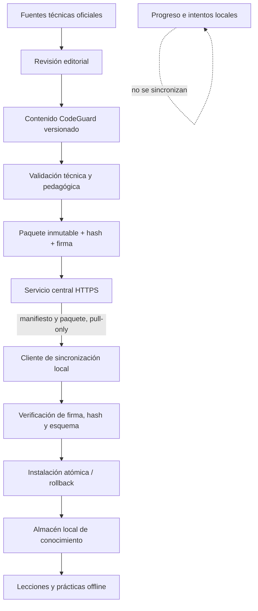

# CodeGuard Pro — Documentación de arquitectura

**Producto:** CodeGuard Pro  
**Versión:** 1.0 (MVP, primer incremento)  
**Estado:** Implementado y verificado (incremento 1)  
**SRS de referencia:** `IEEE830(1).md` v2.0

---

## 1. Visión general

CodeGuard Pro es un **monolito modular** basado en Django (patrón MVT), ejecutado localmente
en `127.0.0.1`, con núcleo local y funcionamiento offline-first. La conexión a Internet es opcional y se reservará para consultar y descargar paquetes de conocimiento académico aprobados. Está diseñado para un único usuario en un equipo con
recursos limitados (HP 240 G10, i3-N305, ~1.3 GB RAM libre, Fedora 44).

La arquitectura prioriza: bajo consumo de memoria/CPU, pocas dependencias, arranque rápido,
fácil mantenimiento y continuidad offline. El funcionamiento académico local no dependerá del servicio central; la sincronización de contenido será una capacidad complementaria, iniciada por el cliente y de solo descarga.

**Estado actual:** el núcleo local está implementado. La sincronización híbrida descrita en la sección 10 es una decisión aprobada y una arquitectura objetivo de la Fase 2; no está implementada en `main`.

---

## 2. Estructura de carpetas

```text
codeguard-pro/
├── manage.py
├── requirements.txt          # dependencias fijadas (versiones exactas)
├── .env.example              # variables de entorno (sin secretos reales)
├── .gitignore
├── README.md
│
├── config/                   # configuración del proyecto Django
│   ├── settings/
│   │   ├── __init__.py
│   │   ├── base.py           # settings base
│   │   └── development.py    # settings de desarrollo local
│   ├── urls.py
│   ├── wsgi.py
│   ├── asgi.py
│   └── middleware.py         # middlewares de seguridad y sesión
│
├── apps/                     # aplicaciones Django (monolito modular)
│   ├── __init__.py
│   ├── core/                 # panel principal, navegación, configuración sistema
│   ├── accounts/             # identidad y acceso (login, setup, frase rescate, contraseña)
│   └── audit/                # registro de eventos de seguridad y acceso
│   [apps académicos pendientes: roadmaps, competencies, library, ...]
│
├── templates/                # plantillas base y por app (Django MVT)
├── static/                   # recursos estáticos locales (sin CDN)
│   ├── css/                  # Bootstrap 5.3.3 + estilos propios
│   └── js/                   # HTMX 2.0.4 + Bootstrap bundle
│
├── media/                    # archivos subidos (fuera del web root)
├── data/                     # datos adicionales
├── logs/                     # registros de ejecución
├── scripts/                  # scripts de utilidad
├── tests/                    # pruebas automatizadas
└── docs/                     # documentación del proyecto
```

Cada aplicación Django tiene responsabilidades delimitadas y evita acoplamiento entre módulos.

---

## 3. Componentes principales

| Componente | Responsabilidad | Estado |
|---|---|---|
| `apps.core` | Panel principal, navegación, configuración global (singleton) | Implementado (inc. 1) |
| `apps.accounts` | Identidad y acceso: login, logout, setup inicial, frase de rescate, cambio de contraseña | Implementado (inc. 1) |
| `apps.audit` | Registro de eventos de seguridad y acceso (auditoría) | Implementado (inc. 1) |
| `config.middleware` | Sesión por inactividad, cabeceras de seguridad, redirección setup inicial | Implementado (inc. 1) |
| `config.settings` | Configuración Django (base + desarrollo) | Implementado (inc. 1) |

Las aplicaciones académicas (`roadmaps`, `competencies`, `library`, `knowledge`, `assessments`,
`evidence`, `labs`, `progress`, `backups`, `vigencia`, `ethics`) se irán añadiendo en los
incrementos siguientes sin modificar el núcleo ya implementado.

---

## 4. Flujo de autenticación

1. **Primera vez:** no existe usuario → redirección a `/accounts/setup/` (configuración inicial:
   usuario, contraseña maestra ≥8 caracteres, aceptación de términos).
2. La frase de rescate se genera (alta entropía ≥128 bits), se muestra **una sola vez** y se
   almacena como hash Argon2. Nunca en texto plano. Es de un solo uso: **no se consume al
   validar**, solo al completar exitosamente el cambio de contraseña (flujo atómico en
   `cambiar_contrasena_por_frase`). Si el cambio falla, la frase no se consume.
3. Tras el setup, se accede a `/accounts/login/` con usuario y contraseña maestra (Argon2).
4. La sesión es server-side con timeout de inactividad (defecto 15 min, configurable).
5. El cierre de sesión exige **POST** (protegido por CSRF). GET devuelve 405.
6. Al cerrar sesión o expirar por inactividad, se registra evento de auditoría.
7. **Recuperación:** `/accounts/rescate/` valida la frase y redirige a
   `/accounts/rescate/resetear/` para establecer una nueva contraseña (con confirmación,
   validadores de Django y regla de no-reutilización de la actual).
8. Todas las vistas protegidas requieren autenticación (`@login_required`) cuando
   `AUTH_DISABLED = False`. Cuando `AUTH_DISABLED = True` (modo temporal sin
   autenticación), las vistas se abren directamente y el progreso se asocia al
   propietario local existente. Ver `docs/MODO_SIN_AUTENTICACION.md`.
9. El middleware de inactividad comprueba la expiración **antes** de ejecutar la vista; una
   sesión vencida nunca modifica el progreso académico. En modo sin autenticación
   este middleware no opera (no hay sesiones que cerrar).

---

### Autenticación temporalmente desactivada

El sistema de autenticación descrito en esta sección está **temporalmente
desactivado** (`AUTH_DISABLED = True` en `config/settings/base.py`). No se han
eliminado modelos, migraciones ni datos. La implementación original se conserva
íntegramente y puede reactivarse con autorización expresa del propietario del
proyecto. Ver `docs/MODO_SIN_AUTENTICACION.md`.

---

## 5. Seguridad por diseño

- **Bind exclusivo:** `127.0.0.1` (nunca `0.0.0.0`).
- **CSP:** `default-src 'self'; script-src 'self'; style-src 'self' 'unsafe-inline'; img-src 'self' data:; font-src 'self'; connect-src 'self'; frame-ancestors 'none'; base-uri 'self';`
- **Cabeceras:** `X-Frame-Options: DENY`, `X-Content-Type-Options: nosniff`,
  `Referrer-Policy: no-referrer`, `Permissions-Policy` restrictiva.
- **CSRF:** token en todas las peticiones que cambian estado.
- **Contraseñas:** Argon2 como hasher principal (`AUTH_PASSWORD_HASHERS`).
- **No secretos en logs ni en el repositorio:** `.env.example` sin valores reales, `.gitignore`
  excluye `.env`.
- **DEBUG:** `False` por defecto; `True` solo en desarrollo explícito.
- **Recursos estáticos:** servidos localmente, sin CDN, sin dependencia de Internet.

Ver `docs/SEGURIDAD.md` para el detalle completo.

---

## 6. Base de datos

SQLite con FTS5 verificado en el entorno real (SQLite 3.51.2). Las migraciones de Django se
aplican desde una base de datos vacía. Ver `docs/MODELO_DATOS.md`.

---

## 7. Despliegue y ejecución

**Servidor empaquetado (Electron):** `server_entry.py` arranca el WSGI de Django mediante
**Waitress** en `127.0.0.1:<CODEGUARD_PORT>` con **WhiteNoise** para servir los recursos
estáticos locales. No se usa `runserver --insecure`.

**Desarrollo:** `python manage.py runserver 127.0.0.1:8000` (solo desarrollo, `DEBUG=True`).

No se usan contenedores, máquinas virtuales ni servicios adicionales (RNF-001, restricciones de
hardware).

---

## 8. Sistema de diseño y 12 paletas

El frontend adopta un sistema visual unificado basado en variables CSS semánticas definidas
en `static/css/themes.css`. Cada tema consume exclusivamente sus propias variables; no
existen colores de marca hardcodeados fuera de dicho archivo.

### 8.1 Variables semánticas

`--cg-bg`, `--cg-surface`, `--cg-surface-hover`, `--cg-surface-elevated`,
`--cg-primary`, `--cg-primary-hover`, `--cg-primary-dark`, `--cg-accent`,
`--cg-text`, `--cg-text-secondary`, `--cg-text-muted`, `--cg-text-inverse`,
`--cg-border`, `--cg-border-focus`, `--cg-success`, `--cg-warning`,
`--cg-danger`, `--cg-info`, `--cg-shadow`, `--cg-radius`, `--cg-transition`.

Las transiciones usan propiedades concretas (no `all`). Se respeta `prefers-reduced-motion`.

### 8.2 Asignación de paletas oficiales a los 12 temas

Cada paleta utiliza exactamente los seis códigos HEX oficiales, mapeados en orden a
fondo, superficie, superficie-hover, superficie-elevada, primario, acento y texto.

| Tema | Paleta oficial | Códigos HEX |
|---|---|---|
| `light` | P01 — Coral y vino | `#FFBB94`, `#FB9590`, `#852E4E`, `#FB9590`, `#DC586D`, `#A33757`, `#4C1D3D` |
| `dark` | P02 — Ciruela y malva | `#190019`, `#2B124C`, `#DFB6B2`, `#2B124C`, `#522B5B`, `#854F6C`, `#FBE4DB` |
| `high-contrast` | P04 — Monocromática | `#000000`, `#1A1A1A`, `#333333`, `#000000`, `#FFFFFF`, `#D9D9D9`, `#FFFFFF` |
| `retro-pixel` | P05 — Rosa y frambuesa | `#E11D48`, `#F472B6`, `#FDE1E7`, `#F472B6`, `#FB7185`, `#FDBA74`, `#FFF7F9` |
| `cyberpunk` | P03 — Violeta eléctrico | `#0B0720`, `#25134D`, `#D1B8FF`, `#25134D`, `#6A2FC8`, `#9D71E8`, `#F2E9FF` |
| `fantasy` | P07 — Rosa empolvado | `#4B0F1F`, `#7A3F56`, `#F7EFEF`, `#7A3F56`, `#B78793`, `#E8C9D0`, `#FFFCFA` |
| `sci-fi` | P08 — Pizarra | `#0F172A`, `#334155`, `#E2E8F0`, `#334155`, `#64748B`, `#94A3B8`, `#F8FAFC` |
| `warrior` | P06 — Fuego y naranja | `#7F1D1D`, `#DC2626`, `#FFE4C7`, `#DC2626`, `#F97316`, `#FDBA74`, `#FFF7ED` |
| `mage` | P09 — Violeta y dorado | `#1A1A1F`, `#2D2B55`, `#F0D9B5`, `#2D2B55`, `#6A5ACD`, `#A678B9`, `#F4A62A` |
| `rogue` | P10 — Verde petróleo | `#0A0F14`, `#0F3D3E`, `#EADCC8`, `#0F3D3E`, `#2E6F73`, `#7FB3B8`, `#C6601F` |
| `paladin` | P11 — Azul y turquesa | `#0B132B`, `#1C2541`, `#F4D6B0`, `#1C2541`, `#3A506B`, `#5BC0BE`, `#D97706` |
| `dark-mage` | P12 — Tierra y madera | `#1A120E`, `#3A2418`, `#D5C4AE`, `#3A2418`, `#6B4A2E`, `#A88462`, `#4A4A46` |

Los identificadores de tema (`data-theme`, `localStorage`, menú de Electron) se conservan
sin cambios.

### 8.3 Accesibilidad cromática

- WCAG AA para texto normal en todos los temas.
- Alto contraste funcional en `high-contrast` (fondo negro, texto blanco, bordes blancos).
- Estados de foco visibles (`focus-visible` con `outline` en `--cg-border-focus`).
- No se depende exclusivamente del color para comunicar estados (etiquetas de texto,
  iconos y patrones complementan el código de color).

## 10. Arquitectura objetivo: distribución y sincronización de conocimiento

El diseño detallado del modelo de datos, las claves estables, el contrato de paquetes y la migración desde los modelos actuales está en `docs/DISENO_DATOS_SINCRONIZACION.md`.

> **Estado: DISEÑO APROBADO; IMPLEMENTACIÓN PENDIENTE EN FASE 2.** Esta sección describe el objetivo y no afirma que existan actualmente el servidor central, el cliente de sincronización o los paquetes firmados.

### 10.1 Límites de confianza y responsabilidades

- **Aplicación local:** Electron inicia Django en `127.0.0.1`; SQLite conserva contenido instalado, progreso, intentos y preferencias.
- **Servicio central de conocimiento:** publica manifiestos y paquetes académicos inmutables por HTTPS. No ejecuta la aplicación local ni almacena el progreso del estudiante.
- **Entorno editorial:** crea, valida, revisa, aprueba y firma paquetes. Sus credenciales y claves privadas nunca se distribuyen al cliente.
- **Fuentes técnicas externas:** aportan documentación de referencia. Sus cambios se detectan y revisan; no se convierten automáticamente en publicaciones.

### 10.2 Flujo de datos



### 10.3 Contrato del paquete

Cada paquete deberá declarar como mínimo: `package_id`, `package_version`, `published_at`, `content_schema_version`, `minimum_app_version`, `size_bytes`, `sha256`, firma digital, lista de recursos incluidos y metadatos de fuente/vigencia por recurso. Se debe definir un formato serializado validable y con límites de tamaño; no se aceptará contenido ejecutable.

El hash detecta corrupción accidental. La firma digital autentica el origen y debe verificarse con una clave pública de confianza integrada en el cliente. La clave privada permanece en el entorno de publicación.

### 10.4 Ciclo local de actualización

1. Consultar el manifiesto con timeout corto y sin bloquear la interfaz.
2. Comparar las versiones publicadas con las instaladas.
3. Descargar el paquete compatible a almacenamiento temporal.
4. Verificar firma, hash, tamaño, esquema, compatibilidad y estructura.
5. Instalar de forma atómica y registrar versión activa.
6. Mantener la versión anterior para rollback.
7. Si falla cualquier paso, conservar el contenido activo y registrar un error recuperable.

La comprobación se podrá realizar al iniciar y en momentos oportunos con conexión; debe admitir reintento manual, backoff y opción de desactivar/posponer la comprobación automática.

### 10.5 Separación de datos y compatibilidad académica

El paquete de conocimiento nunca sobrescribe progreso, intentos, preferencias, notas ni datos personales. Los intentos deben conservar la versión de contenido y del evaluador que los originó. Una actualización no recalifica evidencias históricas ni concede dominio retroactivo. Si una lección se retira, se informa al estudiante y se conserva la trazabilidad de sus intentos.

La sincronización de la Fase 2 es pull-only: el cliente descarga contenido y no envía al servidor código, respuestas, puntuaciones, historial ni telemetría. La sincronización entre dispositivos no está incluida.

### 10.6 Fuentes y vigencia

El catálogo editorial registrará publicador, título, URL canónica, edición/versionado, licencia/condiciones, fecha de consulta, fecha de revisión, responsable y estado. Los contenidos tendrán estados editoriales y de vigencia separados. Una fecha de revisión vencida significa que debe revisarse, no que el contenido sea automáticamente incorrecto.

### 10.7 Requisitos de seguridad

- HTTPS/TLS y firma digital de paquetes.
- Validación estricta de manifiestos y esquemas.
- Límites de tamaño, cantidad de archivos y rutas permitidas; prevención de path traversal y zip bombs.
- Ningún script, migración ni comando se ejecuta desde un paquete de contenido.
- Descarga temporal, instalación atómica, registro de errores y rollback.
- No abrir el servidor local a conexiones remotas ni aceptar peticiones entrantes desde Internet.
- No incorporar secretos ni claves privadas al cliente.

### 10.8 Estado de implementación

| Capacidad | Estado en `main` |
|---|---|
| Aplicación local Electron + Django + SQLite | Implementada |
| Contenido de lección, ejemplos y ejercicios | Modelos/vista iniciales implementados |
| Metadatos completos de fuentes y vigencia | Pendiente |
| Flujo editorial versionado | Pendiente |
| Servicio central de publicación | Pendiente |
| Manifiesto y paquetes firmados | Pendiente |
| Cliente de sincronización | Pendiente |
| Verificación, instalación atómica y rollback | Pendiente |
| Pruebas de sincronización y continuidad offline | Pendiente |

---

## 11. Próximos incrementos

- Incremento 2: Roadmap ASCENSO (33 etapas, dependencias, progreso).
- Incremento 3: Competencias y evaluaciones.
- Incremento 4: Biblioteca documental (PDF, FTS5) y base de conocimiento.
- Incremento 5: Evidencias y laboratorios.
- Incremento 6: Administración, backups y vigencia.
