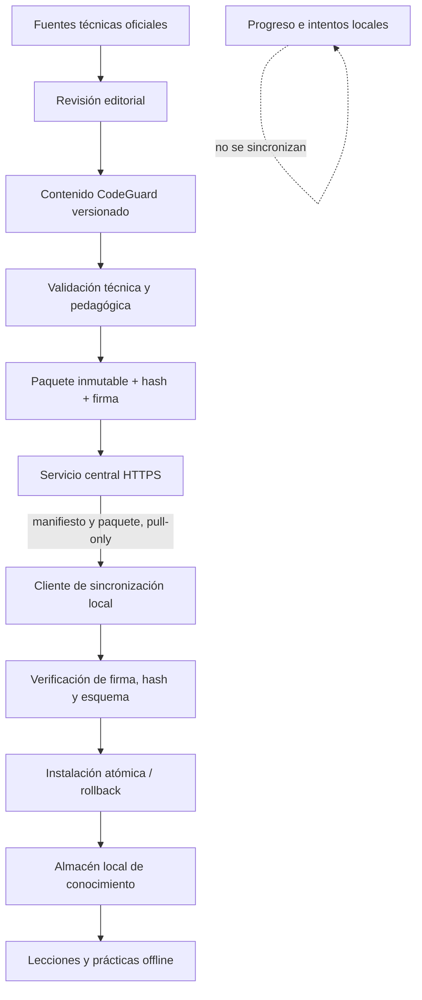

# CodeGuard Pro — Documentación de arquitectura

**Producto:** CodeGuard Pro  
**Versión:** 2.0 (Incremento 1 + Fase 2 parcialmente implementada)  
**Estado:** Núcleo funcional verificado; motor de aprendizaje y conocimiento versionado en curso  
**SRS de referencia:** `IEEE830(1).md` v2.0  
**Línea base integrada:** `main` (`2c5d441`); cliente HTTP inicial en `feat/phase-2-http-sync-client`  
**HEAD de referencia de main:** `2c5d441`

---

## 1. Visión general

CodeGuard Pro es un **monolito modular** basado en Django (patrón MVT), ejecutado localmente
en `127.0.0.1`, con núcleo local y funcionamiento offline-first. La conexión a Internet es opcional
y se reserva para consultar y descargar paquetes de conocimiento académico aprobados. Está diseñado
para un único usuario en un equipo con recursos limitados (HP 240 G10, i3-N305, ~1.3 GB RAM libre,
Fedora 44).

La arquitectura prioriza: bajo consumo de memoria/CPU, pocas dependencias, arranque rápido,
fácil mantenimiento y continuidad offline. El funcionamiento académico local no dependerá del
servicio central; la sincronización de contenido será una capacidad complementaria, iniciada por
el cliente y de solo descarga.

**Estado actual:** el núcleo local está implementado y verificado (incremento 1). La Fase 2 (motor de aprendizaje y conocimiento versionado) está implementada parcialmente en `main`: roadmap ASCENSO 3.1, flujo editorial, publicador, catálogo firmado v2 e instalador transaccional con rollback. El propietario confirmó 119 pruebas OK en `main` `2c5d441` y 132 pruebas OK en `feat/phase-2-http-sync-client`, junto con `manage.py check` limpio y `makemigrations --check --dry-run` sin cambios. El cliente HTTP inicial está validado localmente. El scheduler Electron y el backoff superaron las pruebas unitarias locales confirmadas por el propietario; la compilación real de PyInstaller y la ejecución integrada con Electron siguen pendientes. Hosting, endpoint público y claves de producción siguen pendientes.

---

## 2. Estructura de carpetas

```text
codeguard-pro/
├── manage.py
├── requirements.txt          # dependencias fijadas (versiones exactas)
├── .env.example              # variables de entorno (sin secretos reales)
├── .gitignore
├── README.md
├── PROJECT_CONTROL.md        # estado oficial del proyecto
│
├── config/                   # configuración del proyecto Django
│   ├── settings/
│   │   ├── __init__.py
│   │   ├── base.py           # settings base
│   │   ├── development.py    # settings de desarrollo local
│   │   └── desktop.py        # settings para aplicación empaquetada
│   ├── urls.py
│   ├── wsgi.py
│   ├── asgi.py
│   └── middleware.py         # middlewares de seguridad y sesión
│
├── apps/                     # aplicaciones Django (monolito modular)
│   ├── __init__.py
│   ├── core/                 # panel principal, navegación, configuración sistema (singleton)
│   ├── accounts/             # identidad y acceso (login, setup, frase rescate, contraseña)
│   ├── audit/                # registro de eventos de seguridad y acceso (auditoría)
│   └── roadmaps/             # roadmap ASCENSO, contenido académico, flujo editorial,
│   │                         # registro de paquetes, distribución firmada, importación
│
├── templates/                # plantillas base y por app (Django MVT)
├── static/                   # recursos estáticos locales (sin CDN)
│   ├── css/                  # Bootstrap 5.3.3 + estilos propios (12 temas)
│   └── js/                   # HTMX 2.0.4 + Bootstrap bundle
├── media/                    # archivos subidos (fuera del web root)
├── data/                     # datos adicionales (SQLite, .secret_key, logs)
├── logs/                     # registros de ejecución
├── scripts/                  # scripts de utilidad
├── tests/                    # pruebas automatizadas (por app)
├── docs/                     # documentación del proyecto
├── electron/                 # aplicación de escritorio Electron
├── dist/                     # salida de compilación
├── build/                    # archivos intermedios de compilación
└── node_modules/             # dependencias de Electron
```

Cada aplicación Django tiene responsabilidades delimitadas y evita acoplamiento entre módulos.

---

## 3. Componentes principales

| Componente | Responsabilidad | Estado |
|---|---|---|
| `apps.core` | Panel principal, navegación, configuración global (singleton) | Implementado (inc. 1) |
| `apps.accounts` | Identidad y acceso: login, logout, setup inicial, frase de rescate, cambio de contraseña | Implementado (inc. 1, auth temporalmente desactivada) |
| `apps.audit` | Registro de eventos de seguridad y acceso (auditoría) | Implementado (inc. 1) |
| `apps.roadmaps` | Roadmap ASCENSO, contenido académico, flujo editorial, paquetes, distribución | Implementado parcialmente (Fase 2) |
| `config.middleware` | Sesión por inactividad, cabeceras de seguridad, acceso local | Implementado (inc. 1) |
| `config.settings` | Configuración Django (base + desarrollo + desktop) | Implementado (inc. 1) |
| Electron | Contenedor de escritorio que inicia Django local (Waitress) | Implementado |

---

## 4. Flujo de autenticación

El sistema de autenticación original se conserva íntegro pero está **temporal y opcionalmente
desactivado** (`AUTH_DISABLED = True` en `config/settings/base.py`):

1. **Modo sin autenticación (actual):** la aplicación abre directamente el panel principal.
   No se solicita usuario ni contraseña. `request.user` es `AnonymousUser`. El progreso se
   asocia al propietario local existente (`request.usuario_local`). La auditoría registra
   actor nulo (`usuario=None`).
2. **Modo con autenticación (desactivado temporalmente):** setup inicial → login con
   contraseña maestra (Argon2) → sesión server-side con timeout de inactividad → logout vía
   POST → recuperación por frase de rescate.

Cuando `AUTH_DISABLED = False`, el flujo original recupera su funcionamiento completo sin
requerir migraciones ni cambios de esquema. Ver `docs/MODO_SIN_AUTENTICACION.md`.

---

## 5. Seguridad por diseño

- **Bind exclusivo:** `127.0.0.1` (nunca `0.0.0.0`).
- **CSP:** `default-src 'self'; script-src 'self'; style-src 'self' 'unsafe-inline';
  img-src 'self' data:; font-src 'self'; connect-src 'self'; frame-ancestors 'none';
  base-uri 'self';`
- **Cabeceras:** `X-Frame-Options: DENY`, `X-Content-Type-Options: nosniff`,
  `Referrer-Policy: no-referrer`, `Permissions-Policy` restrictiva.
- **CSRF:** token en todas las peticiones que cambian estado.
- **Contraseñas:** Argon2 como hasher principal (`AUTH_PASSWORD_HASHERS`).
- **No secretos en logs ni en el repositorio:** `.env.example` sin valores reales, `.gitignore`
  excluye `.env`.
- **DEBUG:** `False` por defecto; `True` solo en desarrollo explícito.
- **Recursos estáticos:** servidos localmente, sin CDN, sin dependencia de Internet.
- **Criptografía:** `cryptography==46.0.3` para verificación Ed25519 de manifiestos de
  conocimiento (distribución firmada).

Ver `docs/SEGURIDAD.md` para el detalle completo.

---

## 6. Base de datos

SQLite con FTS5 verificado en el entorno real (SQLite 3.51.2). Las migraciones de Django se
aplican desde una base de datos vacía. Ver `docs/MODELO_DATOS.md`.

---

## 7. Despliegue y ejecución

**Servidor empaquetado (Electron):** `server_entry.py` arranca el WSGI de Django mediante
**Waitress** en `127.0.0.1:<CODEGUARD_PORT>` con **WhiteNoise** para servir los recursos
estáticos locales. No se usa `runserver --insecure`.

**Desarrollo:** `python manage.py runserver 127.0.0.1:8000` (solo desarrollo, `DEBUG=True`).

No se usan contenedores, máquinas virtuales ni servicios adicionales (RNF-001, restricciones de
hardware).

---

## 8. Sistema de diseño y 12 paletas

El frontend adopta un sistema visual unificado basado en variables CSS semánticas definidas
en `static/css/themes.css`. Cada tema consume exclusivamente sus propias variables; no
existen colores de marca hardcodeados fuera de dicho archivo.

Ver `docs/ARQUITECTURA.md` (sección 8 original) para la tabla completa de los 12 temas con
sus códigos HEX oficiales (P01–P12) y reglas de accesibilidad cromática (WCAG AA).

---

## 9. Arquitectura objetivo: distribución y sincronización de conocimiento

El diseño detallado está en `docs/DISENO_SINCRONIZACION_Y_PUBLICACION.md` y
`docs/DISENO_SINCRONIZACION_Y_PUBLICACION.md`.

> **Estado: DISEÑO APROBADO (ADR-004); implementación parcial en la rama de trabajo.**
> El registro local de paquetes (`PaqueteConocimientoInstalado`, `EstadoSincronizacion`) y el
> verificador de distribución firmada (Ed25519) están implementados. El cliente de sincronización
> de red, el servicio central y el publicador siguen pendientes.

### 9.1 Límites de confianza y responsabilidades

- **Aplicación local:** Electron inicia Django en `127.0.0.1`; SQLite conserva contenido
  instalado, progreso, intentos y preferencias.
- **Servicio central de conocimiento:** publica manifiestos y paquetes académicos inmutables
  por HTTPS. No ejecuta la aplicación local ni almacena el progreso del estudiante.
- **Entorno editorial:** crea, valida, revisa, aprueba y firma paquetes. Sus credenciales y
  claves privadas nunca se distribuyen al cliente.
- **Fuentes técnicas externas:** aportan documentación de referencia. Sus cambios se detectan
  y revisan; no se convierten automáticamente en publicaciones.

### 9.2 Flujo de datos



### 9.3 Estado de implementación

| Capacidad | Estado en `main` / rama de trabajo |
|---|---|
| Aplicación local Electron + Django + SQLite | Implementada |
| Roadmap ASCENSO 3.1 (33 etapas) | Implementado (cargar_ascenso) |
| Contenido académico editable | Implementado |
| Claves UUID estables (lección, ejemplo, ejercicio) | Implementado (migración 0004) |
| Catálogo de fuentes (`FuenteConocimiento`) | Implementado (migración 0005) |
| Snapshots inmutables (`VersionContenidoLeccion`) | Implementado (migración 0005) |
| Referencias de fuente (`ReferenciaFuenteContenido`) | Implementado (migración 0005) |
| Flujo editorial (revisión, aprobación, publicación, retirada) | Implementado (migraciones 0006–0008) |
| Revisión de licencias de fuentes | Implementado (migraciones 0009–0010) |
| Autoría de versiones | Implementado (migración 0011) |
| Registro local de paquetes (`PaqueteConocimientoInstalado`) | Implementado (migración 0012) |
| Un solo activo por canal + estado de sincronización | Implementado (migración 0013) |
| Verificador de distribución firmada (Ed25519, manifiesto, ZIP) | Implementado |
| Comandos de gestión editorial y distribución | Incluye `publicar_paquete_conocimiento` y `sincronizar_conocimiento`; el scheduler Electron inicia el cliente en proceso separado en la rama aislada |
| Generador local de paquetes firmados (ZIP + manifiesto Ed25519) | Implementado; migración 0015 y pruebas del generador validadas localmente por el propietario |
| Catálogo firmado de fuentes (índice v2) | Implementado y validado localmente por el propietario (119 pruebas OK en `main`; 132 en rama cliente HTTP) |
| Instalador transaccional local (snapshots, catálogo, activación y rollback) | Implementado y validado en `main` (119 pruebas OK; migración 0016); cliente HTTP validado en rama (132 pruebas) |
| Cliente de sincronización HTTP pull-only | Implementación inicial en `feat/phase-2-http-sync-client`; pruebas pendientes de validación local |
| Hosting, endpoint y publicación remota | Pendiente; no se ha seleccionado proveedor ni configurado URL/key de producción |

---

## 10. Próximos incrementos

La implementación de conocimiento versionado y sincronización híbrida pertenece a la Fase 2.
El detalle de entidades y migraciones propuestas está en `docs/DISENO_SINCRONIZACION_Y_PUBLICACION.md`.

El orden vigente de las fases, dependencias y criterios de cierre se mantiene en
`docs/PLAN_MAESTRO_CODEGUARD.md` y `docs/PLAN_DESARROLLO.md`.

---

## 11. Integración con el ejecutable de escritorio

La aplicación empaquetada inicia Django desde el binario PyInstaller `CodeGuardServer`.
La futura sincronización se ejecutará como comando de una sola ejecución soportado por ese
mismo binario y será invocada por Electron después de mostrar la ventana principal. No se
exigirá Python externo en el equipo instalado, no se creará un daemon permanente y no se
bloqueará el arranque local. El renderer solo recibirá estado mediante IPC limitado.

El cargador `cargar_ascenso` queda fuera del flujo de sincronización. En particular,
`--recrear` puede eliminar progreso por las relaciones en cascada y nunca debe utilizarse
para actualizar contenido pedagógico.
### 9.1 Scheduler de sincronización de conocimiento (rama aislada)

Electron programa una primera comprobación 30 segundos después de que Django y la ventana estén disponibles, y realiza sondeos locales cada cinco minutos. El cliente Python respeta `EstadoSincronizacion.next_check_after`, por lo que no realiza una petición de red en cada sondeo. Las respuestas válidas programan 24 horas; los fallos aplican backoff exponencial desde 15 minutos hasta 24 horas.

La sincronización se ejecuta en un proceso hijo independiente. En desarrollo utiliza el entorno virtual; en producción reutiliza el ejecutable PyInstaller mediante `CodeGuardServer --sync-knowledge`. Este modo no inicia Waitress, no ejecuta migraciones y no carga/recrea el roadmap.

La concurrencia se limita en Electron y mediante un bloqueo de archivo por canal bajo `DATA_DIR`. El renderer solo recibe estado descriptivo por IPC. La configuración incompleta (URLs, allowlist o claves de confianza) desactiva la sincronización sin impedir el funcionamiento offline.

**Estado de validación:** el propietario confirmó la ejecución satisfactoria de las pruebas unitarias de backoff y lock entre procesos, además de los chequeos sintácticos. El build real PyInstaller y la prueba de arranque/sincronización desde Electron siguen pendientes. No hay endpoint público ni claves de producción.