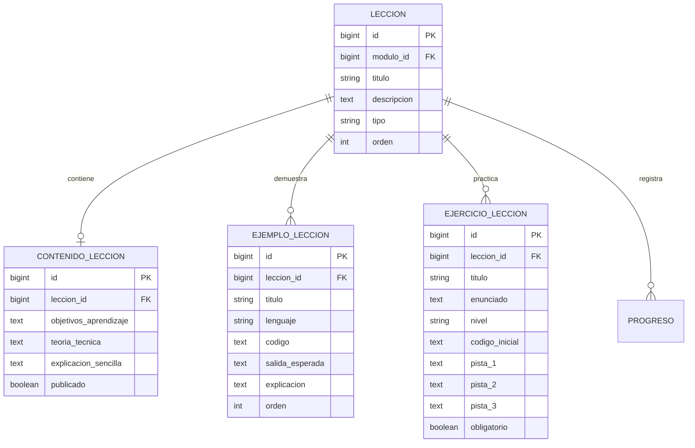
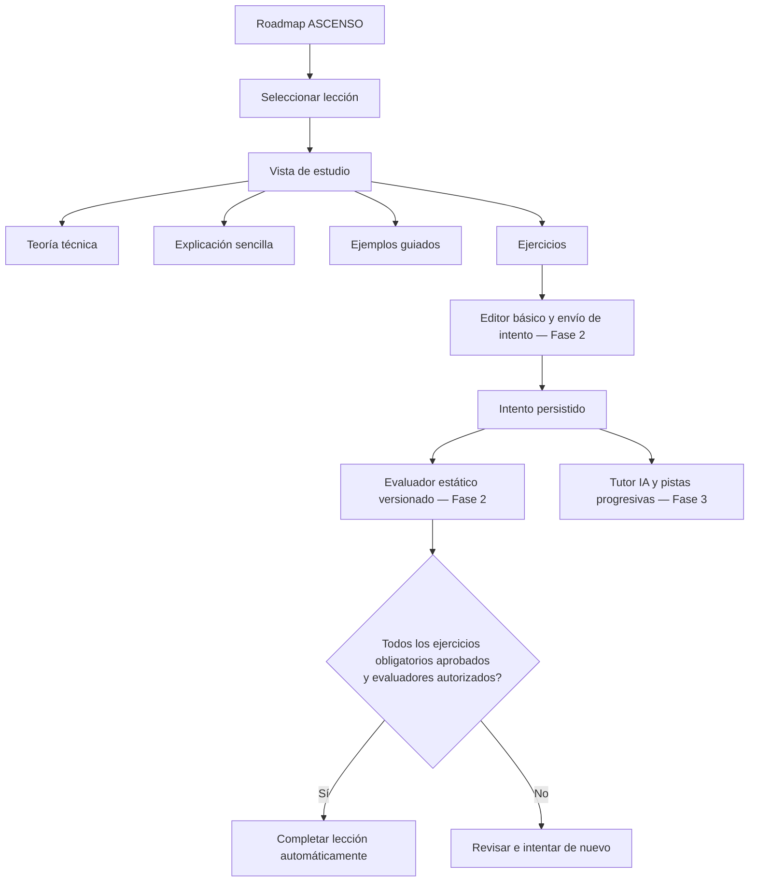

# Fase 2 — Sistema de aprendizaje interactivo

**Producto:** CodeGuard Pro  
**Estado:** Primer incremento implementado; validación local pendiente.  
**Línea base:** rama `main`.

## 1. Objetivo

Convertir cada lección del Roadmap ASCENSO en una unidad de estudio navegable y estructurada, sin confundir la existencia de una ficha académica con el dominio demostrado del contenido.

## 2. Alcance del primer incremento

Cada lección dispone ahora de una ruta propia y de una estructura de contenido separada del catálogo ASCENSO:

- **Contenido de lección:** objetivos de aprendizaje, teoría técnica, explicación sencilla, notas y estado de publicación.
- **Ejemplos guiados:** contexto, lenguaje, código, salida esperada y explicación paso a paso.
- **Ejercicios:** enunciado, instrucciones, lenguaje, nivel, código inicial, obligatoriedad y hasta tres campos de pistas.
- **Vista de estudio:** organiza las secciones anteriores y conserva navegación de regreso a la etapa.

La información fuente del Roadmap ASCENSO continúa siendo el catálogo de etapas, módulos y títulos de lecciones. El contenido pedagógico se almacena en entidades relacionadas, de modo que enriquecer una lección no modifica ni duplica los datos oficiales del roadmap.

## 3. Modelo de datos



## 4. Decisiones y límites

1. Abrir una lección registra el estado «En progreso» (5 % inicial); nunca la marca como completada.
2. La vista muestra solamente contenidos y ejercicios publicados.
3. Los ejercicios publicados permiten enviar una respuesta mediante un editor de texto básico. El área de edición conserva el código inicial cuando existe, pero todavía no incorpora resaltado de sintaxis.
4. Cada entrega se guarda como un intento asociado al ejercicio y al usuario local/autenticado. Se conserva el resultado, la retroalimentación, la puntuación disponible y la versión del evaluador aplicada.
5. Los evaluadores iniciales son deterministas y estáticos: comparación de respuesta exacta y comprobación de fragmentos requeridos/prohibidos. No ejecutan código ni verifican su comportamiento.
6. Si un ejercicio no tiene evaluador activo, la entrega se conserva como «Pendiente de revisión» y no concede aprobación.
7. La finalización automática de una lección exige aprobar todos sus ejercicios obligatorios con la versión activa de un evaluador que tenga habilitada explícitamente la autorización de dominio. Esa autorización está desactivada por defecto; una comprobación estática simple no debe completar una lección por sí sola.
8. Los tres campos de pistas fijan un máximo estructural de tres pistas por ejercicio. Su entrega secuencial y el contador de pistas corresponden al tutor de la Fase 3.
9. La ruta antigua de marcado manual continúa rechazando solicitudes para completar lecciones y etapas.
10. El modelo de progreso existente se conserva para no perder compatibilidad con los registros actuales.

## 5. Flujo previsto



## 6. Próximos incrementos de la Fase 2

- Definir la plantilla editorial para que cada lección mantenga rigor técnico, explicación accesible y ejemplos suficientes.
- Diseñar e incorporar un mecanismo versionado para cargar y mantener grandes volúmenes de contenido sin editar directamente la base de datos.
- Implementar la navegación anterior/siguiente y el índice de secciones de la lección.
- Definir estados de lectura y progreso parcial sin permitir finalización manual.
- Incorporar resaltado de sintaxis y una experiencia de edición más completa sin perder compatibilidad offline.
- Ampliar los evaluadores con contratos de pruebas seguros y verificables. La ejecución de código seguirá bloqueada hasta disponer de un sandbox aislado.
- Crear un flujo editorial versionado para configurar evaluadores sin editar directamente la base de datos.
- Añadir pruebas de integración y validar migraciones en una copia de la base de datos local.

## 7. Validación antes de considerar estable este incremento

Desde la carpeta local del proyecto:

```bash
python manage.py check
python manage.py makemigrations --check --dry-run
python manage.py migrate
python manage.py test apps.roadmaps
```

Luego iniciar CodeGuard Pro con `./run.sh`, abrir una etapa y entrar en una lección. La comprobación visual debe repetirse con los temas principales y en escritorio/móvil.

> La Fase 2 sigue en progreso. Este incremento incorpora entrega, persistencia de intentos y evaluación estática inicial; no implementa ejecución real de código, resaltado de sintaxis, tutor IA ni cobertura editorial de todas las lecciones.

## 8. Estado de autoría de contenidos

Los modelos y la vista de estudio ya están preparados, pero el repositorio todavía no contiene teoría, ejemplos y ejercicios editoriales para todas las lecciones. Tampoco debe asumirse que existe un editor disponible en la aplicación: `django.contrib.admin` no está instalado en la configuración actual. La autoría y publicación masiva de contenidos se resolverán mediante un flujo versionado de datos y revisión editorial antes de activar el material para estudiantes.

La ruta de estudio muestra un estado explícito de «Contenido en preparación» cuando una lección no tiene contenido publicado. No se presenta texto vacío como si fuera una lección terminada.

## 9. Auditoría y centralización de reglas de progreso — incremento en curso**Rama de trabajo:** `phase-2/progress-domain-rules`

Se detectó que las vistas impedían completar manualmente una lección, pero el servicio `marcar_leccion()` todavía aceptaba `completada=True`. De forma similar, `marcar_etapa()` permitía aprobar una etapa si sus prerrequisitos estaban satisfechos. Esto dejaba una vía interna para conceder progreso sin evidencia académica.

Correcciones realizadas en esta rama:

- `marcar_leccion()` rechaza la finalización manual y conserva únicamente la operación de reapertura.
- `marcar_etapa()` rechaza la aprobación manual y conserva únicamente la operación de reapertura; primero informa si faltan prerrequisitos.
- `recalcular_progreso_etapa()` calcula el porcentaje de cobertura, pero no convierte automáticamente el 100 % de lecciones registradas en aprobación de etapa.
- La aprobación de etapa queda reservada para un futuro servicio que valide evaluaciones y criterios obligatorios.
- Las pruebas se actualizaron para verificar el rechazo desde los servicios y desde la vista.

**Límite importante:** este incremento aún no incorpora un mecanismo autorizado para aprobar lecciones o etapas a partir de intentos/evaluaciones, porque ese modelo de evidencia todavía no existe. Tampoco sustituye una auditoría de todos los posibles puntos de escritura directa sobre el modelo `Progreso`. La validación local debe ejecutarse antes de integrar esta rama.


## 10. Intentos y evaluación determinista — rama `phase-2/exercise-attempts`

Este incremento incorpora:

- `ConfiguracionEvaluacion`: contrato por ejercicio, con versiones históricas, una sola versión activa y configuración privada no expuesta en la plantilla.
- `IntentoEjercicio`: persistencia de la respuesta, resultado, puntuación, retroalimentación, fecha y versión de evaluación aplicada.
- Endpoint POST protegido por CSRF para recibir entregas, con límite de 20.000 caracteres.
- Editor de texto básico en la vista de estudio e historial de los tres intentos más recientes.
- Evaluadores iniciales `respuesta_exacta` y `codigo_contiene`. El segundo comprueba fragmentos de texto; no analiza sintaxis ni ejecuta el programa.
- Finalización automática únicamente cuando todos los ejercicios obligatorios publicados cuentan con un intento aprobado contra su versión activa y el evaluador tiene habilitada expresamente la opción `permite_completar_leccion`.
- Registro de auditoría para entregas y finalizaciones basadas en evidencia.

### Límites de seguridad y alcance

El servidor no ejecuta código enviado. Los evaluadores de fragmentos son heurísticas estáticas y pueden producir falsos positivos; por eso su configuración no autoriza completar lecciones por defecto. No deben usarse como prueba suficiente de dominio en ejercicios que requieran comprobar comportamiento, salida o lógica.

Antes de habilitar ejecución real se requiere un sandbox independiente con aislamiento de procesos, límites de CPU/memoria/tiempo, sistema de archivos efímero y red deshabilitada. No se debe implementar esa ejecución dentro de una vista o proceso Django.

### Validación local requerida

```bash
export CODEGUARD_DATA_DIR="$PWD/data"
./.venv/bin/python manage.py check
./.venv/bin/python manage.py makemigrations --check --dry-run
./.venv/bin/python manage.py migrate
./.venv/bin/python manage.py test apps.roadmaps --settings=config.settings.development
./.venv/bin/python manage.py test --settings=config.settings.development
```

Las pruebas de esta rama cubren evaluación exacta, comprobación estática, configuración inválida, límite de entrega, historial y finalización condicionada a evidencia. La validación de estos comandos todavía debe ejecutarse en el entorno local del proyecto.
