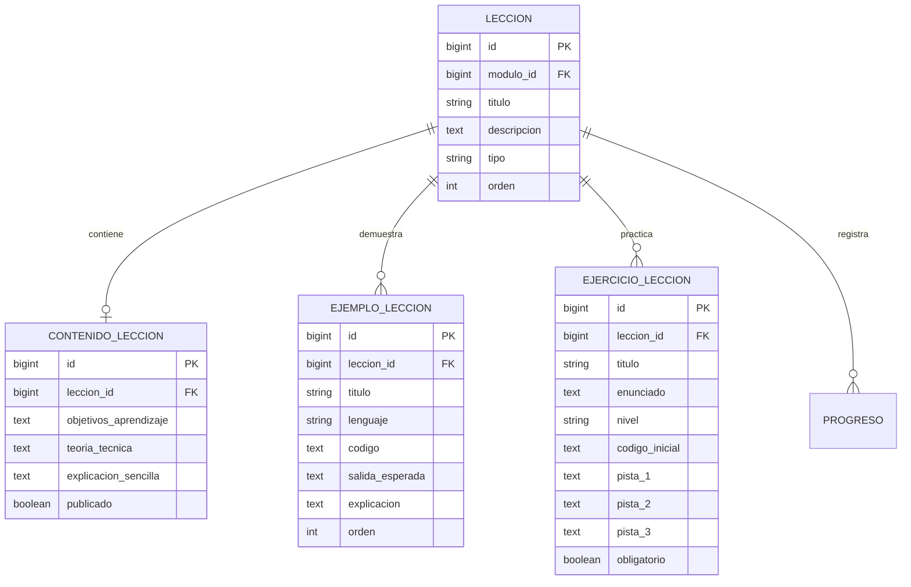
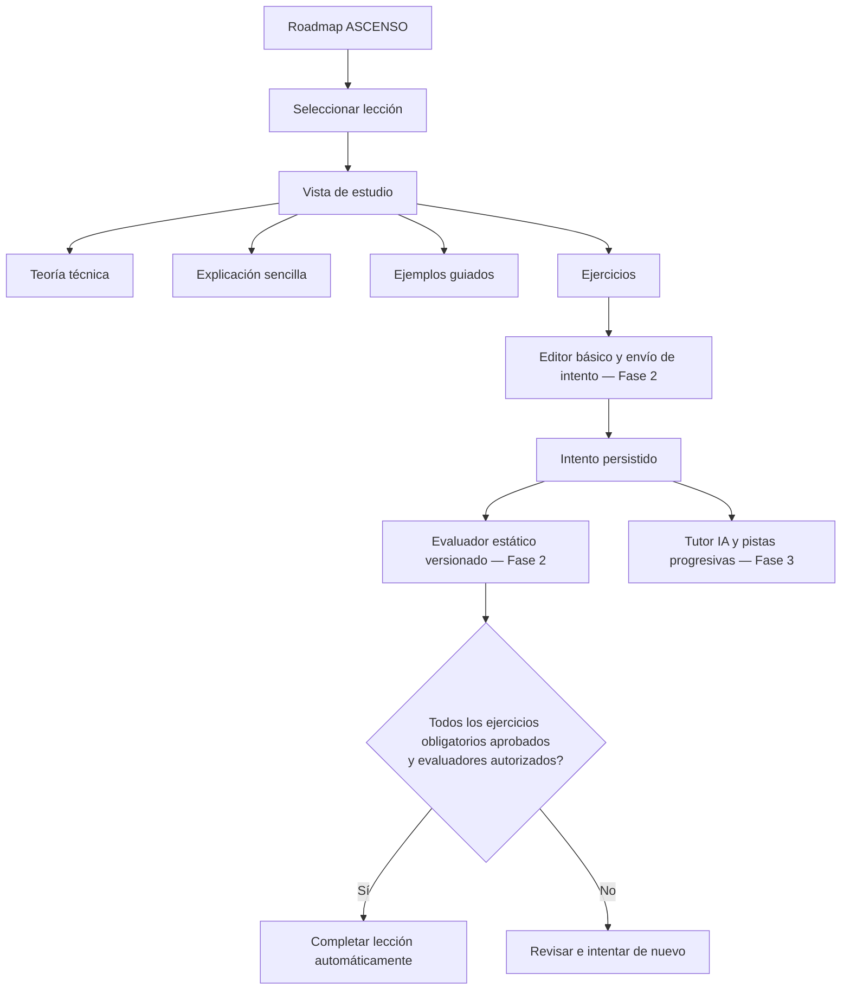

# Fase 2 — Sistema de aprendizaje interactivo

**Producto:** CodeGuard Pro  
**Estado:** Primer incremento implementado; validación local pendiente.  
**Línea base:** rama `main`.

## 1. Objetivo

Convertir cada lección del Roadmap ASCENSO en una unidad de estudio navegable y estructurada, sin confundir la existencia de una ficha académica con el dominio demostrado del contenido.

## 2. Alcance del primer incremento

Cada lección dispone ahora de una ruta propia y de una estructura de contenido separada del catálogo ASCENSO:

- **Contenido de lección:** objetivos de aprendizaje, teoría técnica, explicación sencilla, notas y estado de publicación.
- **Ejemplos guiados:** contexto, lenguaje, código, salida esperada y explicación paso a paso.
- **Ejercicios:** enunciado, instrucciones, lenguaje, nivel, código inicial, obligatoriedad y hasta tres campos de pistas.
- **Vista de estudio:** organiza las secciones anteriores y conserva navegación de regreso a la etapa.

La información fuente del Roadmap ASCENSO continúa siendo el catálogo de etapas, módulos y títulos de lecciones. El contenido pedagógico se almacena en entidades relacionadas, de modo que enriquecer una lección no modifica ni duplica los datos oficiales del roadmap.

## 3. Modelo de datos



## 4. Decisiones y límites

1. Abrir una lección registra el estado «En progreso» (5 % inicial); nunca la marca como completada.
2. La vista muestra solamente contenidos y ejercicios publicados.
3. Los ejercicios publicados permiten enviar una respuesta mediante un editor de texto básico. El área de edición conserva el código inicial cuando existe, pero todavía no incorpora resaltado de sintaxis.
4. Cada entrega se guarda como un intento asociado al ejercicio y al usuario local/autenticado. Se conserva el resultado, la retroalimentación, la puntuación disponible y la versión del evaluador aplicada.
5. Los evaluadores iniciales son deterministas y estáticos: comparación de respuesta exacta y comprobación de fragmentos requeridos/prohibidos. No ejecutan código ni verifican su comportamiento.
6. Si un ejercicio no tiene evaluador activo, la entrega se conserva como «Pendiente de revisión» y no concede aprobación.
7. La finalización automática de una lección exige aprobar todos sus ejercicios obligatorios con la versión activa de un evaluador que tenga habilitada explícitamente la autorización de dominio. Esa autorización está desactivada por defecto; una comprobación estática simple no debe completar una lección por sí sola.
8. Los tres campos de pistas fijan un máximo estructural de tres pistas por ejercicio. Su entrega secuencial y el contador de pistas corresponden al tutor de la Fase 3.
9. La ruta antigua de marcado manual continúa rechazando solicitudes para completar lecciones y etapas.
10. El modelo de progreso existente se conserva para no perder compatibilidad con los registros actuales.

## 5. Flujo previsto



## 6. Próximos incrementos de la Fase 2

- Definir la plantilla editorial para que cada lección mantenga rigor técnico, explicación accesible y ejemplos suficientes.
- Diseñar e incorporar un mecanismo versionado para cargar y mantener grandes volúmenes de contenido sin editar directamente la base de datos.
- Implementar la navegación anterior/siguiente y el índice de secciones de la lección.
- Definir estados de lectura y progreso parcial sin permitir finalización manual.
- Incorporar resaltado de sintaxis y una experiencia de edición más completa sin perder compatibilidad offline.
- Ampliar los evaluadores con contratos de pruebas seguros y verificables. La ejecución de código seguirá bloqueada hasta disponer de un sandbox aislado.
- Crear un flujo editorial versionado para configurar evaluadores sin editar directamente la base de datos.
- Añadir pruebas de integración y validar migraciones en una copia de la base de datos local.

## 7. Validación antes de considerar estable este incremento

Desde la carpeta local del proyecto:

```bash
python manage.py check
python manage.py makemigrations --check --dry-run
python manage.py migrate
python manage.py test apps.roadmaps
```

Luego iniciar CodeGuard Pro con `./run.sh`, abrir una etapa y entrar en una lección. La comprobación visual debe repetirse con los temas principales y en escritorio/móvil.

> La Fase 2 sigue en progreso. Este incremento incorpora entrega, persistencia de intentos y evaluación estática inicial; no implementa ejecución real de código, resaltado de sintaxis, tutor IA ni cobertura editorial de todas las lecciones.

## 8. Estado de autoría de contenidos

Los modelos y la vista de estudio ya están preparados, pero el repositorio todavía no contiene teoría, ejemplos y ejercicios editoriales para todas las lecciones. Tampoco debe asumirse que existe un editor disponible en la aplicación: `django.contrib.admin` no está instalado en la configuración actual. La autoría y publicación masiva de contenidos se resolverán mediante un flujo versionado de datos y revisión editorial antes de activar el material para estudiantes.

La ruta de estudio muestra un estado explícito de «Contenido en preparación» cuando una lección no tiene contenido publicado. No se presenta texto vacío como si fuera una lección terminada.

## 9. Auditoría y centralización de reglas de progreso — incremento en curso**Rama de trabajo:** `phase-2/progress-domain-rules`

Se detectó que las vistas impedían completar manualmente una lección, pero el servicio `marcar_leccion()` todavía aceptaba `completada=True`. De forma similar, `marcar_etapa()` permitía aprobar una etapa si sus prerrequisitos estaban satisfechos. Esto dejaba una vía interna para conceder progreso sin evidencia académica.

Correcciones realizadas en esta rama:

- `marcar_leccion()` rechaza la finalización manual y conserva únicamente la operación de reapertura.
- `marcar_etapa()` rechaza la aprobación manual y conserva únicamente la operación de reapertura; primero informa si faltan prerrequisitos.
- `recalcular_progreso_etapa()` calcula el porcentaje de cobertura, pero no convierte automáticamente el 100 % de lecciones registradas en aprobación de etapa.
- La aprobación de etapa queda reservada para un futuro servicio que valide evaluaciones y criterios obligatorios.
- Las pruebas se actualizaron para verificar el rechazo desde los servicios y desde la vista.

**Límite importante:** este incremento aún no incorpora un mecanismo autorizado para aprobar lecciones o etapas a partir de intentos/evaluaciones, porque ese modelo de evidencia todavía no existe. Tampoco sustituye una auditoría de todos los posibles puntos de escritura directa sobre el modelo `Progreso`. La validación local debe ejecutarse antes de integrar esta rama.


## 10. Intentos y evaluación determinista — rama `phase-2/exercise-attempts`

Este incremento incorpora:

- `ConfiguracionEvaluacion`: contrato por ejercicio, con versiones históricas, una sola versión activa y configuración privada no expuesta en la plantilla. La opción para aportar a la finalización está desactivada por defecto.
- `IntentoEjercicio`: persistencia de la respuesta, resultado, puntuación, retroalimentación, fecha y versión de evaluación aplicada.
- Endpoint POST protegido por CSRF para recibir entregas, con límite de 20.000 caracteres.
- Editor de texto básico en la vista de estudio e historial de los tres intentos más recientes.
- Evaluadores iniciales `respuesta_exacta` y `codigo_contiene`. El segundo comprueba fragmentos de texto y devuelve «Criterios estáticos cumplidos», no una aprobación académica; no analiza sintaxis ni ejecuta el programa.
- Finalización automática únicamente cuando todos los ejercicios obligatorios publicados cuentan con un intento aprobado contra su versión activa y el evaluador tiene habilitada expresamente la opción `permite_completar_leccion`.
- Registro de auditoría para entregas y finalizaciones basadas en evidencia.

### Límites de seguridad y alcance

El servidor no ejecuta código enviado. Los evaluadores de fragmentos son heurísticas estáticas y pueden producir falsos positivos; por eso su configuración no autoriza completar lecciones por defecto. No deben usarse como prueba suficiente de dominio en ejercicios que requieran comprobar comportamiento, salida o lógica.

Antes de habilitar ejecución real se requiere un sandbox independiente con aislamiento de procesos, límites de CPU/memoria/tiempo, sistema de archivos efímero y red deshabilitada. No se debe implementar esa ejecución dentro de una vista o proceso Django.

### Validación local requerida

```bash
export CODEGUARD_DATA_DIR="$PWD/data"
./.venv/bin/python manage.py check
./.venv/bin/python manage.py makemigrations --check --dry-run
./.venv/bin/python manage.py migrate
./.venv/bin/python manage.py test apps.roadmaps --settings=config.settings.development
./.venv/bin/python manage.py test --settings=config.settings.development
```

Las pruebas de esta rama cubren evaluación exacta, comprobación estática, configuración inválida, límite de entrega, historial y finalización condicionada a evidencia. La validación de estos comandos todavía debe ejecutarse en el entorno local del proyecto.

## 11. Conocimiento académico y sincronización híbrida

**Diseño de datos y contrato técnico:** consultar `docs/DISENO_DATOS_SINCRONIZACION.md`. El documento contiene la auditoría de modelos/migraciones, entidades propuestas, payload, manifiesto, firma, estrategia de migración y pruebas derivadas.

**Decisión de producto aprobada:** CodeGuard Pro utilizará un modelo híbrido: un servicio central publica contenido académico revisado y versionado; la aplicación local consulta y descarga actualizaciones automáticamente cuando dispone de conexión; el contenido queda almacenado localmente para continuar trabajando offline. Esta capacidad pertenece a la Fase 2.

**Estado real en `main`: DISEÑO DOCUMENTADO; NO IMPLEMENTADO.** Los modelos actuales de lecciones, ejemplos, ejercicios, intentos y evaluadores no constituyen todavía un sistema de sincronización. No existe en esta revisión evidencia de un cliente de sincronización, un servicio central de publicación, manifiestos firmados ni un instalador local de paquetes.

### 11.1 Principios de arquitectura

- El núcleo de CodeGuard sigue ejecutándose localmente mediante Electron + Django + SQLite.
- El servicio central es una fuente de distribución de conocimiento, no un servidor de ejecución de la aplicación del estudiante.
- La comunicación de sincronización será iniciada por el cliente mediante HTTPS (pull-only). No se abrirá el servidor local a Internet ni se aceptarán conexiones entrantes remotas.
- La conexión es opcional. No se bloquean el arranque, el acceso al contenido descargado, la práctica disponible ni la consulta del progreso.
- El servicio central distribuye únicamente contenido editorial publicado. No recibe código, intentos, calificaciones, progreso, notas privadas ni telemetría del estudiante.
- La actualización de conocimiento es independiente de la actualización del programa, sus dependencias o sus binarios.
- La sincronización entre dispositivos y la subida de progreso quedan fuera de esta decisión.

### 11.2 Componentes previstos

| Componente | Responsabilidad | Estado |
|---|---|---|
| Catálogo de fuentes | Registrar documentación oficial, ediciones, URL canónica, licencia y fecha de consulta | Pendiente |
| Repositorio editorial | Mantener lecciones, ejemplos, ejercicios y referencias revisados | Pendiente |
| Validador editorial | Comprobar estructura, enlaces, referencias, ejemplos y compatibilidad | Pendiente |
| Publicador central | Publicar paquetes inmutables y manifiesto firmado | Pendiente |
| Cliente de sincronización | Consultar versiones y descargar paquetes cuando hay conexión | Pendiente |
| Verificador local | Validar firma, hash, tamaño, esquema y compatibilidad | Pendiente |
| Instalador local | Activar paquetes de forma atómica y permitir rollback | Pendiente |
| Estado de vigencia | Mostrar actualización, última revisión, obsolescencia y retiro | Pendiente |

### 11.3 Metadatos mínimos del contenido

Cada recurso académico debe poder identificar:

- ID estable, tipo de recurso y versión.
- Lenguaje/tecnología, versión objetivo y nivel formativo.
- Fuente primaria: publicador, título, URL canónica y edición o versión consultada.
- Licencia/condiciones de uso y forma de atribución requerida.
- Fecha de consulta, fecha de revisión técnica y fecha de publicación.
- Estado editorial: borrador, en revisión, aprobado, publicado, sustituido o retirado.
- Revisor/responsable y motivo del cambio.
- Versión del esquema del paquete y versión mínima de CodeGuard compatible.
- Relaciones con objetivos, lecciones, ejemplos, ejercicios y criterios de evaluación.

Una fuente oficial es evidencia y referencia, no permiso automático para copiar su contenido. CodeGuard debe redactar explicaciones propias, exactas y pedagógicas. Las herramientas automáticas pueden detectar cambios en fuentes, pero no publicar cambios sin revisión.

### 11.4 Flujo de publicación y sincronización

1. Registrar una fuente técnica y verificar su licencia/condiciones.
2. Consultar la documentación oficial y registrar la edición/versiones relevantes.
3. Detectar cambios de fuente y crear una propuesta de revisión; no alterar directamente el contenido publicado.
4. Actualizar la explicación pedagógica, ejemplos y ejercicios de CodeGuard.
5. Revisar exactitud técnica, claridad, vigencia, licencias y referencias.
6. Validar ejemplos y contratos de evaluación.
7. Aprobar una versión inmutable del contenido.
8. Generar un paquete y manifiesto con identificador, versión, fecha, tamaño, hash, firma, esquema y compatibilidad.
9. El cliente consulta el manifiesto por HTTPS cuando hay conexión, compara versiones y descarga el paquete compatible.
10. El cliente descarga a una ubicación temporal y valida firma, hash, estructura, tamaño y compatibilidad.
11. El cliente activa el paquete de forma atómica, conserva la versión anterior y registra el resultado.
12. Si ocurre un error, conserva la última versión válida, informa el estado y permite reintentar.

### 11.5 Reglas de integridad, seguridad y privacidad

- TLS/HTTPS para el transporte y firma digital para autenticar los paquetes; el hash por sí solo detecta corrupción, pero no autentica al publicador.
- La clave privada de publicación permanece exclusivamente en el entorno editorial/servidor. El cliente contiene únicamente la clave pública de verificación.
- Validar tamaño máximo, tipos de archivo, rutas internas, esquema y referencias antes de procesar un paquete. Prevenir path traversal y archivos comprimidos maliciosos.
- Los paquetes de contenido no pueden ejecutar código, scripts, migraciones ni comandos.
- La instalación debe poder revertirse sin modificar la base de datos del progreso.
- Mantener separados el catálogo académico versionado y los registros personales/locales.
- Conservar en cada intento la versión de contenido y de evaluación utilizada. No recalificar automáticamente intentos históricos por la llegada de una versión nueva.
- No subir al servidor central información personal ni datos académicos del estudiante.
- No confundir contenido que necesita revisión por antigüedad con contenido confirmado como incorrecto.

### 11.6 Política de actualización

- Comprobar actualizaciones al iniciar y en momentos oportunos mientras exista conexión, sin bloquear la interfaz.
- Aplicar timeout, reintentos con backoff y límites de descarga; evitar conexiones permanentes.
- Permitir desactivar o posponer la comprobación automática y ofrecer una actualización manual.
- La última versión válida local siempre está disponible offline.
- Mostrar estados diferenciados: actualizado, actualización disponible, sin conexión, revisión recomendada, contenido retirado/sustituido y error de sincronización.
- Una retirada por error crítico debe advertir al estudiante y evitar nuevas asignaciones del contenido afectado, pero no borrar intentos ni evidencias históricas.

### 11.7 Orden de implementación

1. Definir esquema de metadatos y catálogo de fuentes.
2. Definir formato versionado del paquete y manifiesto.
3. Crear flujo editorial de importación, validación, revisión y publicación.
4. Crear publicador central de solo lectura para el cliente.
5. Crear cliente local de consulta y descarga.
6. Implementar verificación criptográfica, validación y límites de seguridad.
7. Implementar instalación atómica, historial de versiones y rollback.
8. Integrar indicadores de vigencia y estados de sincronización en la interfaz.
9. Añadir pruebas de desconexión, interrupción, corrupción, firma inválida, incompatibilidad, rollback y preservación del progreso.
10. Publicar inicialmente un conjunto pequeño de contenidos revisados y ampliar el catálogo por rutas prioritarias.

### 11.8 Criterios de aceptación adicionales

- CodeGuard arranca y permite estudiar sin conexión a Internet.
- El contenido descargado se consulta sin llamadas de red.
- El cliente no envía datos del estudiante durante la sincronización.
- Un manifiesto o paquete con firma/hash inválidos nunca se instala.
- Un paquete incompatible o mal formado no reemplaza el contenido local.
- Una descarga interrumpida deja intacta la versión activa.
- La activación y el rollback no modifican progreso, preferencias ni intentos.
- Las evidencias conservan las versiones originales de contenido y evaluación.
- El usuario puede ver la fecha de revisión, fuente y estado de vigencia.
- Las fuentes modificadas solo generan propuestas hasta completar la revisión editorial.
- El flujo funciona en la aplicación empaquetada Electron y en el entorno de desarrollo.

---

## 12. Fuera de alcance de esta sincronización

- Sincronizar progreso, cuentas, notas privadas o intentos hacia la nube.
- Sincronizar el mismo perfil entre varios dispositivos.
- Actualizar automáticamente el ejecutable, Python, Django o dependencias.
- Ejecutar código descargado de fuentes externas.
- Aprobar contenido generado automáticamente sin revisión.
- Reemplazar el sistema de evaluación o el sandbox de ejecución de ejercicios.

### 11.4 Integración con Electron y cargador ASCENSO

La sincronización debe ejecutarse como tarea no bloqueante después de que Electron muestre la ventana principal. En producción, Electron inicia el binario PyInstaller `CodeGuardServer`; por ello, el futuro comando de sincronización debe poder ejecutarse también desde ese binario en modo de una sola ejecución. En desarrollo se utilizará el mismo comando Django desde el entorno virtual.

El comando comparte la base de datos local y no debe modificar el roadmap curricular. El cargador actual `cargar_ascenso` no es un importador de contenido: trabaja con títulos, reconstruye prerrequisitos y su opción `--recrear` puede borrar progreso por cascada. El sincronizador no debe llamarlo ni recrear etapas, módulos o lecciones. La identidad UUID del catálogo debe incorporarse mediante una migración/exportación controlada.

La descarga y verificación ocurren fuera de la transacción; la activación local se realiza en una transacción corta y protegida contra ejecuciones simultáneas. Si la conexión falla, el servicio no responde o SQLite está ocupado, la versión local activa permanece disponible.


### Primer incremento técnico

La base de conocimiento comienza con identificadores UUID permanentes para lecciones, ejemplos y ejercicios, además de protección de las relaciones históricas de intentos y evaluadores. La migración preserva registros existentes y prepara identidades portables. Todavía no implementa snapshots ni sincronización online.


### Catálogo de fuentes y snapshots (incremento en curso)

Se incorporan modelos para registrar fuentes técnicas con licencia y edición, snapshots JSON versionados por lección y referencias de atribución. Se limita a una versión publicada por lección y se protegen las fuentes/versiones históricas contra borrado. Este incremento todavía no implementa el servicio que genera snapshots ni el proceso de publicación/sincronización.


### Servicio inicial de snapshots

Se añade `apps/roadmaps/knowledge.py` para generar snapshots deterministas a partir del contenido editorial, incluyendo ejemplos y ejercicios publicados, y asociar referencias de fuentes. Cada operación crea una versión en estado borrador con SHA-256 y número incremental. No publica automáticamente ni modifica el progreso del estudiante.


### Flujo editorial de aprobación y publicación

Se incorporan servicios de dominio para enviar snapshots a revisión, aprobarlos, publicarlos y retirar publicaciones. Cada transición exige un usuario activo con privilegios editoriales. La aprobación registra al revisor; la publicación registra al publicador y sustituye la versión anterior en una transacción. Una versión en revisión o en estados posteriores no permite modificar su snapshot, hash, identidad o resumen de cambios. La retirada exige motivo y no elimina evidencias históricas.

Django Admin permanece deshabilitado. La interfaz editorial se implementará por separado cuando se defina el esquema de autenticación y permisos de CodeGuard.
