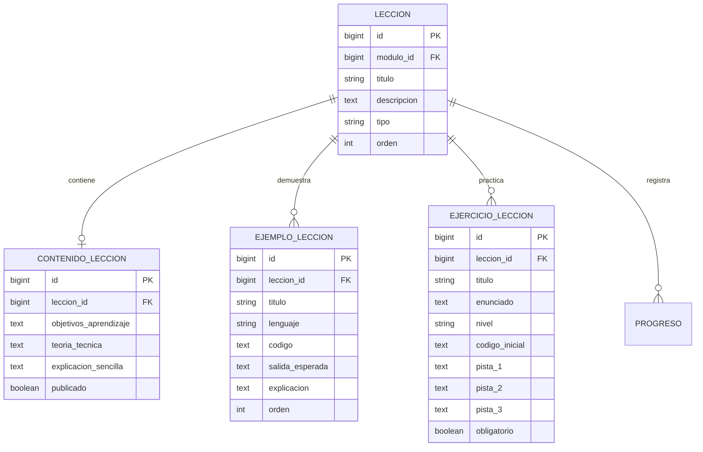
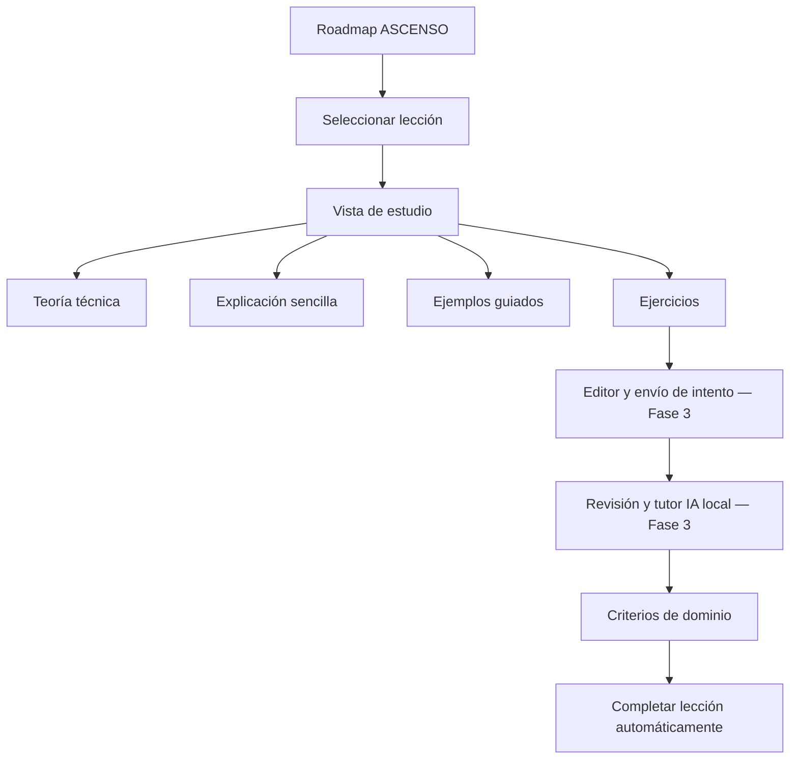

# Fase 2 — Sistema de aprendizaje interactivo

**Producto:** CodeGuard Pro  
**Estado:** Primer incremento implementado; validación local pendiente.  
**Línea base:** rama `main`.

## 1. Objetivo

Convertir cada lección del Roadmap ASCENSO en una unidad de estudio navegable y estructurada, sin confundir la existencia de una ficha académica con el dominio demostrado del contenido.

## 2. Alcance del primer incremento

Cada lección dispone ahora de una ruta propia y de una estructura de contenido separada del catálogo ASCENSO:

- **Contenido de lección:** objetivos de aprendizaje, teoría técnica, explicación sencilla, notas y estado de publicación.
- **Ejemplos guiados:** contexto, lenguaje, código, salida esperada y explicación paso a paso.
- **Ejercicios:** enunciado, instrucciones, lenguaje, nivel, código inicial, obligatoriedad y hasta tres campos de pistas.
- **Vista de estudio:** organiza las secciones anteriores y conserva navegación de regreso a la etapa.

La información fuente del Roadmap ASCENSO continúa siendo el catálogo de etapas, módulos y títulos de lecciones. El contenido pedagógico se almacena en entidades relacionadas, de modo que enriquecer una lección no modifica ni duplica los datos oficiales del roadmap.

## 3. Modelo de datos



## 4. Decisiones y límites

1. Abrir una lección registra el estado «En progreso» (5 % inicial); nunca la marca como completada.
2. La vista muestra solamente contenidos y ejercicios publicados.
3. Los ejercicios de este incremento son material didáctico; todavía no reciben código enviado ni se califican.
4. El editor, la ejecución controlada, la evaluación de respuestas y el tutor local pertenecen a la Fase 3.
5. Los tres campos de pistas fijan un máximo estructural de tres pistas por ejercicio. La entrega secuencial y el contador de pistas se implementarán junto al sistema de intentos del tutor.
6. La ruta antigua de marcado manual ya rechaza solicitudes para completar una lección. La finalización verificable se conectará cuando existan intentos y criterios de evaluación.
7. El modelo de progreso existente se conserva para no perder compatibilidad con los registros actuales.

## 5. Flujo previsto



## 6. Próximos incrementos de la Fase 2

- Definir la plantilla editorial para que cada lección mantenga rigor técnico, explicación accesible y ejemplos suficientes.
- Diseñar e incorporar un mecanismo versionado para cargar y mantener grandes volúmenes de contenido sin editar directamente la base de datos.
- Implementar la navegación anterior/siguiente y el índice de secciones de la lección.
- Definir estados de lectura y progreso parcial sin permitir finalización manual.
- Incorporar los criterios de finalización que consumirá el sistema de ejercicios de la Fase 3.
- Añadir pruebas de integración y validar migraciones en una copia de la base de datos local.

## 7. Validación antes de considerar estable este incremento

Desde la carpeta local del proyecto:

```bash
python manage.py check
python manage.py makemigrations --check --dry-run
python manage.py migrate
python manage.py test apps.roadmaps
```

Luego iniciar CodeGuard Pro con `./run.sh`, abrir una etapa y entrar en una lección. La comprobación visual debe repetirse con los temas principales y en escritorio/móvil.

> No se considera completada la Fase 2 con este incremento. Se ha establecido el primer bloque de arquitectura y navegación; falta cargar contenido pedagógico real, implementar interacción con ejercicios y conectar los criterios de finalización.

## 8. Estado de autoría de contenidos

Los modelos y la vista de estudio ya están preparados, pero el repositorio todavía no contiene teoría, ejemplos y ejercicios editoriales para todas las lecciones. Tampoco debe asumirse que existe un editor disponible en la aplicación: `django.contrib.admin` no está instalado en la configuración actual. La autoría y publicación masiva de contenidos se resolverán mediante un flujo versionado de datos y revisión editorial antes de activar el material para estudiantes.

La ruta de estudio muestra un estado explícito de «Contenido en preparación» cuando una lección no tiene contenido publicado. No se presenta texto vacío como si fuera una lección terminada.
